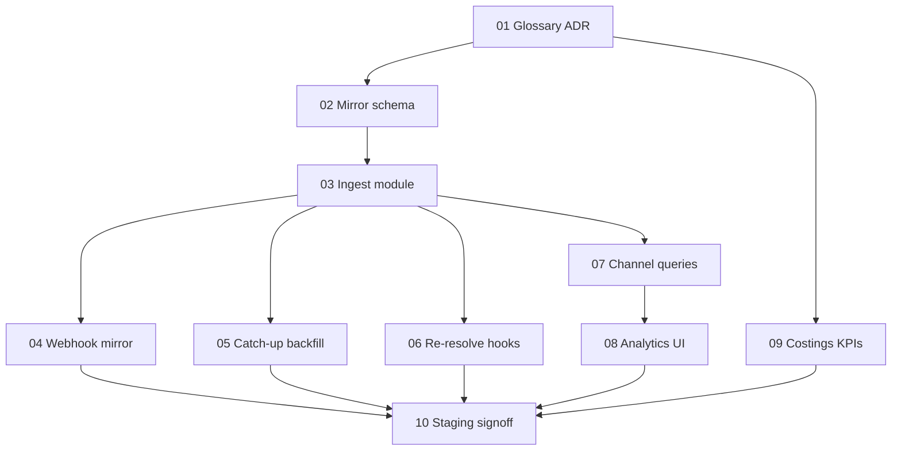

# Analytics DB channel facts — Vertical Slices (Issues)

Tracer-bullet breakdown of the PRD (`../analytics-db-channel-facts-prd.md`). Each slice is a thin, demoable path through all layers (schema, API, UI, tests). Published locally for build tracking (no external issue tracker required).

**Triage label:** `needs-triage` (each slice)

## Slices

| # | Title | Type | Blocked by | User stories |
|---|-------|------|------------|--------------|
| 01 | Domain glossary + ADR 0006 | AFK | none | 29, 30 |
| 02 | Shopify order mirror schema + sync cursor | AFK | 01 | 25 |
| 03 | Order-mirror ingest module + tests | AFK | 02 | 9–11, 15–16, 26, 28 |
| 04 | Webhook writes mirror (paid + refunds) | AFK | 03 | 6, 15, 34, 38 |
| 05 | Chained daily catch-up / backfill | AFK | 03 | 7–8, 37 |
| 06 | Immediate re-resolve on mapping + Costings save | AFK | 03 | 12–14, 28, 39 |
| 07 | Channel analytics queries (All/Orders/Shopify) + tests | AFK | 03 | 3–5, 19, 27–28, 32, 35–36 |
| 08 | Analytics UI: toggle, DB wire, RBAC, cleanup | AFK | 07 | 1–2, 5, 20, 22–24, 31, 33 |
| 09 | Costings as-of-now on-hand KPI cards | AFK | 01 | 21, 40 |
| 10 | Staging E2E signoff | HITL | 04, 05, 06, 08, 09 | 38–40 |

## Dependency graph

## How to work a slice

1. Pick an unblocked AFK slice (or HITL when ready for staging).
2. Implement end-to-end for that tracer only; leave follow-on slices alone.
3. Mark acceptance criteria done in the slice file when verified.
4. Do not close or edit the parent PRD status except via normal triage.
