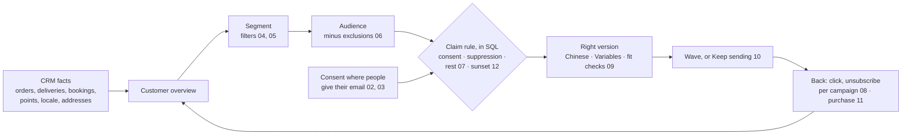

# PRD — Campaign audiences: the CRM decides who gets which email

**Status:** planned (2026-10-30). Nothing built. Slices are in [`issues/`](issues/README.md).
**Owner request (2026-10-30):** "Based on our CRM for our customers, research, think and plan how
we might integrate it with our email marketing feature, so that I'm able to send the right emails
to the right audience."
**Builds on:** `PRD-customer-crm` (ADR 0028: Segments, the Customer overview),
`PRD-crm-retention-loop` (the Lifecycle stage, stage chips, Playbooks),
`PRD-email-marketing` and `PRD-campaign-send-flow` (Email campaigns, Waves, the claim rule,
Resend's plan), `PRD-campaign-email-editor` (blocks, Variables, the Chinese version, the send
checklist), `PRD-loyalty-points` (ADR 0030).
**Does not replace:** retention-loop slices 04 (stage chips) and 07 (Playbooks). This plan gives
the Playbooks the audiences they need, and lets them keep sending (slice 10 here).
**Owner decisions:** seven open. See [Owner decisions](#owner-decisions).

## The short version

The CRM and Email campaigns are already joined: a **Segment** is an **Audience**, and the claim
rule checks consent and suppression in SQL at every send. What is missing is around that join:

1. **Most of the people you would want to email cannot be emailed.** Nothing on this site asks
   for marketing consent except the Profile toggle. Every customer who first buys here is
   `not_subscribed`, so every Audience drops them.
2. **Several audiences cannot be described.** "Bought a pillow but not an Mbolster", "delivered
   60 days ago", "ships to Singapore", "owns a size M", "didn't get last week's email": none is a
   filter, so none can be a Segment.
3. **Nothing spaces one person's emails.** The ledger stops the same campaign twice, not three
   different ones in a week.
4. **Nobody can see which emails worked, or which audience was wrong.** No clicks, no
   unsubscribes per campaign, no purchases after a campaign.
5. **The right email often depends on timing**, and every Wave needs a person to start it.

The plan, in build order: ask for consent where people give their email (02, 03); add the
filters the audiences need (04, 05) and exclusions (06); give every person a rest between
emails (07); record clicks and unsubscribes per campaign (08); check the email against the people
it goes to (09); let a campaign keep sending to people who join its Audience (10); show results
(11); stop emailing people who never engage (12). Topics and "fewer emails" come later (13).

## Problem statement

### 1. Consent is only collected from the Shopify import and the Profile toggle

`customers.marketing_email_source` accepts `shopify_import`, `account`, `unsubscribe_link`,
`complaint` and `support` (`supabase/migrations/20261020120000_marketing_consent.sql:54-55`).
The shop checkout, the customisation contact step, appointment booking and Sign in ask nothing.
A Customer created at checkout (`app/api/shop/checkout/route.ts:718`) or at Accept
(`app/api/results/[id]/accept/route.ts:519`) is `not_subscribed` until they find
*Email me news and offers* on their Profile (`app/[lang]/account/actions.ts:95`).

So the sendable list is the Shopify subscribers, shrinking with every unsubscribe. The
retention loop's *Second purchase* Playbook, written for *New* customers, would reach almost
nobody who bought here. This is the largest gap: no targeting can reach someone who never
agreed.

### 2. The Customers list cannot describe several audiences

The filters (`lib/crm/customer-filters.ts`) are good at *who bought what, and when last*. They
cannot say:

| Audience a campaign needs | Why it can't be said today |
|---|---|
| Bought a pillow, **not** an Mbolster (the pairing) | `bought` is "any of"; there is no "didn't buy" |
| Delivered 60 days ago (*Second purchase*) | *Last order* is in whole months, and on payment, not delivery |
| *New · Delivered*, *At risk · Lapsed* | the Stage filter takes main stages only |
| Ships to Singapore (in-store fitting and re-adjustment are Singapore-only, `CONTEXT.md` *In-store fitting*) | no country on the overview |
| Reads Chinese | `customers.locale` drives the Chinese version but is not a filter |
| Owns a size M (covers and cases are sized) | `customer_purchase_lines.pillow_id` holds it; nothing reads it |
| Points expire within 3 months | *Points* is has / none only |
| Got campaign X, or not; clicked it; emailed in the last 14 days | `last_campaign_sent_at` is on the overview, not a filter; clicks are not recorded |
| Everyone in Segment A **except** Segment B | an Audience is one Segment |

### 3. Nothing spaces one person's emails

`customer_campaign_sends` is unique per (Customer, campaign). Two Playbooks, a launch and a
points-expiry reminder can all reach one Customer in the same week. Each unwanted email risks an
unsubscribe (the Customer becomes *Lost*) or a spam report (the Wave pause rule trips at 0.1%).

### 4. Results stop at "sent"

- **Clicks:** Resend's tracking is off, so links are not rewritten (`PRD-email-marketing`,
  *Not in v1*). Only Claim links opened are counted. Site links carry
  `utm_campaign=<campaign name>`, which reaches first-party analytics by name, not by person.
- **Unsubscribes:** `customer_consent_events` records the source, never the campaign that
  caused it (`20261020120000_marketing_consent.sql:73-83`). The best signal that an audience
  was wrong is thrown away.
- **Purchases after a campaign** (retention metric M22) are not computed.
- **Opens** would not help: Apple Mail is 76.6% of opens (`PRD-campaign-email-editor`, citing
  Litmus) and Mail Privacy Protection pre-fetches every image.

### 5. Timing needs a person

A Wave picks the next eligible people who have not been sent this campaign. That already makes a
campaign re-runnable: a Wave next week reaches only people who joined the Segment since. But a
person has to remember to run it, every week, for every Playbook.

## Research

Most sources are vendor or agency content; their numbers are directional. Legal points need
counsel's check against the primary text before slice 02 ships.

- **Consent: a separate, unticked box, not bundled with the terms.** Singapore guidance
  summarised by agencies says pre-ticked boxes and consent folded into the T&Cs are not valid
  consent for marketing under the PDPA
  ([MarketingAgency.sg](https://marketingagency.sg/pdpa-email-marketing-singapore),
  [Pandectes](https://pandectes.io/blog/pdpa-compliance-in-singapore-key-requirements-explained/),
  [Hashmeta](https://hashmeta.com/blog/pdpa-marketing-compliance-complete-singapore-data-protection-guide-for-marketers)).
  The Spam Control Act requires an unsubscribe facility in every commercial email, and an
  `<ADV>` label on unsolicited bulk email; IMDA's checklist asks that an unsubscribe be honoured
  within 10 working days ([IMDA](https://imda.gov.sg/infocomm-regulation-and-guides/unsolicited-communications/best-practices-for-organisations),
  [Spam Control Act](https://sso.agc.gov.sg/Act/SCA2007)). Consented email is not unsolicited,
  which is why the source of every consent is recorded.
  → *An unticked box wherever a person gives us their email (slice 02); a double opt-in sign-up
  for people who have not bought (slice 03).*
- **Engagement means clicks, not opens.** Mail Privacy Protection marks nearly every Apple Mail
  message opened; vendors move segments and triggers to clicks
  ([Mapp](https://docs.mapp.com/docs/ios-15-and-mapp),
  [Marketing 360](https://help.marketing360.com/portal/en/kb/articles/understandingapplemailprivacyprotection686576179bf96),
  [EmailListValidation](https://emaillistvalidation.com/blog/recency-segments-after-apple-mail-privacy-protection-inflated-opens/)).
  → *First-party clicks per send (slice 08). No open pixel.*
- **Stop emailing people who never engage.** Gmail's line is a 0.3% spam rate, with 0.1% the
  healthy target; guides prune addresses with no engagement in six to twelve months
  ([Bird](https://bird.com/docs/knowledge-base/deliverability/gmail-yahoo-requirements),
  [Mailgun](https://www.mailgun.com/?p=4546)).
  → *A sunset rule on clicks, after one "still want these?" email (slice 12).*
- **Space each person's emails.** Klaviyo's Smart Sending skips anyone emailed in the last 16
  hours by default, per profile, and can be turned off per campaign; it publishes no weekly cap
  ([Klaviyo](https://help.klaviyo.com/hc/en-us/articles/115002779311-Understanding-Smart-Sending-in-Klaviyo)).
  → *A rest period checked in the claim rule, with a monthly cap (slice 07). Our volumes are
  weekly, not hourly, so the window is days.*
- **Measure lift with a holdout, if the list is big enough.** A stable, hashed holdout (5–10%)
  compared on orders is the method; practitioners warn that small lists rarely reach
  significance ([Attribuly](https://attribuly.com/blogs/measure-abandoned-cart-incrementality-step-by-step/),
  [Zembula](https://www.zembula.com/?p=3893),
  [InboxArmy](https://www.inboxarmy.com/blog/email-marketing-whats-a-hold-out-group-and-why-you-should-use-them/),
  [Polar Analytics](https://www.polaranalytics.com/case-studies/reuse-klaviyo-holdout-incrementality-test)).
  → *Purchases after a campaign first; a holdout only where an audience accumulates (slice 11).*
- **Let people choose less, not only nothing.** Preference centres with an "opt-down" are
  reported to cut unsubscribes, with SendGrid self-reporting 20% fewer
  ([Twilio SendGrid](https://www.twilio.com/en-us/blog/insights/the-power-of-an-email-preference-center),
  [Transcend](https://transcend.io/blog/opt-down-reduce-email-unsubscribes)). Resend's Topics
  offer this for its Broadcasts only ([Resend](https://resend.com/docs/dashboard/topics/introduction));
  we send through its API with our own ledger.
  → *Later, and decided on retention slice 11's unsubscribe reasons (slice 13). Never Resend's
  contacts as a second source of consent.*
- **Retention practice** (stages, cross-sell after the first purchase, win-back) is already
  researched in `PRD-crm-retention-loop` and not repeated here.

## How it fits together

Every send answers three questions, in this order. The first is a rule nobody can turn off; the
second is Staff's choice; the third is checked before a Wave.

1. **May we email this person?** Marketing consent, suppression (bounce, complaint), the rest
   period (07) and, later, the sunset rule (12) and topics (13). Checked in SQL at the moment of
   each send (`marketing_campaign_blocker()`), as consent is today.
2. **Is this email for them?** The Audience: a Segment built from CRM filters (04, 05), minus
   excluded Segments (06).
3. **Is this the right version for them?** Language, Variables with fallbacks, and fit checks
   that compare the email with the people it goes to (09).

What comes back from each send (a click, an unsubscribe, a purchase) becomes a column on the
Customer overview, and so a filter: the loop closes through the same mapping.

## What it makes possible

The test of this plan: each of these is a Segment plus a campaign, with no hand-built list.

| Email | Audience | Excluding | Needs |
|---|---|---|---|
| The Mbolster that pairs with your pillow | Stage *New* or *Loyal*; bought Premium or Basic; **didn't buy** Mbolster; delivered **over 30 days** ago | bought in the last 14 days | 04, 06 |
| New covers in your size | bought Premium; **pillow size** M | | 04 |
| A second pillow for the household | *New · Settled*; one pillow; **ships to Singapore** (in-store wording) | anyone emailed in the last 14 days (07 does it) | 04, 05 |
| The same, overseas | as above; **ships outside Singapore** (online wording) | | 05 |
| We miss you | *At risk* | *At risk · Lapsed* | 04 |
| Welcome back | *At risk · Lapsed* | | 04 |
| How we measure you (for people who have not bought) | *Lead*; subscribed through the sign-up form or a held quote | | 02, 03 |
| Didn't open the launch? Don't resend. Didn't **click** it: a follow-up | got campaign X; **did not click** it | | 05, 08 |
| Our new website, with points waiting | *Imported from Shopify, not signed in yet* (today) | | built |

Not in the list on purpose: the review request and the check-up reminder (aftercare, never a
campaign); the points-expiry reminders (already automatic, `PRD-loyalty-points` slice 07).

## Solution

1. **Glossary and ADR (01).** New terms and one ADR before any code: see
   [Glossary](#glossary-slice-01).
2. **Ask for consent where people give their email (02).** An unticked *Email me news and offers*
   box at shop checkout, on the customisation contact step (Mpillow, Mbolster, a Paired build,
   the Assisted finish) and on appointment booking. Ticking it records consent through
   `set_marketing_email()` with a new source (`checkout`, `customisation`, `appointment`).
   Unticked changes nothing; nothing re-subscribes an `unsubscribed` Customer but their own tick.
3. **A sign-up for people who have not bought (03).** A footer form, double opt-in: the confirm
   link creates or finds the Customer and subscribes them (`newsletter`). They are *Lead*s.
4. **Purchase filters (04).** *Didn't buy*, *Pillow size*, *Delivered* in days, and the
   **sub-status** on the Stage filter (*New · Delivered*, *At risk · Lapsed*).
5. **Reach filters (05).** *Ships to* (Singapore, elsewhere, unknown), *Language*, *Points expire
   within*, *Campaign* (got it, didn't, clicked, didn't click), *Last emailed*.
6. **Exclude Segments from an Audience (06).** Up to three, fixed with the Audience at the first
   Wave. The plan lists who each one left out.
7. **A rest period (07).** Nobody receives a marketing email within N days of the last one, or
   more than M in 30 days. Checked in the claim rule; a rested Customer is skipped, not failed,
   and is eligible for a later Wave.
8. **Clicks and unsubscribes per campaign (08).** Each site link carries a per-send token,
   recorded on the send, then stripped. The unsubscribe link carries the send, so the consent
   event names the campaign. No link rewriting, no open pixel.
9. **The right version: fit checks and two Variables (09).** The send checklist compares the email
   with the Wave's people: Chinese readers without a Chinese version, Variables that fall back,
   in-store wording to people overseas, products they already own. *Your pillow* and *Points
   expire on* become Variables.
10. **Keep sending (10).** After its first Wave, a campaign can be set to keep sending to people
    who join its Audience: the daily job (chained onto `results-sla`, no third cron) runs one Wave
    a day for it, inside Resend's room, the pause rule and the rest period. This is how a Playbook
    reaches each customer at their own 60 days.
11. **Results per campaign (11).** Delivered, clicked, unsubscribed, spam reports, and purchases
    within 30 days by people sent it, by stage. An optional holdout for kept-sending campaigns.
12. **Engaged and unengaged (12).** A subscriber who has clicked nothing in their last N campaigns
    and has not bought or signed in for 12 months is *Unengaged*: left out of campaigns unless one
    asks for them, after one "still want to hear from us?" email.
13. **Later: topics and fewer emails (13).** Specified, not scheduled; decided on unsubscribe
    reasons.
14. **Sign-off (14).** The owner sends three of the emails in the table above on production.

## Decisions

1. **Consent stays one rule in SQL.** Every new reason not to send (rest period, sunset, topic)
   is added to `marketing_campaign_blocker()` and to `composedCampaignBlocker`, with cases in
   `supabase/tests/email-marketing/campaign-rule-cases.json`, so the TypeScript and the SQL
   cannot disagree and the plan can never promise a send the claim refuses.
2. **Audiences are CRM filters, never a copy.** Every new audience is a filter on the Customer
   overview through `applyCustomerFilters`, so it is a list, a Segment and an Audience at once.
   Email campaigns adds no filter of its own; exclusions are Segments too.
3. **The stage is still not consent.** A filter, a Segment or an exclusion only ever narrows. The
   claim rule decides who may receive.
4. **Clicks are recorded on the send, never used to identify a browser.** A click token proves the
   link came from that email, not who is holding it (emails are forwarded). It is written to the
   `customer_campaign_sends` row and never merges a **Visitor** into a **Customer**; ADR 0007's
   deterministic merge (Sign in, checkout email) is unchanged. Purchases are attributed by
   `customer_id`, not by browser.
5. **Rested is not failed.** A Customer skipped for the rest period gets no ledger row, so the
   next Wave reaches them; the plan says when they are next eligible.
6. **Kept-sending campaigns send only what a person approved.** Their email and Audience are locked
   by the first Wave, which a person started after a test. The daily job adds no new content and
   never widens the Audience.
7. **Transactional and aftercare email are outside all of this.** Order email stays on Gmail; the
   review request and check-up reminder keep their rules (`PRD-customer-crm`). Neither counts
   toward the rest period. The points-expiry reminders do (decision 2 below).

## Owner decisions

1. **Where to ask for consent, and how.** Recommended: an unticked box at shop checkout, the
   customisation contact step and appointment booking (single opt-in, since the order or
   booking confirmation reaches that address at once), and double opt-in for the footer sign-up.
   Counsel checks the wording against the PDPC's Advisory Guidelines before slice 02 ships.
   For a customisation, the Customer is found or created at hold when the box is ticked (today
   it is created at Accept), so a person whose quote ends without an Order can still be a
   subscribed *Lead*. Unticked, nothing changes.
2. **The rest period.** Recommended: 7 days between marketing emails, at most 4 in 30 days.
   Counted: campaign sends and points-expiry reminders. Not counted: transactional and aftercare.
   One code constant, not a setting, like the stage thresholds.
3. **Keep sending** reverses `PRD-crm-retention-loop` decision 6 and its *Out of scope* line
   ("automated flows that send without a person starting a Wave"). Recommended: yes, with the
   guards in decision 6 above, a daily cap per campaign, and a Pause switch. The Playbooks are
   the reason.
4. **The sunset rule.** Recommended: *Unengaged* after no click in their last 6 campaigns and no
   purchase, booking or sign-in for 12 months; one re-permission email first; their consent stays
   `subscribed` (it is a sending choice, not consent).
5. **A holdout.** Recommended: off until a kept-sending campaign has passed 500 people sent; then
   a stable 10% by hash of the Customer id. At today's list sizes the numbers are directional.
6. **The sign-up creates Customer rows for people who have not bought.** `CONTEXT.md` says a
   Customer is created at checkout, at Sign in, or by the import; this adds "or by confirming the
   sign-up". Recommended: yes; they are *Lead*s, which the funnel already names.
7. **Topics** (slice 13): decided after three months of unsubscribe reasons (retention slice 11).

## Glossary (slice 01)

Proposed for `CONTEXT.md`, *Email marketing*:

- **Consent source**: where a Customer's **Marketing consent** was given or withdrawn. Today
  `shopify_import`, `account`, `unsubscribe_link`, `complaint`, `support`; this plan adds
  `checkout`, `customisation`, `appointment`, `newsletter`. _Avoid_: "list" or "signup source".
- **Rest period**: how long after one marketing email a Customer receives no other, and how many
  they may receive in 30 days. _Avoid_: "frequency cap" in UI copy; "smart sending".
- **Exclusion**: a Segment whose Customers a campaign's Audience leaves out. Fixed with the
  Audience at the first Wave.
- **Campaign click**: the first time a person opened a site link from one campaign send, recorded
  on that send. _Avoid_: "open" (not recorded); treating it as proof of who clicked.
- **Kept sending**: a campaign that runs one Wave a day, by itself, to people who have joined its
  Audience since. _Avoid_: "automation", "flow", "drip" (each suggests branching and content
  changes this does not have).
- **Unengaged**: a subscribed Customer the sunset rule leaves out of campaigns. Not a
  **Lifecycle stage** and not consent.

The **Audience** entry gains: "minus its **Exclusions**; the **Rest period** and the sunset rule
narrow it at every send, as consent does".

## Hazards

Inherited, unchanged: consent only (`PRD-email-marketing`); never the transactional mailbox; the
ledger first; no review gating (`PRD-customer-crm`, sixth hazard: no new filter may reach the
review request job); no third cron (fourth hazard); no PII in Telegram; Resend's plan
(`PRD-campaign-send-flow`); no Shopify dependency (`CLAUDE.md`). New:

- **Link scanners click links.** Corporate mail filters open every link to check it. A click is
  counted only from a request that looks like a person (a GET a browser follows, not a HEAD, and
  not within seconds of delivery), and the results say clicks are approximate.
- **A tick at checkout is not a verified address.** Someone can type another person's email.
  The confirmation email, bounce suppression and the unsubscribe link in every campaign are the
  protection; the sign-up form, where no purchase confirms the address, is double opt-in.
- **Kept sending shares 100 emails a day.** On Resend's free plan, a kept-sending Wave and a
  manual Wave draw on the same room. The daily job leaves a reserve (default 30) for tests and
  manual Waves, and stops at a 429.
- **Ships to is a guess for some.** It is the latest Order's shipping country, else the default
  address. A Shopify-era buyer may have neither: *Unknown*, counted by the fit check, never
  treated as Singapore.
- **Privacy notice.** Click recording and consent at checkout need a line in the privacy policy
  before slices 02 and 08 ship.
- **Grants.** Every new `customers` or overview column stays server-only unless a migration
  grants it (`PRD-customer-crm`, first hazard).

## Out of scope

- Open tracking, and Resend's own click tracking (link rewriting).
- Branching flows (if they clicked, wait 3 days, send B). Kept sending is one email per campaign.
- SMS and WhatsApp marketing (`PRD-email-marketing`: email only).
- Predicted churn, lifetime value or "best time to send".
- A/B tests of subject lines. With waves of 50–100 the samples are too small; revisit with list
  size.
- Syncing contacts or Segments to Resend.
