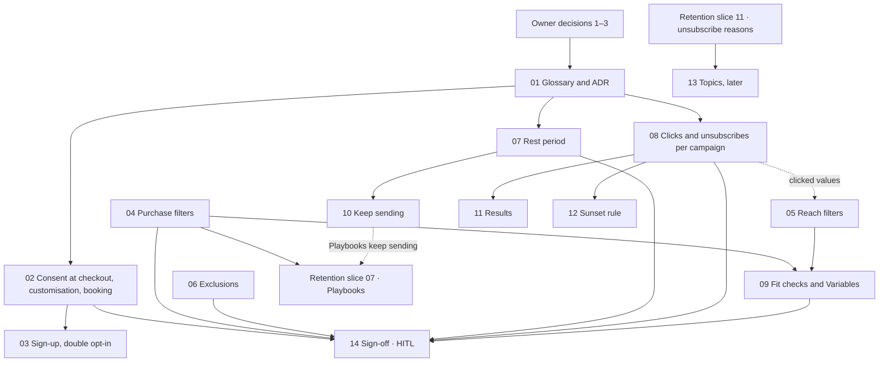

# Campaign audiences: vertical slices (issues)

A tracer-bullet breakdown of the PRD (`../campaign-audiences-prd.md`). Each slice is a thin,
demoable path through the layers it touches.

- **Triage label:** `needs-triage` (all slices)
- **Tracker:** not filed. File the PRD as one issue and each slice as a sub-issue when the owner
  has settled decisions 1–3.
- **Owner decisions:** see the PRD. Decisions 1 (consent capture), 2 (rest period) and 3 (keep
  sending) gate slices 02, 07 and 10.

## Slices

| # | Title | Type | Status | Blocked by |
|---|-------|------|--------|------------|
| [01](01-glossary-and-adr.md) | Glossary and ADR | AFK, then HITL | not started | owner decisions 1–3 |
| [02](02-consent-where-people-give-their-email.md) | Ask for consent where people give their email | AFK, then HITL | not started | 01 |
| [03](03-newsletter-sign-up.md) | A sign-up for people who have not bought, double opt-in | AFK | not started | 02, owner decision 6 |
| [04](04-purchase-filters.md) | Purchase filters: didn't buy, pillow size, delivered, sub-status | AFK | not started | none |
| [05](05-reach-filters.md) | Reach filters: ships to, language, points expiry, campaign history | AFK | not started | 08 (clicked values only) |
| [06](06-exclude-segments.md) | Exclude Segments from an Audience | AFK | not started | none |
| [07](07-rest-period.md) | A rest period between one person's emails | AFK | not started | 01 |
| [08](08-clicks-and-unsubscribes-per-campaign.md) | Clicks and unsubscribes, tied to the campaign | AFK, then HITL | not started | 01 |
| [09](09-fit-checks-and-variables.md) | The right version: fit checks and two Variables | AFK | not started | 04, 05 |
| [10](10-keep-sending.md) | Keep sending: reach people as they join the Audience | AFK | not started | 01, 07 |
| [11](11-campaign-results.md) | Results per campaign: clicks, unsubscribes, purchases after | AFK | not started | 08 |
| [12](12-engaged-and-unengaged.md) | Engaged and unengaged: the sunset rule | AFK | not started | 08 + three months, owner decision 4 |
| [13](13-topics-and-fewer-emails.md) | Later: topics and "fewer emails" | HITL, then AFK | specified | retention slice 11 data |
| [14](14-signoff.md) | Sign-off: three of the plan's emails on production | HITL | not started | 02, 04, 06–09 |

## Dependency graph

## Build order

1. **04 and 06 now.** Neither needs a decision, and 04 unblocks the retention loop's Playbooks.
2. **The owner settles decisions 1–3; then 01.**
3. **02 next, as soon as counsel approves the wording.** Every day without it, new buyers join the
   list unable to be emailed.
4. **07 before more than one campaign runs at a time**, and **08** early, so clicks and
   unsubscribes are collected before 11 and 12 read them.
5. **05, 09, then 10 and 11.**
6. **03, 12 and 13** last: 12 needs three months of clicks, 13 needs unsubscribe reasons.
