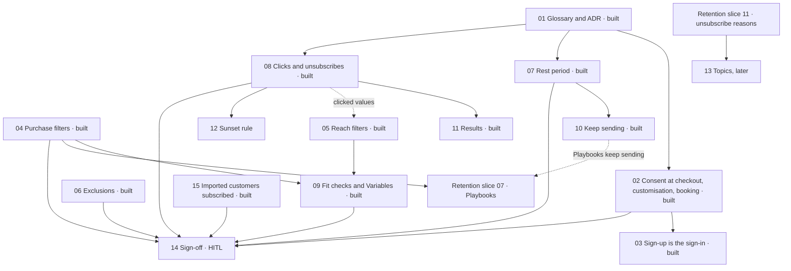

# Campaign audiences: vertical slices (issues)

A tracer-bullet breakdown of the PRD (`../campaign-audiences-prd.md`). Each slice is a thin,
demoable path through the layers it touches.

- **Triage label:** `needs-triage` (all slices)
- **Tracker:** not filed. File the PRD as one issue and each slice as a sub-issue.
- **Owner decisions:** all settled on 2026-10-31 (see the PRD). Consent is ticked by default and
  imported customers start subscribed (ADR 0039); rest period and keep sending as recommended;
  the sunset rule is a simple rule read from the Lifecycle stage.

## Slices

| # | Title | Type | Status | Blocked by |
|---|-------|------|--------|------------|
| [01](01-glossary-and-adr.md) | Glossary and ADR | AFK | **built** | none |
| [02](02-consent-where-people-give-their-email.md) | Ask for consent where people give their email | AFK, then HITL | **built** at checkout, customisation, booking; counsel to read | none |
| [03](03-newsletter-sign-up.md) | The sign-up is the Customer sign-in (two tabs: Customer, Staff) | AFK | built | 02, owner decision 6 |
| [04](04-purchase-filters.md) | Purchase filters: didn't buy, pillow size, delivered, sub-status | AFK | **built** | none |
| [05](05-reach-filters.md) | Reach filters: ships to, language, campaign history, last emailed | AFK | **built** | 08 (clicked values only) |
| [06](06-exclude-segments.md) | Exclude Segments from an Audience | AFK | **built** | none |
| [07](07-rest-period.md) | A rest period between one person's emails | AFK | **built** | 01 |
| [08](08-clicks-and-unsubscribes-per-campaign.md) | Clicks and unsubscribes, tied to the campaign | AFK, then HITL | **built**; privacy policy line open | 01 |
| [09](09-fit-checks-and-variables.md) | The right version: fit checks and a Variable | AFK | **built** | 04, 05 |
| [10](10-keep-sending.md) | Keep sending: reach people as they join the Audience | AFK | **built** | 01, 07 |
| [11](11-campaign-results.md) | Results per campaign: clicks, unsubscribes, purchases after | AFK | **built** | 08 |
| [12](12-engaged-and-unengaged.md) | Engaged and unengaged: a simple rule from the Lifecycle stage | AFK | not started | 08 |
| [13](13-topics-and-fewer-emails.md) | Later: topics and "fewer emails" | HITL, then AFK | specified | retention slice 11 data |
| [14](14-signoff.md) | Sign-off: three of the plan's emails on production | HITL | not started | 02, 04, 06–09 |
| [15](15-imported-customers-start-subscribed.md) | Imported customers start subscribed | AFK, then HITL | **built** | none |

## Dependency graph

## Build order

1. **Done 2026-10-31:** 15 (imported customers subscribed), 02's checkout box, and *Email this
   Segment* as a button. The owner runs 15 once Shopify's unsubscribed list is exported.
2. **Done 2026-10-31:** 04 (purchase filters and stage sub-statuses, which unblock the retention
   loop's Playbooks) and 06 (exclusions).
3. **Done 2026-10-31:** 01 (glossary, ADR 0040, the consent data-flow page) and the rest of 02
   (the box on the customisation contact step and on booking). Counsel still to read the wording;
   the privacy policy line and the signed-in unsubscribed case are open.
4. **Done 2026-10-31:** 07 (the rest period: 7 days, at most 4 in 30) and 08 (clicks and
   unsubscribes per send), so clicks are collected before 11 and 12 read them. The privacy
   policy needs its line on click recording before 08 ships.
5. **Done 2026-10-31:** 05 (reach filters: ships to, language, campaign history,
   last emailed), then 09 (fit checks before a wave, and *Your pillow*), then 10 (keep sending:
   one Wave a day per campaign, paused when its Segment changes), then 11 (results by stage at
   send, purchases within 30 days, and a holdout offered from 500 sent).
6. **03, 12 and 13** last: 12 needs six campaigns' clicks, 13 needs unsubscribe reasons.
   **Done 2026-11-01:** 03, redesigned with the owner: the sign-up is the Customer sign-in, and
   Sign in has a Customer tab and a Staff tab (ADR 0041). Owner to-do: paste the two auth email
   templates. **Next:** 12, then 13.
