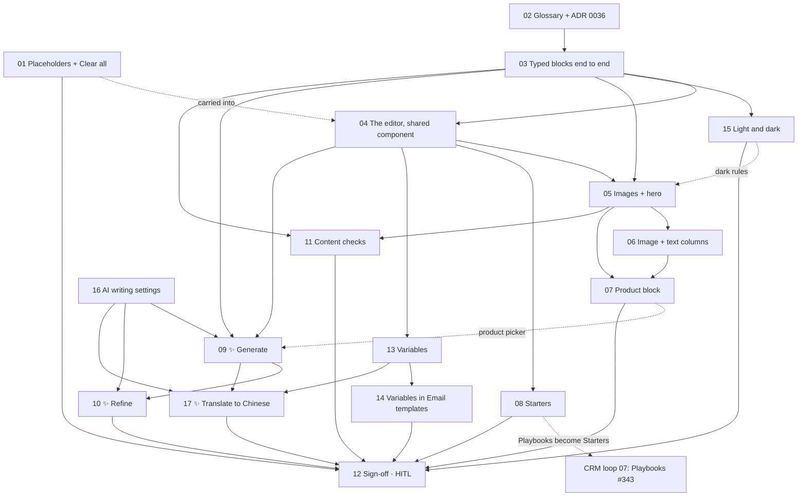

# Campaign email editor: vertical slices (issues)

A tracer-bullet breakdown of the PRD (`../campaign-email-editor-prd.md`). Each slice is a thin,
demoable path through the layers it touches.

- **Triage label:** `needs-triage` (all slices)
- **Tracker:** [#354](https://github.com/ivanyeors/mp/issues/354) is the PRD issue. Each slice is a
  sub-issue, and its row below links it.
- **Base:** main at `0eb7d55` (CRM retention loop, #353).
- **Owner decisions:** settled on 2026-10-29 (PRD *Decisions* 1–12). Slices 01–12 were filed on
  2026-10-28 and updated with the answers; 13–17 were added for them (Variables, Variables in
  Email templates, light and dark, the AI writing settings, Translate to Chinese).

## Slices

| # | Title | Type | Status | Blocked by |
|---|-------|------|--------|------------|
| [01](01-clear-all.md) · [#355](https://github.com/ivanyeors/mp/issues/355) | Placeholders, not prefilled words: New campaign opens empty, and Clear all gets back there | AFK | done | none |
| [02](02-glossary-and-adr.md) · [#356](https://github.com/ivanyeors/mp/issues/356) | The words and the decision: glossary entries and ADR 0036 | AFK (docs) | done | none |
| [03](03-typed-blocks.md) · [#357](https://github.com/ivanyeors/mp/issues/357) | Typed blocks end to end: saved, previewed, tested and sent | AFK | done | 02 |
| [04](04-editor.md) · [#358](https://github.com/ivanyeors/mp/issues/358) | The editor: drag blocks into the email, see the real email beside it, one shared component | AFK | partial | 03 |
| [05](05-images-and-hero.md) · [#359](https://github.com/ivanyeors/mp/issues/359) | Images and the hero: from the Media Library, safe in every inbox | AFK | not started | 03 (04 for the UI) |
| [06](06-image-and-text.md) · [#360](https://github.com/ivanyeors/mp/issues/360) | Image + text: two columns that stack on a phone, in every inbox | AFK | not started | 05 |
| [07](07-product-block.md) · [#361](https://github.com/ivanyeors/mp/issues/361) | Product block: up to three Listed products, priced from Costings at send | AFK | not started | 05, 06 |
| [08](08-start-from.md) · [#362](https://github.com/ivanyeors/mp/issues/362) | Starters: ready-made layouts built from the same blocks, to start from or drag in | AFK | not started | 04 |
| [09](09-ai-generate-draft.md) · [#363](https://github.com/ivanyeors/mp/issues/363) | ✨ Generate: Claude writes the email from its subject, inside the editor | AFK | not started | 03, 04, 16 (07 for products) |
| [10](10-ai-refine.md) · [#364](https://github.com/ivanyeors/mp/issues/364) | ✨ Refine: subject-line ideas, a preview line, and rewriting one block | AFK | not started | 09, 16 |
| [11](11-content-checks.md) · [#366](https://github.com/ivanyeors/mp/issues/366) | Content checks before send: links, images, size, words | AFK | not started | 03, 05 |
| [12](12-signoff.md) · [#367](https://github.com/ivanyeors/mp/issues/367) | Sign-off: the owner builds a real EDM and checks it in every inbox | HITL | not started | 01–11, 13–17 |
| [13](13-variables.md) · [#370](https://github.com/ivanyeors/mp/issues/370) | Variables: drag a customer's first name, last name or points into any text | AFK | not started | 04 |
| [14](14-email-template-variables.md) · [#371](https://github.com/ivanyeors/mp/issues/371) | Variables in Email templates: the shared text input, `{order_number}` dragged in as a chip | AFK | not started | 13 |
| [15](15-light-and-dark.md) · [#372](https://github.com/ivanyeors/mp/issues/372) | Light and dark, automatically: the shell, legacy campaigns and every block | AFK | done | 03 |
| [16](16-ai-writing-settings.md) · [#373](https://github.com/ivanyeors/mp/issues/373) | AI writing settings on General: on or off, the model, the effort and the limits | AFK | done | none |
| [17](17-translate-to-chinese.md) · [#374](https://github.com/ivanyeors/mp/issues/374) | ✨ Translate to Chinese: a 中文 version for customers who use the site in Chinese | AFK | not started | 09, 13, 16 |

**Suggested order:** 01 now, and 16 any time (neither waits on anything). Then 02 → 03 → 04 as
the spine, with 15 straight after 03. After 04, four tracks can run in parallel: media
(05 → 06 → 07), Starters (08), Variables (13 → 14), and AI (09 → 10, then 17 once 13 is in). 11
follows 05 and gains its Variable and 中文 rows as 13 and 17 land; 12 closes.

## Dependency graph



## How to verify the build

Each slice lists its own acceptance criteria and checks. For the whole branch:

```bash
npm run typecheck
npm run lint
npx vitest run components/block-editor components/settings lib/email lib/email-campaigns lib/ai lib/i18n lib/media lib/media-assets lib/reviews "app/[lang]/settings/campaigns" "app/[lang]/settings/email-templates" "app/api/settings"
rm -rf graphify-out/cache && ./scripts/graphify update .   # then commit graphify-out with the change
```
