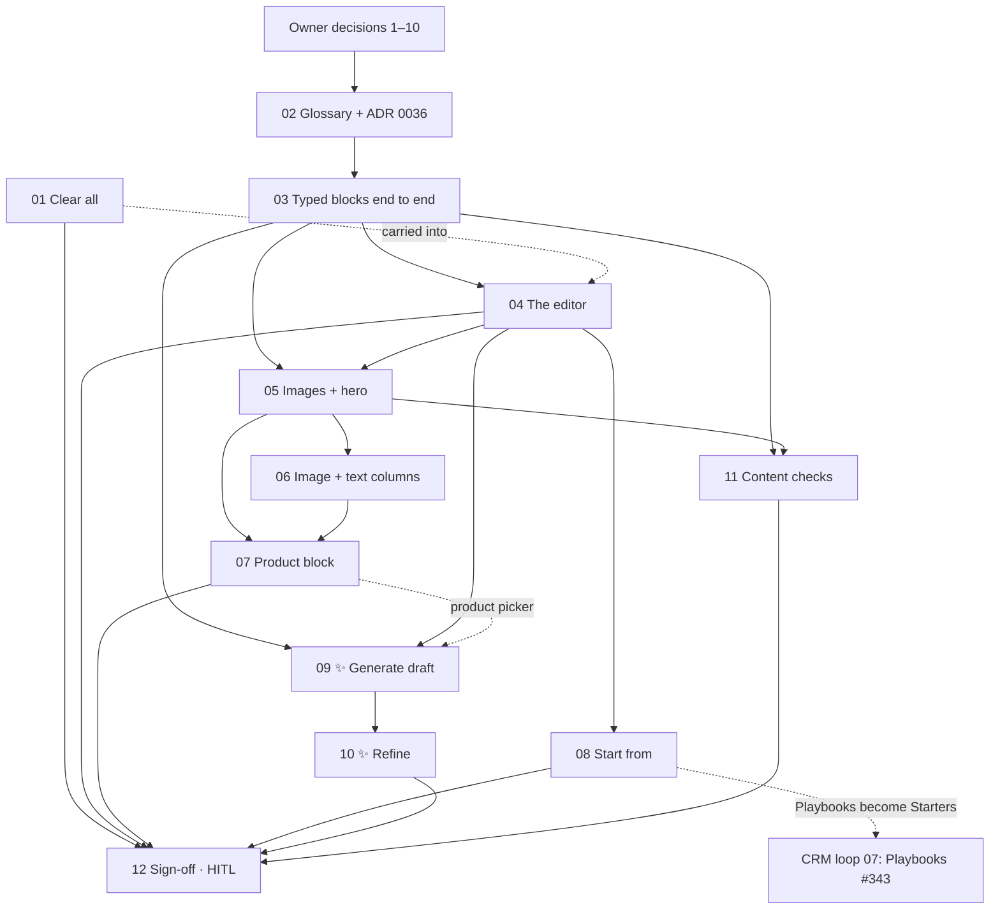

# Campaign email editor: vertical slices (issues)

A tracer-bullet breakdown of the PRD (`../campaign-email-editor-prd.md`). Each slice is a thin,
demoable path through the layers it touches.

- **Triage label:** `needs-triage` (all slices)
- **Tracker:** [#354](https://github.com/ivanyeors/mp/issues/354) is the PRD issue. Each slice is a
  sub-issue, and its row below links it.
- **Base:** main at `0eb7d55` (CRM retention loop, #353).
- **Owner decisions:** 1–10 in the PRD are recommendations awaiting the owner. Slice 01 needs none
  of them; slice 02 records decision 1; the rest follow the decisions they name.

## Slices

| # | Title | Type | Status | Blocked by |
|---|-------|------|--------|------------|
| [01](01-clear-all.md) · [#355](https://github.com/ivanyeors/mp/issues/355) | Clear all: empty the email in one click, with Undo | AFK | not started | none |
| [02](02-glossary-and-adr.md) · [#356](https://github.com/ivanyeors/mp/issues/356) | The words and the decision: glossary entries and ADR 0036 | AFK (docs) | not started | none |
| [03](03-typed-blocks.md) · [#357](https://github.com/ivanyeors/mp/issues/357) | Typed blocks end to end: saved, previewed, tested and sent | AFK | not started | 02 |
| [04](04-editor.md) · [#358](https://github.com/ivanyeors/mp/issues/358) | The editor: write on the left, the real email on the right | AFK | not started | 03 |
| [05](05-images-and-hero.md) · [#359](https://github.com/ivanyeors/mp/issues/359) | Images and the hero: from the Media Library, safe in every inbox | AFK | not started | 03 (04 for the UI) |
| [06](06-image-and-text.md) · [#360](https://github.com/ivanyeors/mp/issues/360) | Image + text: two columns that stack on a phone, in every inbox | AFK | not started | 05 |
| [07](07-product-block.md) · [#361](https://github.com/ivanyeors/mp/issues/361) | Product block: up to three Listed products, priced from Costings at send | AFK | not started | 05, 06 |
| [08](08-start-from.md) · [#362](https://github.com/ivanyeors/mp/issues/362) | Start from: a blank email, a Starter, or a past campaign | AFK | not started | 04 |
| [09](09-ai-generate-draft.md) · [#363](https://github.com/ivanyeors/mp/issues/363) | ✨ Generate draft: Claude writes the email from its subject | AFK | not started | 03, 04 (07 for products) |
| [10](10-ai-refine.md) · [#364](https://github.com/ivanyeors/mp/issues/364) | ✨ Refine: subject-line ideas, a preview line, and rewriting one block | AFK | not started | 09 |
| [11](11-content-checks.md) · [#366](https://github.com/ivanyeors/mp/issues/366) | Content checks before send: links, images, size, words | AFK | not started | 03, 05 |
| [12](12-signoff.md) · [#367](https://github.com/ivanyeors/mp/issues/367) | Sign-off: the owner builds a real EDM and checks it in every inbox | HITL | not started | 01–11 |

**Suggested order:** 01 now; then 02 → 03 → 04 as the spine. After 04, three tracks can run in
parallel: media (05 → 06 → 07), starting points (08), and AI (09 → 10). 11 follows 05; 12 closes.

## Dependency graph



## How to verify the build

Each slice lists its own acceptance criteria and checks. For the whole branch:

```bash
npm run typecheck
npm run lint
npx vitest run lib/email lib/email-campaigns lib/ai lib/media lib/media-assets lib/reviews "app/[lang]/settings/campaigns"
rm -rf graphify-out/cache && ./scripts/graphify update .   # then commit graphify-out with the change
```
