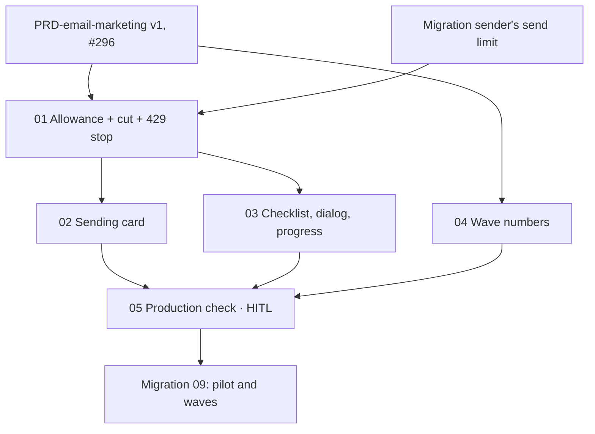

# Campaign send flow: vertical slices (issues)

A tracer-bullet breakdown of the PRD (`../campaign-send-flow-prd.md`). Each slice is a thin,
demoable path through the layers it touches.

- **Triage label:** `needs-triage` (all slices)
- **Tracker:** not filed yet. File the PRD as a parent issue and each slice as a sub-issue, then
  link them in the table below.
- **Base:** main after #319, with the migration sender's send limit replayed onto it (the commit
  "Campaign sender: stay inside Resend's free plan, and stagger a wave across days").
- **Owner decisions:** the five in the PRD, taken on 2026-10-22 and 2026-10-26. Nothing is open.

## Slices

| # | Title | Type | Status | Blocked by |
|---|-------|------|--------|------------|
| [01](01-send-within-the-resend-plan.md) | Send within Resend's plan: the allowance, a wave cut to today's room, a 429 stops at once | AFK | built | — |
| [02](02-sending-status-card.md) | The Sending card on Email campaigns: connected, From, Reply-To, reports, today and this month | AFK | built | 01 |
| [03](03-send-checklist-dialog-progress.md) | The send flow: checklist, a real confirmation, progress, and what next | AFK | built | 01 |
| [04](04-wave-numbers-and-thresholds.md) | Each wave's numbers against the pause lines | AFK | built | — |
| [05](05-verify-on-production.md) | Owner's check on production: status green, a test, the pilot inside the plan | HITL | waiting for deploy | 01–04 |

## Dependency graph



## How to verify the build

Each slice lists its own acceptance criteria and checks. For the whole branch:

```bash
npm run typecheck
npm run lint
npx vitest run lib/email-campaigns lib/customer-migration lib/email "app/[lang]/settings/campaigns"
rm -rf graphify-out/cache && ./scripts/graphify update .   # then: git diff --stat graphify-out is committed
```
