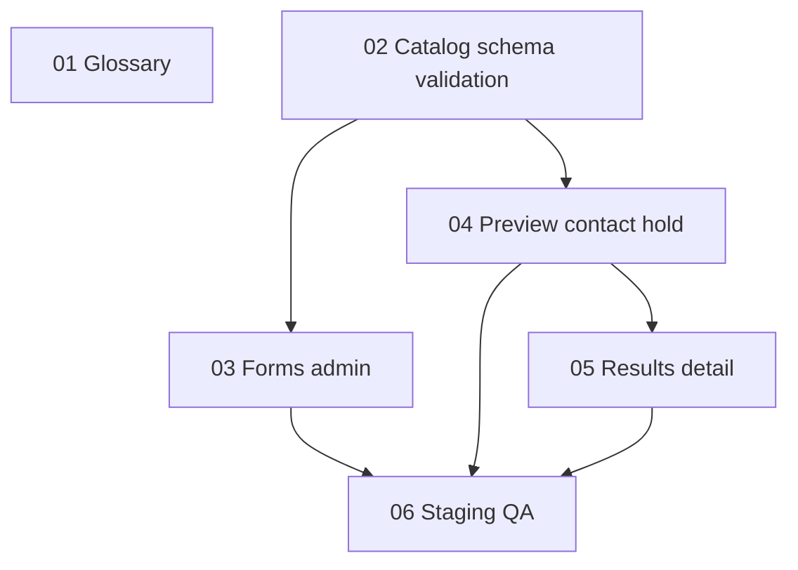

# Configurator Contact + Discovery Source — Vertical Slices (Issues)

Tracer-bullet breakdown of the PRD (`../configurator-contact-forms-prd.md`). Each slice is a thin, demoable path through all layers (schema, API, UI, tests). Published locally (no external issue tracker configured).

**Triage label:** `needs-triage` (each slice)

## Slices

| # | Title | Type | Blocked by | User stories |
|---|-------|------|------------|--------------|
| 01 | Glossary: Discovery source in CONTEXT.md | AFK | none | 1–3 |
| 02 | Catalog + schema: site_settings options, Result columns, validation + checks | AFK | none | 42, 45–48, 50–51 |
| 03 | Landing Site → Forms admin (locale tabs, reorder, archive, Other lock) | AFK | 02 | 26–37 |
| 04 | Preview contact block + hold/in-store persist (mp-config, mp-basic, mbolster) | AFK | 02 | 4–25, 43–44, 49 |
| 05 | Results detail: phone + Discovery source (+ Other) | AFK | 02, 04 | 38–41 |
| 06 | Staging QA signoff checklist (all three flows + in-store save) | HITL | 03–05 | 52 |

## Dependency graph

## Recommended build order

1. **01** (glossary) and **02** (catalog + schema) — parallel; no code dependency between them.
2. **03** (Forms admin) and **04** (preview contact + hold) — parallel after 02.
3. **05** (Results detail) — after 04 (needs persisted fields to display).
4. **06** (staging QA) — after 03–05.

## HITL notes

- **Slice 06:** Human verification on staging — walk mp-config, mp-basic, mbolster-config authorize paths and Mpillow Save without purchasing; confirm Forms CRUD + Results detail show phone and Discovery source.
