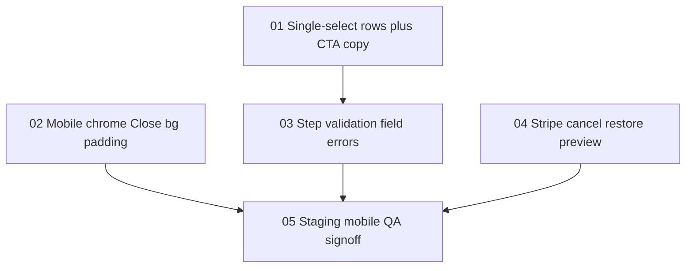

# Configurator Mobile UX — Vertical Slices (Issues)

Tracer-bullet breakdown of the PRD (`../configurator-mobile-ux-prd.md`). Each slice is a thin, demoable path through UI (and tests where specified). Published locally (no external issue tracker configured).

**Triage label:** `needs-triage` (each slice)

## Slices

| # | Title | Type | Blocked by | User stories |
|---|-------|------|------------|--------------|
| 01 | Single-select rows + CTA copy | AFK | none | 1–7, 21–23, 39–41, 48 |
| 02 | Mobile chrome: Close, bg, padding | AFK | none | 9–20, 42 |
| 03 | Step validation + field errors | AFK | 01 | 24–31, 44 |
| 04 | Stripe cancel → preview restore | AFK | none | 32–37, 43, 45 |
| 05 | Staging mobile QA signoff | HITL | 01–04 | 46–47, 49–50 |

## Dependency graph

## Recommended build order

1. **01**, **02**, and **04** in parallel (no mutual blockers).
2. **03** after **01** (option rows must support error styling).
3. **05** after 01–04.

## HITL notes

- **Slice 05:** Physical or staging device pass for Mpillow (full + basic) and Mbolster — option rows, mobile chrome, validation, Stripe cancel restore.
- Checklist + AFK preflight live in [`05-staging-mobile-qa-signoff.md`](./05-staging-mobile-qa-signoff.md). Prod deploy @ `b30efd73` is live; **device matrix still open** (iOS Safari + Android Chrome).
