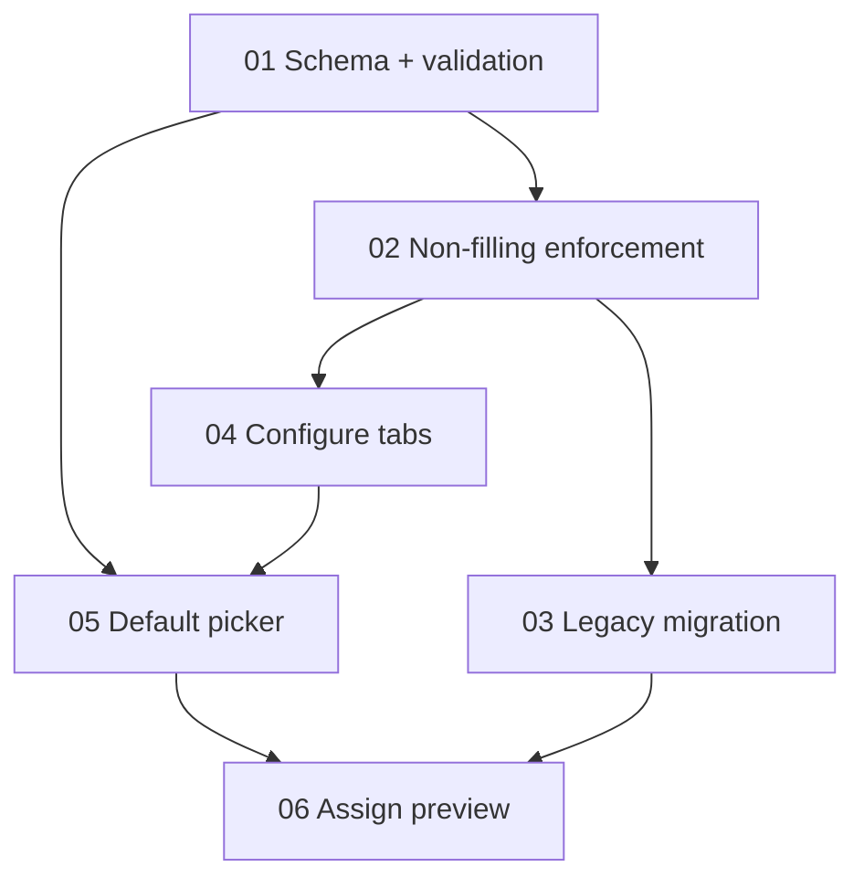

# Configure Product / Filling Config Tabs — Vertical Slices

Tracer-bullet breakdown of the PRD (`../configure-product-filling-tabs-prd.md`). Each slice is a thin, demoable path through all layers (schema, API, UI, tests). Published locally for build tracking.

**Triage label:** `needs-triage` (each slice)

## Slices

| # | Title | Type | Blocked by | User stories |
|---|-------|------|------------|--------------|
| 01 | ADR + default filling schema + validation module | AFK | none | 20, 21 |
| 02 | Non-filling-only warehouse + composed BOM enforcement | AFK | 01 | 7–9, 30 |
| 03 | Migrate legacy BOM fillings to templates | AFK | 01, 02 | 17, 18 |
| 04 | Configure drawer tabs (Product / Filling Config) | AFK | 02 | 1–3, 5–6, 23–25, 26 |
| 05 | Default Filling Template picker on Product tab | AFK | 01, 04 | 4, 24, 28 |
| 06 | Assign preview + confirm UX | AFK | 05 | 10–16, 27, 29 |

## Dependency graph

## Recommended build order

1. **01** — ADR (done in repo) + migration columns + `validateDefaultFillingTemplate` + tests.
2. **02** — Reject/strip fillings on warehouse save, composed save, Apply.
3. **04** — Configure tab UX (can parallel with 03 after 02).
4. **03** — Seed templates + purge legacy filling BOM rows (run before prod assign relies on defaults).
5. **05** — Wire default picker to DB per product card.
6. **06** — Assign two-section preview + hint + reset behavior.

## Parent PRD context

Builds on completed template-linked-customisation slices **02** (Filling Templates data model) and **12** (sale path fillings-only). ADR: `docs/adr/0003-fillings-only-in-filling-templates.md`.
