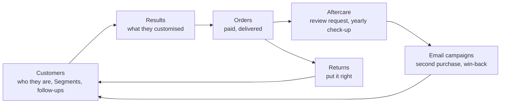

# PRD — CRM retention loop: one menu, one loop, and the hand-offs between its pages

**Status:** slice 01 (the sidebar) built on `claude/hopeful-hopper-bs4ic1` (2026-10-27). Slices
02–08 specified, not started.
**Owner request (2026-10-27):** "In our settings page, sidenav: Customers, Email campaigns, Email
templates (should be a setting/sub-page under campaigns), Results, Orders should be part of our
CRM loop/flow. Cleanup and optimize the sidenav section first for our CRM for customers. Research
online, find a way that we can have seamless integration between these features that goes
through an industry best approach to retaining customers for recurring/returning happy customers."
**Builds on:** `PRD-customer-crm` (ADR 0028: notes, timeline, Segments, follow-ups, aftercare,
reviews), `PRD-email-marketing` and `PRD-campaign-send-flow` (Email campaigns),
`PRD-email-templates`, `PRD-loyalty-points` (ADR 0030).
**Owner decisions:** three open. See [Owner decisions](#owner-decisions).

## Problem statement

The pieces of a CRM are built. They do not yet work as one loop.

1. **The menu hid the loop.** Customers, Email campaigns, Email templates, Results, Orders and
   Returns sat in the *Store* group, between Products and Discounts, mixed with store set-up.
   Email templates was a sibling of Email campaigns, not part of it.
2. **The pages do not hand off to each other.**
   - A Result shows the customer's email and mobile, but no link to their Customer record
     (`app/[lang]/settings/results/[id]/result-detail-client.tsx:1430-1460`).
   - A Return shows the customer's email, but no link to the Customer or to the Order's page
     (`app/[lang]/settings/rma/[id]/page.tsx:97,143`).
   - An Order is the one page that links to its Customer
     (`app/[lang]/settings/orders/[id]/order-detail-client.tsx:1238`).
   - A Segment lives on Customers, and becomes a campaign audience only by opening Email
     campaigns → New campaign and finding it in a dropdown (`campaign-editor.tsx:465-472`).
     Nothing on the Segment says *email these people*.
3. **There is no shared word for where a customer is.** The list can filter *last order within
   or over N months*, *bought*, *re-adjusted* and *email consent* (`lib/crm/customer-filters.ts`),
   so every list of "people drifting away" is built by hand, differently by each person.
4. **Nobody can see whether customers come back.** Analytics measures visits and journeys. There
   is no repeat purchase rate and no count of customers by stage.

## Research

What retention-focused tools and guidance do, and what this plan takes from each. Most sources
are vendor content, so their numbers are directional; slice 06 measures our own.

- **Group the menu by the job, not by the system.** GitLab rebuilt its sidebar from card sorts
  with its users, grouping what is used together
  ([GitLab](https://about.gitlab.com/blog/navigation-research-blog-post/)). Grouping lets people
  scan one group instead of the whole list
  ([UX Movement](https://uxmovement.substack.com/p/how-to-group-your-sidebar-items-for)).
  → *One CRM group, ordered the way a customer goes round the loop (slice 01).*
- **Customers hold the Segments; marketing sends to a Segment.** Shopify keeps Segments under
  Customers, and its RFM report groups customers (New, Active, Loyal, Champions, Needs attention,
  At risk, Almost lost, Dormant…), each previewable as a Segment that a campaign, a discount or an
  automation then targets ([Shopify, RFM analysis](https://www.shopify.com/blog/rfm-analysis);
  [Shopify, segmentation](https://www.shopify.com/au/segmentation)).
  → *Segments stay on Customers. A Segment opens a new campaign in one click (slice 02). The
  stage is a filter, so a stage is a Segment for free (slices 03 and 04).*
- **Name the lifecycle stages and give each its message.** Lifecycle guides map stages (first-time
  buyer, active, loyal, at risk, lapsed) to flows: post-purchase, replenishment, win-back and
  sunset ([Klaviyo](https://www.klaviyo.com/composer/lifecycle-email-marketing-guide);
  [lifecycle stage definitions](https://skillselion.com/skills/finsilabs/awesome-ecommerce-skills/lifecycle-marketing-automation)).
  *At risk* is defined against the product's own purchase cycle, not a fixed number of days
  ([Balistro](https://www.balistro.com/blog/retention-segmentation-rfm-2026);
  [Spotler](https://spotler.com/en-gb/blog/how-to-use-rfm-segments-to-supercharge-win-back-campaigns)).
  → *A stage on every Customer, with thresholds tied to our own cycle: the yearly check-up and the
  24 month points expiry (slice 03).*
- **The second purchase is where retention is won.** Reported odds that a first-time buyer comes
  back run from about 18% to 27%, and rise after the second order
  ([Opensend](https://opensend.com/post/repeat-purchase-rate-ecommerce);
  [Tresl](https://www.tresl.co/blog/magic-number-three)). Adobe defines the measure: people with
  at least *x+1* orders over people with at least *x*
  ([Adobe](https://experienceleague.adobe.com/en/docs/commerce-business-intelligence/mbi/analyze/sql/repeat-order-probability)).
  → *First-time buyers get the most care: aftercare, then a second-purchase campaign (slice 07).
  Our own repeat rate, by Adobe's formula (slice 06).*
- **Talk to customers after the sale, and make returns easy.** Vendor surveys report that most
  shoppers are more likely to buy again from a brand that keeps them informed after the sale, and
  that easy returns make them likelier to come back
  ([Narvar via Netimperative](https://netimperative.com/?p=29890);
  [Outerspace via Opensend](https://opensend.com/post/early-repeat-customer-rate-statistics)).
  Putting a problem right raises satisfaction, but is no substitute for getting it right first
  ([London Business School](https://www.london.edu/faculty-and-research/academic-research/t/the-effects-of-service-failures-and-recovery-on-customer-loyalty-in);
  [Oracle CX](https://blogs.oracle.com/cx/what-is-the-service-recovery-paradox-and-is-it-real)).
  → *Returns are in the loop, linked to the Customer (slices 01 and 02). Aftercare stays a service
  message, never marketing.*
- **Reward the best customers without discounting them.** Champions should be thanked and shown
  what is new, not given codes they would have bought without
  ([Balistro](https://www.balistro.com/blog/retention-segmentation-rfm-2026);
  [Shopify](https://www.shopify.com/blog/rfm-analysis)).
  → *Points and the milestone ladder already reward them (ADR 0030). The Loyal stage's playbook
  is a preview, not a code (slice 07).*
- **Delight is the loop that feeds itself, and hand-offs are where it breaks.** HubSpot's
  flywheel (attract, engage, delight) led it to cut friction at the hand-offs between teams
  ([HubSpot](https://blog.hubspot.com/marketing/our-flywheel)).
  → *Every page in the loop links to the next one (slice 02), and the Customer says what comes
  next (slice 05).*

## The loop

Each stage of the loop already has a page or a job. This plan adds the joins.

| Stage | Where it lives today | What this plan adds |
|---|---|---|
| Know the customer | Customers: overview, filters, Segments, notes, follow-ups, timeline, reviews, points | A lifecycle stage on every Customer (03), stage chips (04), the next step (05) |
| Customise | Results | A link to the Customer (02) |
| Buy and deliver | Orders (links to the Customer already) | Counts toward the stage (03) |
| Aftercare | Customers → Settings: review request 14 days after delivery, yearly check-up (CRM slices 07, 08, 13) | Shown as the next step when due (05) |
| Put it right | Returns / RMA | Links to the Customer and the Order (02) |
| Bring them back | Email campaigns, with Email templates under it | One click from a Segment (02); ready-written playbooks per stage (07) |
| Measure | nothing | Repeat purchase rate and customers by stage (06) |

## Solution

1. **Slice 01, built: one CRM group in the sidebar**, after *Admin Panel*, in loop order:
   Customers, Results, Orders, Returns / RMA, Email campaigns with Email templates beneath it.
   *Store* keeps what is sold and how: Products, Discounts, Shipping. The permission catalog
   carries the same group, so Users & permissions → Roles lists these pages together too. A
   parent page the role cannot open gives way to the child it can (a role with Email templates
   and not Email campaigns sees Email templates on its own), and the Results and Customers badges
   also show on the mobile menu's tiles.
2. **Hand-offs (02).** Result → Customer; Return → Customer and Order; Segment → *Email this
   Segment*; a campaign's Segment audience → that Segment's list.
3. **A lifecycle stage on every Customer (03)**, derived in the Customer overview from facts it
   already has, never stored: *Prospect*, *New*, *Repeat*, *Loyal*, *At risk*, *Lapsed*, and
   *Earlier buyer* (see decision 2). A `stage=` filter, so a stage is a Segment and an Audience.
4. **Stage chips above the Customers list (04)**, with live counts, beside the Segments row.
5. **The next step on the Customer (05)**: their stage and the one thing the loop suggests next,
   from pure rules over facts on the page.
6. **Retention numbers (06)**: repeat purchase rate by Adobe's formula, customers by stage, and
   the median days from first to second order.
7. **Playbooks (07)**: ready-written campaigns per stage, each opening on the stage's Segment,
   sent in waves through the existing flow.
8. **Sign-off (08)**: the owner's walk round the loop on production.

## Decisions

1. **The CRM group is navigation, not a new permission.** Every page keeps its own key. Only
   the catalog's `group` label moves from *Store* to *CRM*, which no stored data reads
   (`admin_roles.permissions` holds keys).
2. **Email templates stays at `/settings/email-templates`.** It is nested under Email campaigns
   in the sidebar and the breadcrumb (*Admin Panel → Email campaigns → Email templates*), and the
   two pages keep their Campaigns / Templates switch. Moving the URL would break saved links and
   the audit log's paths for no gain.
3. **The stage is derived, never stored**, as every other status on the overview is
   (`lib/crm/customer-overview.ts`). Changing a threshold re-sorts everyone at once, with no
   backfill.
4. **The stage reads orders only.** Never reviews, ratings, returns or notes: the stage chooses
   campaign audiences, and nothing about how a customer feels may decide who is asked for a
   review (`PRD-customer-crm` README, sixth hazard).
5. **Playbooks are campaigns, not automation.** Each is a ready-written draft that Staff send in
   waves. That keeps consent, suppression, the pause rule and Resend's plan exactly as
   `PRD-campaign-send-flow` built them, and needs no third cron (`PRD-customer-crm` README,
   fourth hazard).
6. **Aftercare stays out of campaigns.** The review request and the check-up are service
   messages with their own rules (CRM slices 07, 08). A playbook never asks for a review and never
   carries an aftercare message.

## Owner decisions

1. **Stage thresholds.** Recommended: *At risk* from 12 months after the last paid Order (when
   the yearly check-up falls due), *Lapsed* from 24 months (when points expire, ADR 0030).
   *Loyal* from 3 paid Orders. Alternative: let the owner set them on Customers → Settings.
2. **Customers who bought only before the move.** A **Migrated customer** carries a Shopify-era
   order count and amount (`migrated_customers`), but no order dates were imported. Recommended:
   their own stage, *Earlier buyer*, until they order here. Guessing a date would put them in the
   wrong playbook. Their invitation campaign already targets them.
3. **Returns / RMA in the CRM group.** Not in the original list, placed there because a return is
   a step in the customer's loop and is linked to the Customer. Reversible in one line.

## Hazards

Inherited, unchanged: consent only for marketing (`PRD-email-marketing`), no review gating
(`PRD-customer-crm`), Resend's plan (`PRD-campaign-send-flow`), no third cron, no PII in Telegram,
no Shopify dependency (`CLAUDE.md`). New:

- **A stage is not consent.** *Lapsed* is everyone lapsed; the Audience still narrows it to
  `subscribed` at the moment of each send. The stage chips say so.
- **Order statuses.** The stage counts what the overview's `paid_orders` counts: paid, and not
  pending, cancelled, refunded or failed. A refund moves a customer back a stage; that is right.

## Out of scope

- Automated flows that send without a person starting a wave.
- SMS or WhatsApp marketing (`PRD-email-marketing`: email only).
- A customer referral programme. The Partner programme is the referral channel today.
- Predicted churn or lifetime value. The derived stage comes first; prediction needs the
  history slice 06 starts measuring.
