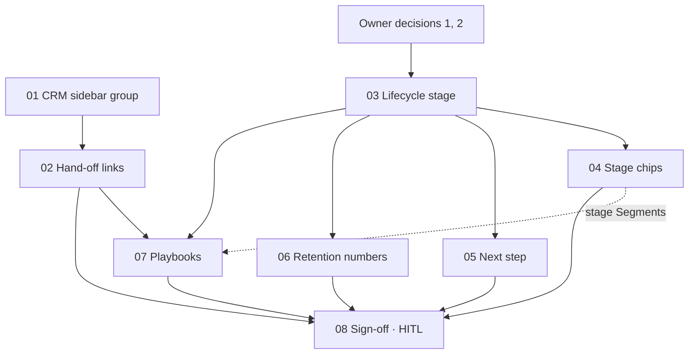

# CRM retention loop: vertical slices (issues)

A tracer-bullet breakdown of the PRD (`../crm-retention-loop-prd.md`). Each slice is a thin,
demoable path through the layers it touches.

- **Triage label:** `needs-triage` (all slices)
- **Tracker:** not filed yet. File the PRD as a parent issue and each slice as a sub-issue, then
  link them in the table below.
- **Owner decisions:** three open in the PRD. Slice 03 waits on decisions 1 and 2.

## Slices

| # | Title | Type | Status | Blocked by |
|---|-------|------|--------|------------|
| [01](01-crm-sidebar-group.md) | One CRM group in the sidebar, in loop order | AFK | **built** | none |
| [02](02-hand-off-links.md) | Hand-offs: every page in the loop links to the next | AFK | not started | 01 |
| [03](03-lifecycle-stage.md) | A lifecycle stage on every Customer, derived from their Orders | AFK | not started | owner decisions 1, 2 |
| [04](04-stage-chips.md) | Stage chips above the Customers list, counted live | AFK | not started | 03 |
| [05](05-next-step-on-customer.md) | The next step on the Customer | AFK | not started | 03 |
| [06](06-retention-numbers.md) | Retention numbers: do customers come back? | AFK | not started | 03 |
| [07](07-stage-playbooks.md) | Playbooks: a ready-written campaign for each stage | AFK, then HITL | not started | 02, 03 |
| [08](08-signoff.md) | Sign-off: the owner walks the loop on production | HITL | not started | 01–07 |

## Dependency graph

## Build order

1. **02 next.** It needs no decision and joins the pages that slice 01 put side by side.
2. **03 once the owner settles the thresholds and *Earlier buyer*.** Everything after it reads
   the stage.
3. **04, 05 and 06 in parallel.**
4. **07** once its words are approved; **08** closes the build.
