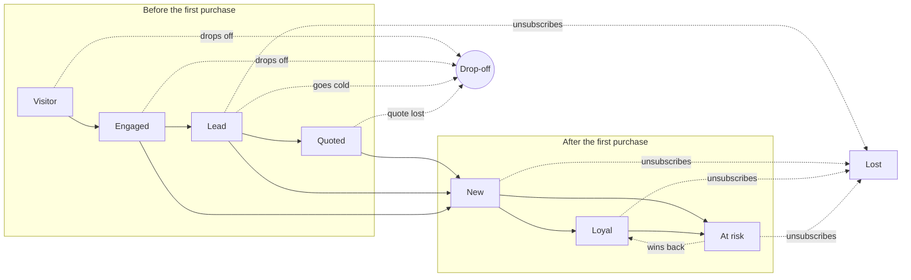

# Customer lifecycle and success metrics

**Status:** defines the stages, the signals and the metrics that slices 03–11 build. The stages
were settled by the owner on 2026-10-27 (thresholds) and 2026-10-28 (the funnel); slices 03 and
10 (part 1) are built.
**Owner input (2026-10-27):** the scenarios in [Where the owner's scenarios land](#where-the-owners-scenarios-land);
"we need to treat Shopify customers as the same customer lifecycle"; and "we should follow up
closely on enabling us to ask them why, to close the feedback loop" for visitors who drop off.

## How it fits together

Three layers, each answering a different question:

1. **Stage: where is this person now?** Exactly one at a time. A person moves forward and
   sometimes back. Stages drive lists, Audiences and the next step (slices 03–05).
2. **Signals: what has happened with them?** Yes or no facts with a date, any number at once:
   *reviewed on Google*, *re-adjusted*, *bought more than one pillow*. Signals are filters on the
   Customers list and the building blocks of metrics.
3. **Metrics: is the loop working?** Rates over a group of people in a time window: *of those who
   first bought in March, how many came back within 12 months?* Metrics go on the scorecard
   (slice 06).

A scenario like "bought a pillow but never came back for a re-adjustment" is a **signal** (has
not re-adjusted) inside a **stage** (New), counted by a **metric** (re-adjustment uptake).

## What counts as a purchase

Everything after the first purchase rests on this, so it is defined once:

- **A purchase is a paid Order with at least one goods line**, not pending, cancelled, refunded
  or failed. A paid re-adjustment fee is a separate service Order (`readjustment_bookings.fee_order_id`)
  and is **not** a purchase. It is the *re-adjusted* signal instead.
- **Shopify-era orders are purchases too** (owner, 2026-10-27). A Migrated customer goes through
  the same stages as everyone else. See [Shopify customers](#shopify-customers-same-lifecycle).
- **Date of a purchase** is its `paid_at`. *Last purchase* is the latest one.

Today the Customer overview's `paid_orders` and `last_paid_at` count every paid Order, re-adjustment
fees included, so a customer who paid for a re-adjustment shows two orders. Slice 03 adds
`purchases` and `last_purchase_at`, which count goods only, reads the stage from them, and moves
the *Last order* filter, sort and column onto them.

## Stages

### Before the first purchase

Measured per **Visitor** and **Visit** (ADR 0007) until we know who they are, then per person.

| Stage | Enters when | Recorded in |
|---|---|---|
| **Visitor** | a Visit starts | `analytics_visits` |
| **Engaged** | opens a configurator or a product page, starts a customisation (a Draft Result), adds to cart, or books a customisation appointment | `analytics_events` paths, `mp_config_responses` with no status, appointments |
| **Lead** | gives us a way to reach them without buying: holds a card on a Result, books an appointment with their email, signs up, or subscribes | `mp_config_responses` `held`, appointments, `customers` |
| **Quoted** | a Result is assigned: a priced build waits for them to accept | `mp_config_responses` `assigned` |

How each one ends without a purchase:

| Exit | Means | Recorded in |
|---|---|---|
| **Bounced** | left from the page they landed on | a Visit with one page view |
| **Dropped off** | left part way: browsing, in a configurator, at checkout | `analytics_visits.drop_off_path`, `drop_off_section` |
| **Went cold** | a Lead with no purchase 30 days later | derived |
| **Quote lost** | a Result ended without an Order: declined, hold released, or expired | `mp_config_responses` status |
| **No-show** | booked a customisation appointment and did not come | not recorded today (see signals) |

**Why** someone dropped off is not recorded anywhere today. ADR 0007 is explicit that a Drop-off
is where they left, never why. Slice 10 asks them. See [Closing the loop on drop-offs](#closing-the-loop-on-drop-offs).

### The funnel on every Customer

Owner, 2026-10-28: *Lead > New > Loyal (subscribers / repeat purchases / bookings) > At risk
(Lapsed) > Lost*, the brackets being sub-statuses within the main stage (PRD owner decision 4).
Exactly one stage per Customer, checked in this order; the thresholds were settled on 2026-10-27
(owner decision 1). Slice 03 builds it: [`issues/03-lifecycle-stage.md`](issues/03-lifecycle-stage.md).

| Order | Stage | Sub-status | Rule | Why this line |
|---|---|---|---|---|
| 1 | **Lost** | | unsubscribed from marketing, with no purchase or attended booking since | they told us; nothing more is sent |
| 2 | **Lead** | | no purchase and no attended booking yet | |
| 3 | **At risk** | *Lapsed* over 24 months | no purchase or attended booking for over 12 months | the yearly check-up falls due at 12; points expire at 24 (ADR 0030) |
| 4 | **Loyal** | *Repeat purchases*, *Bookings* (*Subscriber* with Renew) | 2 or more purchases, or an attended Re-adjustment booking | the second purchase is the hardest one to win |
| 5 | **New** | *Awaiting delivery*, *Delivered*, *Settled* | 1 purchase | |

**The goal is Renew** (owner, 2026-10-28): a monthly service that collects a customer's pillows
and sends them back. A subscriber is *Loyal · Subscriber*, checked before *Lost*, and never *At
risk* while subscribed. Renew is another piece of work; the stage gains that one check when it
lands. **Lost** is the owner's "cancels the subscription and unsubscribes from email / all
marketing": until Renew exists nobody has a subscription to cancel, so unsubscribing is enough.
Everyone between *New* and *Lost* is who marketing works on, until they subscribe or unsubscribe.

**New** has a delivery state, because a first-time buyer's experience is decided here:
*awaiting delivery* → *delivered* → *settled* (30 days after delivery, when the return window
closes, ADR 0011).

**A customer whose every purchase was refunded** has no purchase left, so they go back to
**Lead** (unless they attended a booking), with the *returned* signal set.

**Winning back** is a move, not a stage: an *At risk* customer who buys again or attends a
booking goes to *Loyal*, and the move is counted (metric M21). A *Lost* customer who buys, attends a
booking, or subscribes again leaves *Lost* the same way.

## Signals

Each is a yes or no with a date, on the Customer. *Today* means the data exists; a slice number
means it has to be built.

| Area | Signal | Recorded in | Status |
|---|---|---|---|
| Acquire | First Entry source (UTM, referrer, direct) | `analytics_visits.entry_source` | Today, for Visitors linked to a Customer |
| Acquire | Discovery source (what they told us) | Result `discovery_source` | Today |
| Acquire | Referred by a partner | partner attribution (ADR 0015) | Today |
| Convert | Bought through a customisation or from the shop | the Order's Result link | Today |
| Convert | Attended a customisation appointment | nothing links it to a person today | Needs attendance recorded |
| Deliver | Marked delivered | `orders.delivered_at` | Today, when Easyship or Staff mark it |
| Deliver | Returned (requested, refunded, exchanged) with reason | `rma_requests` | Today |
| Advocate | Review request sent, link clicked | `customer_review_requests` | Today |
| Advocate | Google review linked, with stars | `customer_google_reviews` | Today. Matching is by Staff, so it undercounts |
| Advocate | Shop review, with stars | `product_reviews` | Today |
| Service | Re-adjusted, complimentary or paid | `readjustment_bookings` attended | Today |
| Service | Check-up reminder sent, then booked | `customer_emails` and `customer_whatsapp` (template `aftercare.checkup_<n>m`), bookings | Today |
| Grow | More than one pillow: in one order, or across orders | `customer_purchase_lines` | Today |
| Grow | Mpillow and Mbolster (paired build or later) | `customer_purchase_lines` | Today |
| Grow | Accessory bought | `customer_purchase_lines` | Today |
| Engage | Signed up (account) | overview `has_account` | Today |
| Engage | Subscribed or unsubscribed to marketing email | overview `marketing_email` | Today |
| Engage | Received a campaign, clicked its link | `customer_campaign_sends` | Today |
| Engage | Points earned, spent, expired | Points ledger | Today |
| Engage | Imported from Shopify, claimed | `migrated_customers` | Today |
| Feedback | Why they dropped off or turned a quote down | nothing today | Slice 10 |

## Success metrics

Each metric is a rate with a fixed window, counted by **cohort**: the people who entered the
starting point in the same month. Cohorts stop a busy month from hiding a bad one, and give every
customer the same time to come back.

### The headline

**Returning customer rate**: of first-time customers in a month, the share who **came back
within 12 months**, either for a re-adjustment or for a second purchase, and **kept** what they
bought (no refund). For Mpillow a re-adjustment visit is a return: it is the customer choosing to
come back, and it is where a second pillow is most often sold.

"Happy" cannot be measured directly. Coming back and keeping the purchase is the closest fact the
platform records. Stars, where we have them, sit beside it.

### Before the first purchase

| # | Metric | Formula | Status |
|---|---|---|---|
| M1 | Visit to purchase | Visits with a purchase ÷ Visits, by Entry source | Today (Analytics journey) |
| M2 | Visitor to customer | Visitors who bought within 30 days ÷ Visitors first seen that month | Today, partial: needs Visitor to Customer links |
| M3 | Engagement | Visits that reached Engaged ÷ Visits | Slice 06 |
| M4 | Customisation finished | Draft Results that were held ÷ Draft Results started | Slice 06 |
| M5 | Quote accepted | Results accepted into an Order ÷ Results assigned | Slice 06 |
| M6 | Where and why they drop off | Drop-offs by page and section; then by reason | Where: today. Why: slice 10 |
| M7 | Appointment show and buy | Attended ÷ booked; bought within 30 days ÷ attended | Needs attendance recorded |
| M8 | Time to first purchase | Median days, first Visit to first purchase | Slice 06 |

### After the first purchase

| # | Metric | Formula | Status |
|---|---|---|---|
| M9 | Return rate | Purchases refunded through a return ÷ purchases delivered, with reasons | Slice 06 |
| M10 | Review rate | Google reviews linked ÷ customers sent a review request; shop reviews alongside | Slice 06. A floor, because linking is manual |
| M11 | Rating | Average stars, Google and shop | Today on Customers |
| M12 | Re-adjustment uptake | Premium pillows re-adjusted within 60 days ÷ Premium pillows delivered 60+ days ago; then all pillows within 12 months | Slice 06 |
| M13 | Check-up response | Check-up reminders followed by a booking within 30 days ÷ sent | Slice 06 |
| M14 | More than one pillow | Customers with 2+ pillows ÷ pillow customers: in one order (a household) and across orders (came back) | Slice 06 |
| M15 | Mbolster attach | Pillow customers who also bought an Mbolster ÷ pillow customers | Slice 06 |
| M16 | Repeat purchase rate | Customers with 2+ purchases ÷ with 1+; and 3+ ÷ 2+ (Adobe's formula) | Slice 06 |
| M17 | Second purchase within 12 months | By first purchase month | Slice 06 |
| M18 | One-time buyers | Customers with 1 purchase, first purchase over 12 months ago ÷ all customers that old | Slice 06 |
| M19 | Time to second purchase | Median days, first to second purchase | Slice 06 |
| M20 | Customers by stage | Lead, New, Loyal, At risk (Lapsed), Lost, and the trend | Slices 03, 04 |
| M21 | Win-back | At risk at the start of a quarter who bought or attended a booking during it | Slice 06 |
| M22 | Campaign to purchase | Customers sent a campaign who bought within 30 days, against the same stage not sent it | Slice 06; the sent side is `email_campaign_stage_results` (PRD-campaign-audiences slice 11) |
| M23 | Imported customers | Claimed ÷ imported; bought here ÷ claimed | Today, partly (claims) |
| M24 | Points | Points spent ÷ points earned; points expired | Slice 06 |
| M25 | Spend per customer | Average spend per customer at 12 and 24 months after the first purchase | Slice 06 |

None of these may choose who receives a Review request. Measuring review rate by stage is fine;
sending the request to some stages and not others is review gating (`PRD-customer-crm` README,
sixth hazard).

## Where the owner's scenarios land

| Owner's scenario | Stage | Signal | Metric |
|---|---|---|---|
| 1. Landed and purchased | Visitor → New | | M1, M2, M8 |
| 2. Landed and did not purchase | Visitor, Engaged, Lead or Quoted, whichever they reached | | M2–M5 |
| 3. Landed and dropped off | Visitor or Engaged, then a Drop-off | Drop-off reason (slice 10) | M6 |
| 4. Bought and left a Google review | any after purchase | Google review linked | M10, M11 |
| 5. Bought and left no review | any after purchase | asked, not linked; or not asked yet | M10 |
| 6. Bought a pillow, no re-adjustment | New and later | not re-adjusted | M12 |
| 7. Bought a pillow, came back for a re-adjustment | New, then Loyal (Bookings) | re-adjusted | M12, headline |
| 8. Bought more than one pillow | any after purchase | more than one pillow | M14 |
| 9. Bought nothing after the first purchase | New, then At risk, then At risk (Lapsed) | | M16–M18 |

Added to fill the gaps:

| Scenario | Why it matters | Metric |
|---|---|---|
| Started customising and did not finish | the biggest step between interest and a card hold | M4, M6 |
| Held a card, then the quote ended without an Order | the most expensive loss: they had decided to buy | M5, slice 10 |
| Booked a customisation appointment: came or did not | in-store is a main route to a first purchase | M7 |
| Came to the appointment and did not buy | they met us and still said no | M7, slice 10 |
| Bought, then returned it | a return can end the relationship or save it | M9 |
| Bought an Mpillow and an Mbolster | the pairing the configurator offers | M15 |
| Signed up and never bought | an account with no purchase is a warm Lead | M2 |
| Imported from Shopify: claimed or not, bought here or not | the migration's own outcome | M23 |
| Received a campaign, then bought | whether email brings people back | M22 |
| Earned points and let them expire | a reward that did not bring them back | M24 |
| Left 3 stars or fewer | a customer to put right, by a person | M11, a follow-up |
| Came back because of the check-up reminder | whether aftercare earns the second visit | M13 |
| Referred by a partner | which partners bring customers who stay | M17 by referral |
| Paid, never marked delivered | an operations gap that delays every aftercare message | delivery signal |

## Shopify customers: same lifecycle

Owner, 2026-10-27: a Migrated customer goes through the same stages and metrics as a customer
who first bought here.

**What the platform holds for them today:** a Shopify-era order count and total spent
(`migrated_customers`). It holds no order dates and no products, and the Shopify order mirror
has no customer fields. With a count alone they could be placed as New or Loyal, but never as
At risk, and *bought a pillow* or *more than one pillow* would be unknown.

**Recommended (slice 09): settle their order history once, during the migration.** Import
Shopify's orders export one time, as `CLAUDE.md` directs for Shopify-era facts. Each order
becomes a row of this platform's own staff-only purchase history: the Customer (matched by
email, as the customer import matches), the date paid, the amount, any refund, and each line's
product class (Premium, Basic, Mbolster, accessory). From then on a Shopify-era order is simply
an earlier purchase. It counts for the stage, the signals and every metric, and nothing reads
Shopify again.

**This changes one earlier decision.** ADR 0029 decision 10 says Shopify orders stay unlinked:
customers see no Shopify order history, and Staff see the count and spend. Recommended: keep the
customer side as it is, so the history stays staff-only and never appears in `/account`, and
amend the Staff side so the history counts toward the lifecycle. The owner confirms before slice
09 starts.

Until slice 09 lands, a Migrated customer with Shopify-era orders and no purchase here is placed
by count (New or Loyal). Since 2026-11-08 their latest Fitting record dates the latest of those
orders (ADR 0042 m), so they can be *At risk*; only those with no fitting have no date, and the
list marks them *no dates yet*.

## Closing the loop on drop-offs

Owner, 2026-10-27: follow up closely so we can ask people why. Slice 10 builds it.

**What good practice says.** Ask one closed question with an *Other* box, specific to where they
are, at the moment they leave. Open questions get fewer answers. Expect 5% to 15% to answer, more
at checkout ([Survicate](https://survicate.com/website-survey/exit);
[Informizely](https://www.informizely.com/help/response-rate);
[Zoho](https://www.zoho.com/survey/insight/exit-intent-survey.html)). The usual reasons people
give for leaving a checkout are unexpected costs, a forced account, a long checkout and distrust
of card payment ([Baymard](https://baymard.com/blog/reduce-cart-abandonment)). Each of those
matches something we can change.

**Where we ask, and how:**

| Who | When | How | Stored as |
|---|---|---|---|
| A Visitor in a configurator or at checkout | they move to leave, once per Visitor per 30 days, never in the way | a small card: "What stopped you finishing your custom pillow today?" | a **Drop-off reason** on the Visit, with no name or email asked |
| A shopper turning a quote down | on the decline step itself | the same question, optional, before they confirm | a **decline reason** on the Result |
| A Lead whose hold was released or expired | 2 days after it ended, once | one email or WhatsApp, each answer a one-tap link, no offer | a reason on the Result |
| A customisation appointment with no purchase in 14 days | then | a Follow-up for the Staff member who saw them, with a reason to record | a reason on the Follow-up |

**The answers are the fixes.** Every option either explains a loss or offers help on the spot:

| Answer | What we show at once | What it tells us over time |
|---|---|---|
| Not sure about the size or feel | *Book a fitting* or *Chat with us* | sizing guidance or the configurator |
| Want to try it in person first | studio locations and booking | the in-store route |
| The price | what is included, with no discount offered | pricing and how value is shown |
| Delivery cost or time | delivery options and times | shipping |
| Something did not work | *Tell us what happened*, sent to Staff | a bug |
| Just looking for now | thanks, nothing else | interest, not a loss |
| Other | a text box | new reasons to add |

**Keeping it honest:**
- A Drop-off reason is self-reported, kept apart from a Drop-off, which records where they left.
  That is the line ADR 0007 draws, and `CONTEXT.md` gains the term with that definition, as it
  did for Discovery source.
- An answer holds no contact details, and the card says only that it asks for none: a Visitor
  later merged to a person links their answers to them. Text answers are Staff-only and never
  shown in Telegram.
- The email or WhatsApp to a Lead asks one question about their own unfinished purchase, carries
  no offer and goes once. Counsel confirms it is a service message under the PDPA and the Spam
  Control Act before it is switched on, as with the check-up reminder
  ([PDPC](https://www.pdpc.gov.sg/-/media/Files/PDPC/PDF-Files/Legislation-and-Guidelines/Response-to-Feedback-for-2nd-Public-Consultation---8-Nov-2018.pdf)).
  WhatsApp needs an approved utility template, and goes only to someone who wrote to us there.
- **The loop closes** on a *Why people leave* card: reasons by step and by week, beside M6, each
  naming the area it points to (sizing, in-store, pricing, delivery, a bug), and later a weekly
  count in Telegram with no customer details.
