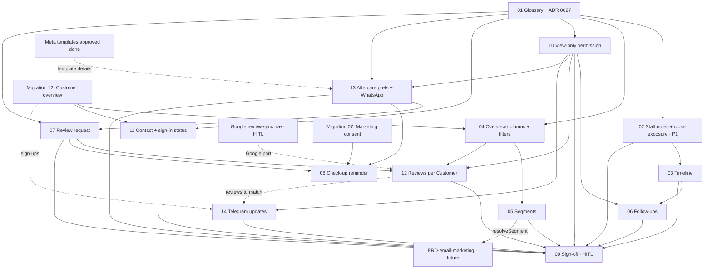

# Customer CRM: vertical slices (issues)

This is a tracer-bullet breakdown of the PRD (`../customer-crm-prd.md`). Each slice is a thin,
demoable path through all layers.

- **Triage label:** `needs-triage` (all slices)
- **Tracker:** [#277](https://github.com/ivanyeors/mp/issues/277) is the PRD issue. Each slice is a sub-issue (#278–#291), and its row below links it. Project **mp**: add #277 to the board by hand and its sub-issues follow.

## Slices

| # | Title | Type | Status | Blocked by | User stories |
|---|-------|------|--------|------------|--------------|
| [01](01-glossary-and-adr.md) · [#278](https://github.com/ivanyeors/mp/issues/278) | Glossary and ADR 0027: what the CRM is made of | AFK | **built** (`a9f1e95`) | none | underpins all |
| [02](02-staff-notes-and-close-exposure.md) · [#279](https://github.com/ivanyeors/mp/issues/279) | Staff notes customers cannot read, and closing the live exposure | AFK | **built** (`5ebb85f`) | 01 | 1, 2, 10 |
| [03](03-customer-timeline.md) · [#280](https://github.com/ivanyeors/mp/issues/280) | One timeline on the Customer detail, merged when it is read | AFK | **not started** | 02 | 3, 4 |
| [04](04-crm-filters-and-overview-columns.md) · [#281](https://github.com/ivanyeors/mp/issues/281) | CRM columns on the Customer overview, the filters that use them, and safe search | AFK | **not started** | 01; migration 12 | 5, 9 |
| [05](05-saved-segments.md) · [#282](https://github.com/ivanyeors/mp/issues/282) | Saved Segments, shared by Staff, counted live | AFK | **not started** | 04 | 6, 16 |
| [06](06-follow-ups.md) · [#283](https://github.com/ivanyeors/mp/issues/283) | Follow-ups assigned to Staff profiles | AFK | **not started** | 03, 10 | 7, 8 |
| [07](07-review-request-after-delivery.md) · [#284](https://github.com/ivanyeors/mp/issues/284) | Review request: one message after delivery (email and WhatsApp), asking for a Google review | AFK | **not started** | 01, 13 | 11–15 |
| [08](08-checkup-reminder.md) · [#285](https://github.com/ivanyeors/mp/issues/285) | Check-up reminder: yearly, Premium Mpillow only, says the visit is paid, to customers who agreed | AFK | **not started** | 07, 13; migration 07 | 24 |
| [09](09-signoff.md) · [#286](https://github.com/ivanyeors/mp/issues/286) | Sign-off: the privacy check in production, a Staff walkthrough, and the first review requests | HITL | **not started** | 02, 03, 05, 06, 07, 10–14 | all |
| [10](10-customers-view-permission.md) · [#287](https://github.com/ivanyeors/mp/issues/287) | A view-only Customers permission | AFK | **built** (`38a8880`) | 01 | 17, 18 |
| [11](11-contact-and-sign-in-status.md) · [#288](https://github.com/ivanyeors/mp/issues/288) | Contact and sign-in status: is the email verified, how do they sign in, is the mobile reachable | AFK | **not started** | 01; migration 12 | 19, 20 |
| [12](12-reviews-per-customer.md) · [#289](https://github.com/ivanyeors/mp/issues/289) | Reviews on every Customer: shop reviews, review requests, and Google reviews matched by Staff | AFK + HITL (Google sync live) | **not started** | 04, 07, 10 | 21–23 |
| [13](13-aftercare-preferences-and-whatsapp.md) · [#290](https://github.com/ivanyeors/mp/issues/290) | Aftercare by email and WhatsApp, with a manual switch to turn them off | AFK (Meta templates approved) | **not started** | 01, 10 | 25–28 |
| [14](14-telegram-updates.md) · [#291](https://github.com/ivanyeors/mp/issues/291) | Telegram updates: four types, each with its own switch | AFK | **built** (`a299f53`) | 10 | 29, 30 |

PRD part 5, email marketing, has no slice here. It is a hand-off to
[`PRD-email-marketing`](../../PRD-email-marketing/email-marketing-prd.md), and slice 05's
`resolveSegment` is the seam.

## Dependency graph

## Build order

1. **01, then 02 straight away.** 02 closes a live exposure: customers can read staff notes,
   tags and order notes today. It needs nothing from the migration PRD, so it can ship before
   any of it.
2. **10 next.** It is small, and once it lands, every later slice's write path is born on
   `customers-edit`. It does not block 02, the urgent fix.
3. **03 and 13 in parallel.** 13 creates the aftercare switches, the WhatsApp channel and the
   two templates. Their copy is approved, so submit them as soon as the script supports URL
   buttons. Then **07**.
   **14** can go any time after 10. Its online Result switch works at once, and its other
   types start posting as 12 and migration slice 12 land.
4. **04 and 11 once migration slice 12 has merged**, because both extend its overview and its
   `linkCustomerToAuthUser` change. Then 05.
5. **06** after 03 and 10, so follow-ups land on the timeline and on the right permission in the
   same PR.
6. **08** after 07 (the same job), and **12** after 04, 07 and 10. 12's Google matching
   lights up once the Google review sync is live (`PRD-google-review-replies` OPS-CHECKLIST).
   It ships without it.
7. **09** closes the build.

## How this fits the Shopify migration PRD

- **Migration slices that create a per-customer source add their own timeline adapter**, and
  nothing else in the CRM changes. They are 02 (imported), 12 (signed up), 05 (claimed and
  voucher), 07 (consent) and 08 (campaign sends).
- **The column grant on `customers` (slice 02 here) and migration slice 07's
  `marketing_email`.** Whichever lands second adds `marketing_email` to the grant.
- **The migration PRD's *Toward a simple CRM* section now points here.** This PRD is the source
  of truth.

## Hazards

**First hazard: grants.** After slice 02, every new `customers` or `orders` column is invisible
to the customer until it is granted, and that is the point. A migration adding a column the
customer should read must grant it, as `20261013110000_order_items_kind.sql:23-26` does for
`order_items`. The check from slice 02 catches a miss.

**Second hazard: no marketing.** If a CRM change sends an email with an offer, or selects
recipients by `marketing_email`, it belongs to `PRD-email-marketing`. Aftercare messages carry
no offer and have a switch per channel. The review request goes once per Customer; the check-up
once per milestone per Order. **One exception, on purpose:** the check-up offers a paid visit,
which the PDPA treats as direct marketing, so its email goes only to Customers whose
`marketing_email` is `subscribed` (slice 08). **WhatsApp never goes to a Customer whose
`aftercare_whatsapp` is off.** Turning it on needs the customer's own action, or a Staff note
recording that the customer agreed.

**Third hazard: no PII in Telegram.** The Staff group is a shared chat. The CRM's own updates
carry counts, Staff names and links only. The one exception is not the CRM's: the online Result
notice is today's build-team notice, and it keeps its content. Slice 14 adds only its switch.

**Fourth hazard: no third cron.** Vercel Hobby allows two, and a test asserts it
(`lib/shopify/order-mirror-catchup.check.ts:24`). Chain onto `results-sla`.

**Fifth hazard: reads on `customers`, writes on `customers-edit`.** After slice 10, a route
or server action that changes anything checks `customers-edit`. The guard test from slice 10
fails on a write left on `customers`.

**Sixth hazard: no review gating.** Nothing about how a customer feels may decide who
receives a review request. That rules out returns, refund requests, ratings, linked reviews and
notes. Nothing may be offered for a review, and the "reach us" line must not be framed as an
alternative to reviewing. Google removes reviews and restricts profiles for this. Slice 12's
check asserts that the request query never reads review data.

**Seventh hazard: Google reviews are never linked automatically.** Only a Staff action
inserts into `customer_google_reviews`.

## Noticed, not fixed here

PostgREST `.or()` filters built from unescaped typed text, in `lib/ecommerce/admin/orders-list.ts:78`,
`lib/ecommerce/customers.ts:55`, `lib/ecommerce/orders.ts:33` and `lib/ecommerce/products.ts:90`.
Slice 04 fixes the Customers list only. These are Staff-only, so they are correctness bugs, not
escalations. They are worth one small PR outside the CRM.

## HITL notes

- **Slice 09** needs the owner's own customer login on production, each Staff role for the
  walkthrough, and 30 days of reminders.
- **Slice 08** is built in the CRM (owner, 2026-10-20), and goes only to customers who agreed
  (research, 2026-10-20). Counsel reads the copy and may relax the email consent rule (slice 09).
- **Slice 13:** the WhatsApp Business account and its appointment templates are approved. The two
  aftercare templates are new, and their copy is approved (owner, 2026-10-20). Run
  `scripts/whatsapp-create-templates.ts` for them, then preflight. Meta's review usually takes
  minutes; record the category it gives.
