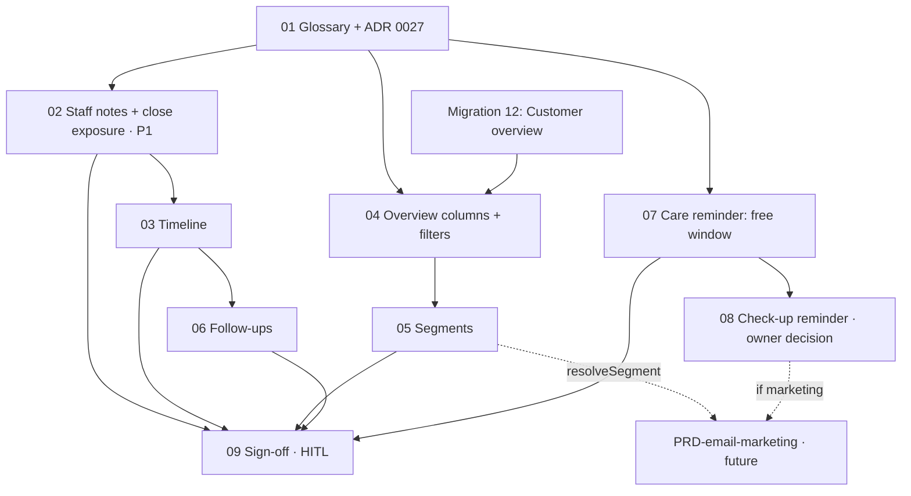

# Customer CRM: vertical slices (issues)

This is a tracer-bullet breakdown of the PRD (`../customer-crm-prd.md`). Each slice is a thin,
demoable path through all layers.

- **Triage label:** `needs-triage` (all slices)
- **Tracker:** not yet filed on GitHub.

## Slices

| # | Title | Type | Status | Blocked by | User stories |
|---|-------|------|--------|------------|--------------|
| [01](01-glossary-and-adr.md) | Glossary and ADR 0027: what the CRM is made of | AFK | **not started** | none | underpins all |
| [02](02-staff-notes-and-close-exposure.md) | Staff notes customers cannot read, and closing the live exposure | AFK | **not started** | 01 | 1, 2, 10 |
| [03](03-customer-timeline.md) | One timeline on the Customer detail, merged when it is read | AFK | **not started** | 02 | 3, 4 |
| [04](04-crm-filters-and-overview-columns.md) | CRM columns on the Customer overview, the filters that use them, and safe search | AFK | **not started** | 01; migration 12 | 5, 9 |
| [05](05-saved-segments.md) | Saved Segments, shared by Staff, counted live | AFK | **not started** | 04 | 6, 16 |
| [06](06-follow-ups.md) | Follow-ups assigned to Staff profiles | AFK | **not started** | 03 | 7, 8 |
| [07](07-care-reminder-free-readjustment.md) | Care reminder: "your free re-adjustment is available until {date}" | AFK | **not started** | 01 | 11–15 |
| [08](08-care-reminder-checkup.md) | *(owner decision)* The periodic "time for a re-adjustment" reminder | AFK | **owner decision** | 07 | 11 |
| [09](09-signoff.md) | Sign-off: the privacy check in production, a Staff walkthrough, and the first reminders | HITL | **not started** | 02, 03, 05, 06, 07 | all |

PRD part 5, email marketing, has no slice here. It is a hand-off to
[`PRD-email-marketing`](../../PRD-email-marketing/email-marketing-prd.md), and slice 05's
`resolveSegment` is the seam.

## Dependency graph

## Build order

1. **01, then 02 straight away.** 02 closes a live exposure: customers can read staff notes,
   tags and order notes today. It needs nothing from the migration PRD, so it can ship before
   any of it.
2. **03 and 07 in parallel.** Both only read tables that exist today.
3. **04 once migration slice 12 has merged**, because it extends `admin_customer_overview`.
   Then 05.
4. **06** after 03, so follow-ups land on the timeline in the same PR.
5. **09** closes the build. **08** waits on counsel and may move to email marketing.

## How this fits the Shopify migration PRD

- **Migration slices that create a per-customer source add their own timeline adapter**, and
  nothing else in the CRM changes. They are 02 (imported), 12 (signed up), 05 (claimed and
  voucher), 07 (consent) and 08 (campaign sends).
- **The column grant on `customers` (slice 02 here) and migration slice 07's
  `marketing_email`.** Whichever lands second adds `marketing_email` to the grant.
- **The migration PRD's *Toward a simple CRM* section now points here.** This PRD is the source
  of truth.

## Hazards

**First hazard: grants.** After slice 02, every new `customers` or `orders` column is invisible
to the customer until it is granted, and that is the point. A migration adding a column the
customer should read must grant it, as `20261013110000_order_items_kind.sql:23-26` does for
`order_items`. The check from slice 02 catches a miss.

**Second hazard: no marketing.** If a CRM change sends an email with an offer, or selects
recipients by `marketing_email`, it belongs to `PRD-email-marketing`. Care reminders are
service messages: one per Order, no offer, their own opt-out.

**Third hazard: no PII in Telegram.** The Staff group is a shared chat. Digests carry counts
and links only.

**Fourth hazard: no third cron.** Vercel Hobby allows two, and a test asserts it
(`lib/shopify/order-mirror-catchup.check.ts:24`). Chain onto `results-sla`.

## Noticed, not fixed here

PostgREST `.or()` filters built from unescaped typed text, in `lib/ecommerce/admin/orders-list.ts:78`,
`lib/ecommerce/customers.ts:55`, `lib/ecommerce/orders.ts:33` and `lib/ecommerce/products.ts:90`.
Slice 04 fixes the Customers list only. These are Staff-only, so they are correctness bugs, not
escalations. They are worth one small PR outside the CRM.

## HITL notes

- **Slice 09** needs the owner's own customer login on production, each Staff role for the
  walkthrough, and 30 days of reminders.
- **Slice 08** needs counsel's answer (owner decision 2).
