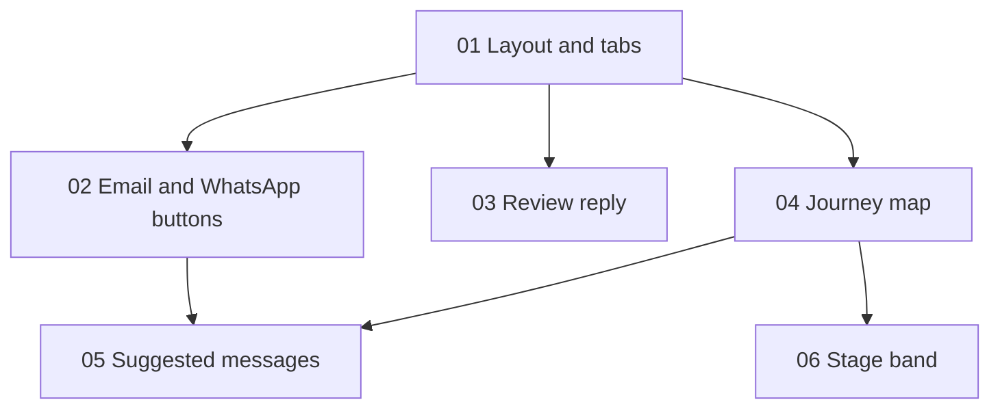

# Customer page and journey: vertical slices (issues)

A breakdown of the PRD (`../customer-page-journey-prd.md`). Each slice is a path through the
layers it touches and can be shown working by itself.

- **Tracker:** not filed on GitHub.
- **Owner decisions:** all five settled on 2026-11-15; see the PRD.

## Slices

| # | Title | Type | Status | Blocked by |
|---|-------|------|--------|------------|
| [01](01-layout-and-tabs.md) | Layout: header, Contact details, rail rows, three large tabs | AFK | **built** | none |
| [02](02-email-and-whatsapp-buttons.md) | Email and WhatsApp buttons that open Gmail and WhatsApp | AFK, then HITL | **built**; HITL to do | 01 |
| [03](03-review-reply.md) | Reply to a Google review from the Reviews tab | AFK, then HITL | **built**; HITL to do | 01 |
| [04](04-journey-map.md) | The journey map: chapters, the map, Now, the composer | AFK | **built** | 01 |
| [05](05-suggested-messages.md) | Suggested messages in the composer | AFK, then HITL | **built**; HITL to do | 02, 04 |
| [06](06-stage-band.md) | The Lifecycle stage band under the map | AFK | specified, not started | 04 |

## Dependency graph

