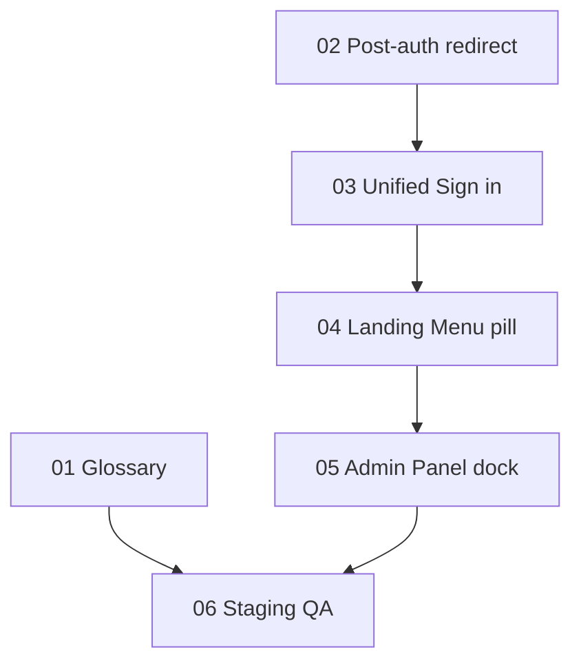

# Dock + Unified Sign In — Vertical Slices (Issues)

Tracer-bullet breakdown of the PRD (`../dock-unified-sign-in-prd.md`). Each slice is a thin, demoable path through docs / auth / dock UI (and tests where specified). Published locally (no external issue tracker configured).

**Triage label:** `needs-triage` (each slice)

## Slices

| # | Title | Type | Blocked by | User stories |
|---|-------|------|------------|--------------|
| 01 | Domain glossary: Sign in / Admin Panel / Profile / Staff / Customer | AFK | none | 28, 35 |
| 02 | Post-auth redirect helper + callback + login already-signed-in | AFK | none | 7–9, 14–17, 32, 45 |
| 03 | Unified Sign in page + redirects + light polish | AFK | 02 | 1–6, 18–19, 30–31, 33, 39, 43 |
| 04 | Landing Menu pill: Sign in / Profile / Admin Panel | AFK | 03 | 1, 10–11, 20–21, 27, 41–42, 44 |
| 05 | Admin Panel dock: Home + Logout only on `/settings/*` | AFK | 04 | 22–26, 34, 40 |
| 06 | Staging QA signoff | HITL | 01–05 | 36–38 |

## Dependency graph

## Recommended build order

1. **01** and **02** in parallel (no mutual blockers).
2. **03** after **02**.
3. **04** after **03**.
4. **05** after **04**.
5. **06** after 01–05.

## HITL notes

- **Slice 06:** Staging device pass for guest / customer / staff Menu pills, Admin Panel dock Home/Logout, and Sign in polish. Checklist lives in [`06-staging-qa-signoff.md`](./06-staging-qa-signoff.md).
