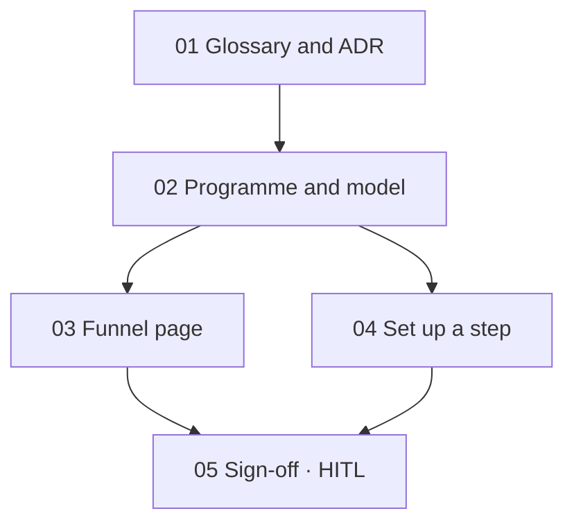

# Email funnel: vertical slices (issues)

A breakdown of the PRD (`../email-funnel-prd.md`). Each slice is a thin, demoable path.

- **Definitions:** `CONTEXT.md` → Email marketing: **Email funnel**, **Funnel step**, **Email
  flow**, **Automatic email**. ADR [0054](../../../docs/adr/0054-email-funnel-reads-what-is-set-up.md).
- **No migration, no money path, no new cron, nothing new sends** (PRD decisions 2 and 3).

## Slices

| # | Title | Type | Status | Blocked by |
|---|-------|------|--------|------------|
| [01](01-glossary-and-adr.md) | Glossary terms and ADR 0054 | AFK | **built** (2026-11-18) | none |
| [02](02-programme-and-model.md) | The programme and the model: stages, steps, flow and results, pure | AFK | not started | 01 |
| [03](03-funnel-page.md) | The Funnel page: stage strip, Segments, Email flow, Results | AFK | not started | 02 |
| [04](04-set-up-a-step.md) | Set up a step: New campaign from a Playbook, with its Segment | AFK | not started | 02 |
| [05](05-signoff.md) | Sign-off: the owner approves the Lead Playbook's words and walks the page | HITL | not started | 03, 04 |

03 and 04 share no files and run at the same time. Their only contract is the address
`/settings/campaigns/new?starter=<starter id>`.
