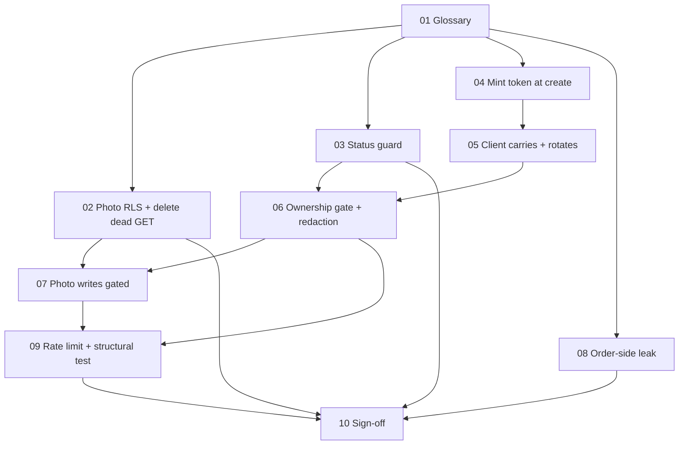

# Guest Result Ownership — Vertical Slices (Issues)

Tracer-bullet breakdown of the PRD (`../guest-result-ownership-prd.md`). Each slice is a thin,
demoable path through all layers (schema, API, client, tests). Published locally
(no external issue tracker configured).

**Triage label:** `needs-triage` (each slice)

## Slices

| # | Title | Type | Status | Blocked by | User stories |
|---|-------|------|--------|------------|--------------|
| 01 | Domain glossary: Draft Result, Result access token, Owner | AFK | open | none | 1–3 |
| 02 | Revoke public access to the body-photo table; delete the dead read endpoint | AFK | open | 01 | 4–7 |
| 03 | Lock writes to Results that are no longer drafts | AFK | open | 01 | 8–11 |
| 04 | Mint the Result access token at draft creation | AFK | open | 01 | 12, 17 |
| 05 | Configurator carries the token and starts a fresh session when refused | AFK | open | 04 | 13–16 |
| 06 | Ownership gate on read and update, and a redacted payload for Owners | AFK | open | 03, 05 | 18–26 |
| 07 | Photo writes behind the same ownership rule | AFK | open | 02, 06 | 4, 27 |
| 08 | Close the order-keyed sibling leak | AFK | open | 01 | 28 |
| 09 | Rate limit the open create path; structural guard against regressions | AFK | open | 06, 07 | 29–33 |
| 10 | Sign-off: the whole guest journey, both locales, second-browser refusal | HITL | open | 02–09 | 34, 35 |

## Dependency graph

## Build order

1. **01 (glossary) first** — every later slice is a sentence about **Draft Result**, **Result
   access token** or **Owner**, and the guard conditions read as domain statements only once
   those exist.
2. **02 next, and it can ship the same day.** It is the smallest diff in the initiative and closes
   the highest-severity hole, because that hole does not go through a route at all. It depends on
   nothing but the glossary and blocks nothing but the photo slice.
3. **03 next.** The second tracer bullet: it lands the majority of the *route*-side risk reduction
   on its own, with no client change, no token and no migration. Ships independently of the whole
   token mechanism.
4. **04 then 05.** Both additive — they mint and carry a credential that nothing yet enforces.
   They must be deployed and confirmed in production *before* 06.
5. **06.** The gate. This is the first slice that can refuse a real customer, which is why it is
   sixth and not first.
6. **07 and 08** in either order — both are small and independent of each other.
7. **09** last of the AFK slices, because the structural test asserts the end state of 02–08.
8. **10** closes it with a human pass.

**Ordering hazard, stated once because it decides the whole sequence:** enforcement ships with no
feature flag. If 06 lands before 05 is live, a customer returning from an abandoned Stripe
checkout has a configurator that can never save again, and it fails silently as a save indicator
stuck on "error". Do not reorder 05 and 06.

## HITL notes

- Slice 10 is the only human slice. It needs a real browser in both locales, a real Stripe
  Checkout session taken to the *cancel* branch, a real assign email, and a second browser holding
  nothing but a **Result** id. It records pass/fail in `../OPS-SIGNOFF.md`.
- Slice 02 carries a manual step inside an otherwise AFK slice: the migration must be applied with
  `supabase db push`, never the MCP `apply_migration` tool, which stamps its own version and
  desyncs the ledger from `supabase/migrations/`. Verification of the policy change needs the
  publishable key against a real instance.
