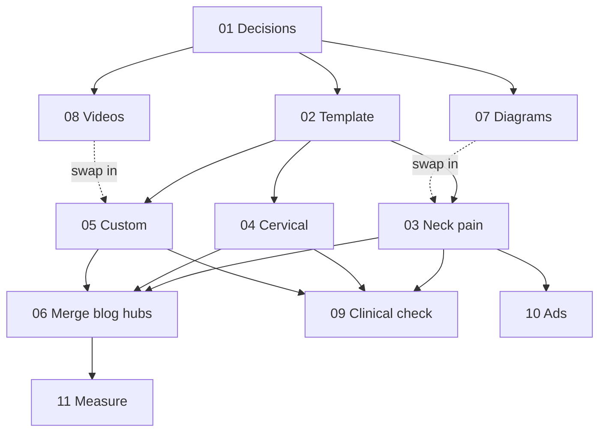

# Guides content — Vertical Slices (Issues)

Breakdown of `../guides-content-prd.md`. Each slice is demoable and has a pass/fail check. Published locally (no external tracker).

**Triage label:** `needs-triage` (each slice)

## Slices

| # | Title | Type | Blocked by | User stories |
|---|-------|------|------------|--------------|
| 01 | Owner decisions D1–D6 and glossary | HITL | none | 14, 16, 18 |
| 02 | Guide template v2: Markdown source, layout, JSON-LD, checks | AFK | 01 | 1, 9, 10, 13, 16, 17, 18 |
| 03 | Rewrite `/guides/neck-pain` | AFK + HITL claim read | 02 | 1–5, 8, 13 |
| 04 | Rewrite `/guides/cervical-pillow` | AFK + HITL claim read | 02 | 2, 4, 5, 8, 13 |
| 05 | Rewrite `/guides/custom-pillow` | AFK + HITL claim read | 02 | 3, 6, 7, 11, 12 |
| 06 | Merge the three blog hubs into their guides (if D1 = merge) | AFK | 03, 04, 05 | 14 |
| 07 | Diagrams and OG images | HITL (commission) | 01 | 2 |
| 08 | Videos: measure, studio fitting, cervical insert | HITL (shoot) | 01 | 6, 10 |
| 09 | Clinical accuracy check and byline (D3) | HITL | 03, 04, 05 | 4, 13 |
| 10 | Ads: landing mapping, negatives, AI Max exclusions | OPS | 03, 04, 05 | 15 |
| 11 | Measure: target queries, annotations, 8-week review | OPS | 06 | — |

## Dependency graph

## Build order

1. 01 (owner). Start 07 and 08 at the same time, since commissioning and shooting take the longest.
2. 02.
3. 03, 04, 05 in parallel. They ship with existing images; 07 and 08 swap new media in later.
4. 06 in the same release as the last of 03–05.
5. 09, 10, 11.
