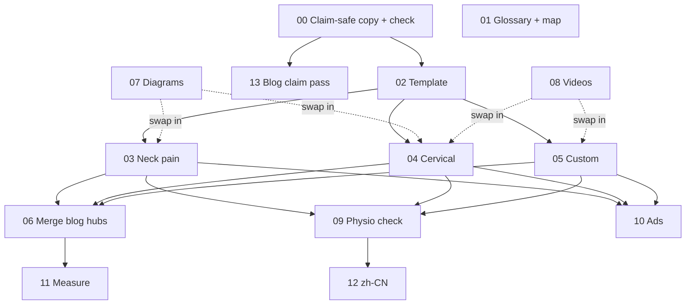

# Guides content — Vertical Slices (Issues)

Breakdown of `../guides-content-prd.md`. Each slice is demoable and has a pass/fail check. Published locally (no external tracker). The owner answered D1–D6 on 22 Nov 2026, so every slice is `ready` except the follow-up 12.

## Slices

| # | Title | Type | Blocked by | User stories |
|---|-------|------|------------|--------------|
| 00 | Claim-safe site copy and a claims check (D2, D2b), **built** | AFK | none | 16 |
| 01 | Record the decisions: glossary and consolidation map | AFK docs | none | 14, 18 |
| 02 | Guide template v2: Markdown source, layout, About this guide, JSON-LD, checks | AFK | 00 | 1, 9, 10, 13, 16, 17, 18 |
| 03 | Rewrite `/guides/neck-pain` (absorbs its blog hub) | AFK + owner claim read | 02 | 1–5, 8, 13 |
| 04 | Rewrite `/guides/cervical-pillow` (absorbs its blog hub) | AFK + owner claim read | 02 | 2, 4, 5, 8, 13 |
| 05 | Rewrite `/guides/custom-pillow` (absorbs its blog hub) | AFK + owner claim read | 02 | 3, 6, 7, 11, 12 |
| 06 | Merge the three blog hubs: 69 old URLs to the guides in one hop (D1) | AFK | 03, 04, 05 | 14 |
| 07 | Diagrams and OG images, in-house SVG (D4) | AFK + owner look | none (drafts in `media/`) | 2 |
| 08 | Videos shot in-house: measure, studio fitting, cervical insert (D4) | HITL shoot + AFK embed | none to shoot; 02 to embed | 6, 10 |
| 09 | Health-fact check by a partner physio, disclosed (D3) | HITL | 03, 04, 05 | 4, 13 |
| 10 | Ads: research ad groups to guides, buying searches to the configurator (D5) | OPS | 03, 04, 05 | 15 |
| 11 | Measure: target queries, annotations, 8-week review | OPS | 06 | — |
| 12 | Full zh-CN guides (D6) | AFK + fluent review | 03–09 live | 9, 11 |
| 13 | Claim pass over the blog (D2) | AFK copy | 00 | 16 |

## Dependency graph

## Build order

1. **Now, in parallel:**
   - 00 (copy and check; the owner OKs the wording table);
   - 01 (docs);
   - owner feedback on the diagram drafts (07);
   - book the studio shoot (08);
   - send the physio the brief (09).
2. 02.
3. 03, 04, 05 in parallel. They ship with existing images; 07 and 08 swap new media in when ready.
4. 06 in the same release as the last of 03–05.
5. 09 credit, 10 ads, 11 measure, 13 blog pass.
6. 12 once the English guides are live and checked.
