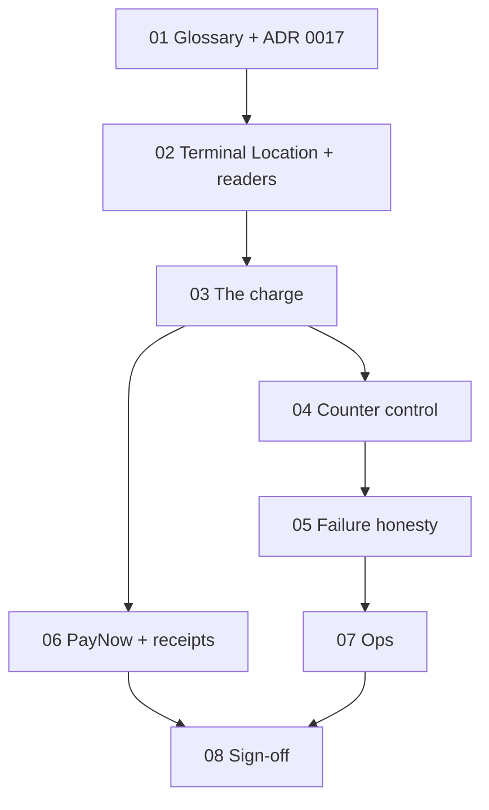

# In-store Counter Payments — Vertical Slices (Issues)

Tracer-bullet breakdown of the PRD (`../in-store-counter-payments-prd.md`). Each slice is a thin,
demoable path through all layers (schema, API, client, tests).

**Triage label:** `needs-triage` (all slices)

## Slices

| # | Title | Type | Status | Blocked by | User stories |
|---|-------|------|--------|------------|--------------|
| 01 | Domain glossary and ADR 0017: Counter payment, Card reader, Terminal Location | AFK | **not started** | none | underpins all |
| 02 | A Terminal Location per Location, and a reader list read live from Stripe | AFK | **not started** | 01 | 12–14 |
| 03 | The charge: a `card_present` PaymentIntent that settles through accept unchanged | AFK | **not started** | 02 | 1–3 |
| 04 | The counter control: one button, and the async truth rendered honestly | AFK | **not started** | 03 | 3–5, 7, 12 |
| 05 | Failure honesty: preflight, no double charge, and money with no Order behind it | AFK | **not started** | 04 | 6, 10, 11, 17 |
| 06 | PayNow at the counter, and a receipt for a sale with no shipping email | AFK | **not started** | 03 | 8, 9 |
| 07 | Ops: a kill switch, fleet health, and a name against every charge | AFK | **not started** | 05 | 15, 16 |
| 08 | Sign-off: one real reader, one real card, one real Singapore dollar | HITL | **not started** | 06, 07 | all |

## Dependency graph

## Build order

1. **01 first, and it is not ceremony.** "Terminal" already means a rules-engine leaf node —
   `firedTerminals` is in `lib/rules-engine/evaluate.ts:75` and in every persisted
   `recommendation_record`, so it cannot be renamed away later. "Location" already means a row on
   `partners` (ADR 0012), and Stripe's `terminal.Location` is a different object with a different id
   space. The `_Avoid_` lines are the deliverable; slice 02's migration is named after them.
2. **02 next.** Additive and inert — one nullable column and one settings section. Nothing charges,
   but nothing downstream can be built until a **Card reader** is reachable. Ends with the
   **Admin Panel** showing a simulated reader as online.
3. **03.** The tracer bullet and the only slice that moves money. Demoable through the API alone,
   with no UI, which is the point: prove the **Order** is correct before a button exists.
4. **04 and 06 in either order.** Both hang off 03. 04 is the operator interface; 06 is a payment
   method and a receipt. They do not touch each other, except that 06 adds one state and one copy
   change to 04's machine — so if 04 lands first, 06 amends it; if 06 lands first, 04 absorbs it.
5. **05.** After 04, because the failure states are rendered by 04's state machine. Deliberately
   separate: these are the guards whose absence is invisible until it is expensive, and they should
   be reviewed on their own rather than buried in a UI diff.
6. **07.** After 05, because a kill switch for a flow with no reconciliation is a way to strand
   money rather than a way to stop it.
7. **08** closes it with a human, real hardware and live SGD.

**Ordering hazard, stated once because it decides a deploy rather than a build:** 03 and 05 must
reach production together. 03 alone can take a customer's money at the counter with none of the
three double-charge guards and no path out of a paid-but-unsettled **Result**. It is safe on a
simulated reader and unsafe on a real one, and the difference is a Dashboard setting rather than a
code change. If only one of the two can ship, ship neither and leave counter payments switched off.

**Second hazard, smaller but load-bearing:** slice 03 must not modify
`app/api/results/[id]/accept/route.ts`. The whole initiative rests on a **Counter payment** being a
**Balance payment** that settles through the existing path unchanged. A diff in that file means the
premise is wrong, and the right response is to stop and re-derive rather than to patch around it.
`accept` is also the only place asserting `balance_paid` before an **Order** exists — for a no-hold
**Result** it is the *only* guard against an unpaid **Order**, and its tests are not padding.

## What the research ruled out, so it is not re-litigated

Three approaches look obvious and are wrong for this codebase. Each is recorded in ADR 0017 with
its reasoning; the short version:

- **Tap to Pay on iPhone or Android.** Available in Singapore, and unreachable — Stripe offers it
  only through the iOS, Android and React Native SDKs. `mp` is a Next.js web app; reaching Tap to
  Pay means shipping a native app, which is larger than this whole initiative.
- **The Terminal JavaScript SDK.** It is the *web* SDK, and Stripe's own guidance at the top of its
  own docs page says to prefer the server-driven integration for smart readers. The JS SDK needs
  the browser and reader on one local network with working local DNS, plus an explicit
  local-network permission prompt on Chrome 142+.
- **A new settlement path.** The obvious shape is "in-store payment" as a sibling of the online
  one. It is unnecessary: `accept` already settles a **Result** whose top-up was paid out-of-band,
  because a customer once paid a link and closed the tab. A counter charge is that same branch with
  a different instrument.

## Hardware

Order on the day slice 01 starts. Nothing between 01 and 07 is blocked by it — every slice builds
against Stripe's **simulated reader** — but slice 08 cannot begin without it and lead time is the
long pole.

Singapore-available smart readers, which are the only ones a server-driven integration can drive:

| Reader | Note |
|---|---|
| **Stripe Reader S710** | Recommended. 4G LTE, so shop-WiFi trouble is not a payments outage. |
| BBPOS WisePOS E | Cheaper, fine on a reliable network. |
| Stripe Reader S700 | S710 without cellular. |
| Verifone V660p / P630 | Private preview in SG. |

Mobile readers (**BBPOS WisePad 3**) are SDK-only and therefore out of reach, for the same reason
as Tap to Pay.

## HITL notes

- **Slice 08 is the only human slice.** Real reader, real card, real SGD, a handset, both locales,
  and one assistant who has not seen the screen before.
- **Slice 02 carries a manual step inside an otherwise AFK slice:** the migration must be applied
  with `supabase db push`, never the MCP `apply_migration` tool, which stamps its own version and
  desyncs the ledger from `supabase/migrations/`.
- **Slice 03 carries a Dashboard step:** three new webhook events on
  `we_1UEpVxCMlMx7bA76xFJYdCCj`, taking it from 9 to 12. Stripe's deployment checklist lists the
  two `terminal.reader.action_*` events as required rather than optional for server-driven
  integrations, and the endpoint host must stay `custom.mpillow.com` — Stripe does not follow
  redirects and `work.mpillow.com` 308s, which has broken delivery on this account before.
- **Not ours to sign off, but wants the same afternoon:** slice 14 of
  `PRD-staff-assist-spatial-fillings` still has an untested catalog save path against a real
  database. It belongs to that slice's sign-off; sweeping it in here on the grounds that both need
  a live DB is how it ends up tested by nobody.
