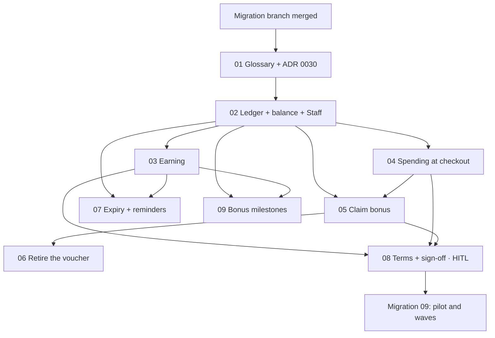

# Loyalty points: vertical slices (issues)

This is a tracer-bullet breakdown of the PRD (`../loyalty-points-prd.md`). Each slice is a thin,
demoable path through all layers.

- **Triage label:** `needs-triage` (all slices)
- **Tracker:** not filed yet. File the PRD as a parent issue and each slice as a sub-issue, then
  link them in the table below.
- **Base:** the migration merged to main (#293). Building on `claude/admiring-ride-40h2o6`
  (owner, 2026-10-21: "We shouldn't send anything at all yet. Build first").
- **Owner decisions:** 15 were taken on 2026-10-21 and the 16th, bonus milestones, on
  2026-10-23 (PRD). Counsel and the accountant still have questions in slice 08.

## Slices

| # | Title | Type | Status | Blocked by | User stories |
|---|-------|------|--------|------------|--------------|
| [01](01-glossary-and-adr.md) | Glossary and ADR 0030: what a point is, and what it is not | AFK | **built** | migration merge | underpins all |
| [02](02-ledger-balance-and-staff.md) | The points ledger, the balance, the settings, and Staff adjustments | AFK | **built** | 01 | 3, 10, 11, 12 |
| [03](03-earning.md) | Earning: points written when an Order's return window closes | AFK | **built** | 02 | 1, 2, 6, 14 |
| [04](04-spending-at-shop-checkout.md) | Spending at shop checkout, reserved so it can never be spent twice | AFK | **built** | 02 | 4, 5, 9, 13, 14 |
| [05](05-claim-bonus.md) | The Claim bonus replaces the voucher, for every customer-facing surface | AFK | **built** | 02, 04 | 7 |
| [06](06-retire-welcome-back-voucher.md) | Retire the Welcome-back voucher | AFK | **built** | 05 | 7, 12 |
| [07](07-expiry-and-reminders.md) | Expiry after 24 months without a purchase, with reminders at 3, 2 and 1 months | AFK | **built** | 02, 03 | 8 |
| [08](08-terms-signoff-and-launch.md) | Sign-off: the terms, counsel, the accountant, a live test, then launch | HITL | **signed off** (2026-10-22); live test after deploy | 03, 04, 05 | all |
| [09](09-bonus-milestones.md) | Bonus milestones: a progress bar to one-time bonuses (owner, 2026-10-23) | AFK | **built**; applied to production (2026-10-23) | 02, 03 | 15, 16 |

## Dependency graph

## Build order

1. **01.**
2. **02.** It can merge and run in production with `points_enabled` off. Staff adjustments work
   from day one.
3. **03 and 04 in parallel.** They touch different files: 03 touches Accept, the daily job and
   `charge.refunded`. 04 touches checkout and the session-ending webhooks.
4. **05,** once 04 has merged, because the bonus must be spendable before any email promises it.
5. **08,** then the migration's waves. **06** and **07** follow, and both must land before the
   first reminder is due, 21 months after launch.

**The import does not wait for points.** Migration slice 04 can import into production now.
Anyone who claims before points launch gets the Claim bonus at their next sign-in, if the Claim
fell inside their window (slice 05). That is the reason the voucher's "set the terms before the
import" rule no longer applies.

## Hazards

**First hazard: this one decides a deploy, not just a build.** No email that promises points
may be sent before slices 04, 05 and 08 are live in production. Slice 05 makes the wave sender's
preflight refuse otherwise.

On 2026-10-21 the owner had the first campaign promise the points. Admin Panel → Email campaigns
(`PRD-email-marketing`) now drafts it: *"Sign in within 3 months of this email and we'll add
1,000 points to your account"*. Its 3 months are decision 11's window, counted from this email,
so the window question is settled. The page now checks: a campaign that mentions points is refused until points are on and
launched with a Claim bonus (`pointsCheck`, slice 05), and the migration's wave sender does the
same (`claimBonusOffer`).

**Second hazard.** The balance is never a column on `customers`. The customer can read their own
row (ADR 0029 (d)), and a stored total drifts from its history. Read it with `points_balance`.

**Third hazard.** There is no third cron (`vercel.json`). The earn, expiry, reminder and sweep
runners chain onto `results-sla`, as the Aftercare runners do (`lib/aftercare/job.ts`).

**Fourth hazard.** Do not touch the Results money path. The hold, the pricers, `planCapture` and
the hold endings keep `discountAmount: 0`. The only Results change is that Accept resolves a
Customer (slice 03). Spending points on Results needs its own PRD.

**Fifth hazard.** 100 points = S$1 is a constant in code, never a setting. Making it editable
would let one save devalue every balance.

**Sixth hazard.** "Is this Customer a partner?" has one answer: `is_partner_customer`
(slice 02). The earn job, checkout, the Claim and Staff adjustments all ask it. Do not write a
second check.

## What the audit found, so it is not re-litigated

- **Refunds need no change.** Every refund path already pays cash only, up to the cash not yet
  refunded. That is exactly the owner's rule: points used are never refunded, and a partial
  return treats them as spent on what was kept. Slice 04 pins this with tests and changes no
  refund code.
- **Discounts already stack.** Partner pricing is added to the coupon and sent to Stripe as one
  `amount_off`. Points join that sum. Do not add a second Stripe discount.
- **GST is off.** Mellow Life is not GST-registered, and the owner ruled that GST does not count
  for points. Build nothing for it.
- **Vouchers are gone.** A code-based incentive is an ordinary Discounts code (owner, decision 14).
- **Nothing for Shopify.** No points for Shopify-era spend, and no Shopify app or integration
  (CLAUDE.md).
