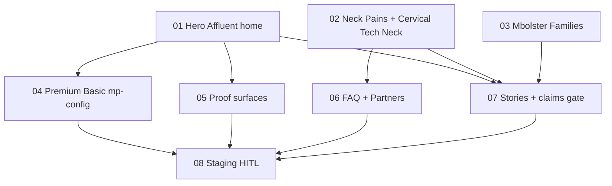

# Marketing Copy Rewrite — Vertical Slices

Tracer-bullet breakdown of the PRD (`../marketing-copy-rewrite-prd.md`). Each slice is a thin, demoable path through i18n → surface render → (where needed) config/FAQ. Published locally (no external issue tracker configured).

**Triage label:** `needs-triage` (each slice)

**Source of truth:** marketing-copy-gap-audit canvas Recommended column.

## Slices

| # | Title | Type | Blocked by | User stories |
|---|-------|------|------------|--------------|
| 01 | Hero + Affluent Pain home stack | AFK | none | 1–5, 35, 40, 44 |
| 02 | Neck Pains + Cervical Tech Neck section | AFK | none | 16–21, 36, 41 |
| 03 | Mbolster Families weave | AFK | none | 22–27, 37 |
| 04 | Premium/Basic slide-in + mp-config polish | AFK | 01 | 6–10 |
| 05 | Proof surfaces (credibility, review, founder, ambassadors, size-matters slide) | AFK | 01 | 11–15, 34 |
| 06 | Page FAQ + Partners Local Ambassador copy | AFK | 02 | 28–32 |
| 07 | Stories chrome → i18n + claim/SEO self-check | AFK | 01, 02, 03 | 33, 38–39 |
| 08 | Staging copy sign-off (mobile + desktop) | HITL | 01–07 | 42–43, 45–48 |

## Dependency graph

