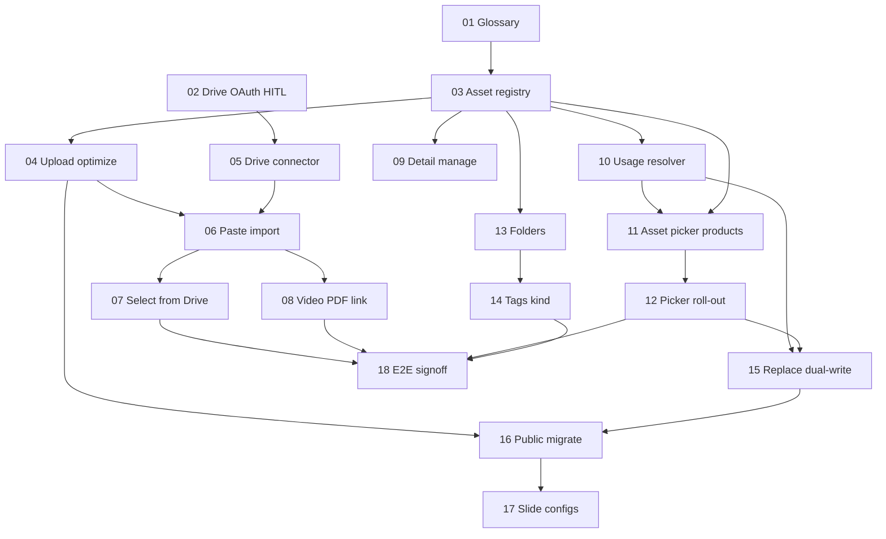

# Media Asset Library — Vertical Slices

Tracer-bullet breakdown of the PRD (`../media-asset-library-prd.md`). Each slice is a thin, demoable path through all layers (schema, API, UI, tests). Published locally for build tracking (no external issue tracker configured).

**Triage label:** `needs-triage` (each slice)

## Slices

| # | Title | Type | Blocked by | Modules | User stories |
|---|-------|------|------------|---------|--------------|
| 01 | Domain glossary: Media Asset terms in CONTEXT | AFK | none | glossary | 33 (partial), all scopes |
| 02 | HITL: Drive API + OAuth re-consent + Shared Drive access | HITL | none | 3 | 28, 47 |
| 03 | Asset registry: table + CRUD API + backfill bucket files | AFK | 01 | 1 | 1, 23–24 |
| 04 | Direct image upload → optimize → storage → Asset | AFK | 03 | 1, 2, 7 | 2–3, 25–26 |
| 05 | Drive connector: resolve URL + browse Shared Drives/folders | AFK | 02 | 3 | 27–28 |
| 06 | Paste Drive link → preview → import image Asset | AFK | 04, 05 | 3, 4, 2, 7 | 4, 6, 29 |
| 07 | Select from Drive dialog → select → import | AFK | 06 | 3, 4, 7 | 5 |
| 08 | Video/PDF Drive import as link-only Assets + preview | AFK | 06 | 4, 7 | 7–8 |
| 09 | Asset detail: rename, alt, Open in Drive, delete guard | AFK | 03 | 1, 5, 7 | 9–12 |
| 10 | Usage resolver v1: scanners + used/unused + last_used_at | AFK | 03 | 5, 7 | 13–15, 30–32 |
| 11 | Asset picker: replace ImagePicker; wire products | AFK | 03, 10 | 6, 5 | 19–21 |
| 12 | Roll Asset picker to blogs, categories, partners, page builder | AFK | 11 | 6, 9 | 20 |
| 13 | Organization: folders (assign, browse, filter) | AFK | 03 | 8, 7 | 34–35, 39 |
| 14 | Organization: tags + filter by kind | AFK | 13 | 8, 7 | 36–38 |
| 15 | Replace-everywhere + dual-write Asset ids on landing slots | AFK | 10, 12 | 5, 9 | 40–42 |
| 16 | Migrate `/public` marketing images into Asset library | AFK | 04, 15 | 9, 2 | 43, 45 |
| 17 | Adopt product slide section configs onto Assets (or defer) | HITL | 16 | 9 | 44, 46 |
| 18 | Staging E2E signoff: full library QA checklist | HITL | 07, 08, 12, 14 | 7+ | 47 |

## Dependency graph

## Recommended build order

### Scope 1 — Library core (slices 01–12)

1. **01** + **02** in parallel — glossary + Drive ops prerequisite.
2. **03** — Asset registry + backfill (foundation for everything).
3. **04** + **05** in parallel — upload/optimize path and Drive connector.
4. **06** → **07** — Drive paste then browser dialog.
5. **08** — video/PDF link Assets (can parallel **09**/**10** after **03**).
6. **09** + **10** in parallel — detail sheet and usage resolver.
7. **11** → **12** — Asset picker on products then roll out.

### Scope 2 — Organization (slices 13–14)

8. **13** → **14** — folders then tags + kind filters.

### Scope 3 — Full DAM (slices 15–17)

9. **15** — replace-everywhere + landing Asset ids (needs picker roll-out).
10. **16** → **17** — `/public` migration then slide config adoption decision.

### Signoff

11. **18** — staging E2E after core + org complete.

## Parent PRD context

Grill-with-docs session (Jul 2026). Key terms: **Media Asset**, Drive provenance, one-time import, hybrid references, used/unused, last used — see `CONTEXT.md` after slice 01.

**Hard constraints:** Images hosted in Supabase for fast display; video/PDF Drive-linked only; no Drive sync; workspace OAuth only (`admin@mpillow.com` + Shared Drives).
