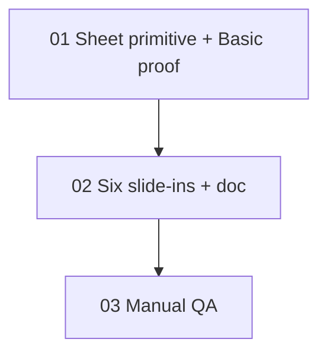

# Landing Slide-In Safe-Area Fix — Vertical Slices

Tracer-bullet breakdown of the PRD (`../modal-safe-area-prd.md`). Each slice is a thin, demoable path. Published locally for build tracking.

**Triage label:** `needs-triage` (each slice)

## Slices

| # | Title | Type | Blocked by | User stories |
|---|-------|------|------------|--------------|
| 01 | Sheet primitive + Basic Mpillow proof | AFK | none | 1, 15–17, 25–26, 33–35, 37, 40 |
| 02 | Remaining six slide-ins + layout doc | AFK | 01 | 2–14, 18–24, 27–32, 36 |
| 03 | Manual device QA sign-off | HITL | 02 | 8–14, 31–32, 41 |

## Dependency graph

## Recommended build order

1. **01** — Extend Sheet with `insetTopPadding`, export `sheetStickyTopClassName` / `sheetStickyBottomClassName`, unit test; wire Basic Mpillow learn-more as end-to-end proof.
2. **02** — Apply sticky classes to Premium, Mbolster, Cervical, Ambassadors, Size Matters, Book Appointment; update `full-slidein-layout.md` template.
3. **03** — Run device matrix (Safari iOS tab + A2HS, Chrome Android tab + PWA) across all seven slide-ins; confirm quick-sheet non-regression.

## Parent PRD context

Build plan `modal_safe_area_fix_5bf13547` (Jul 2026). Domain terms: **Learn-more slide-in**, **Sheet**, **sticky chrome**, **safe-area tokens** (`--safe-top`, `--mobile-top-clearance`, `--safe-bottom`).

**Hard constraints:** No JS device sniffing; no new dependencies; desktop layout unchanged (`md:pt-0` / `md:pb-0`).
