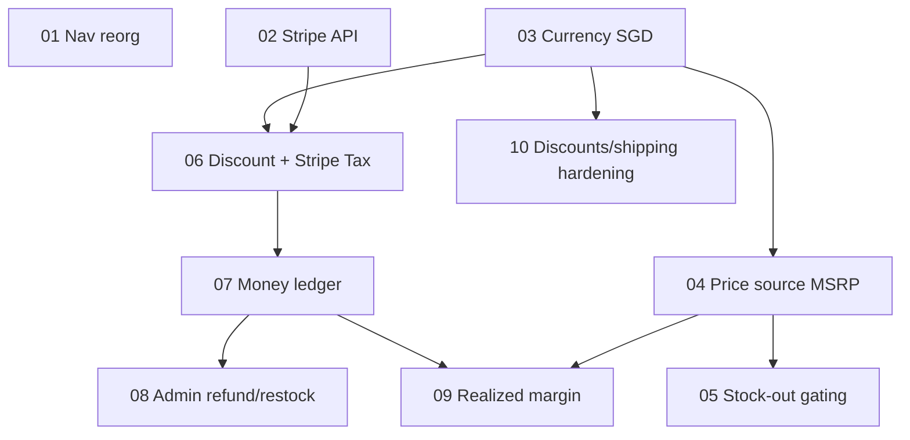

# Money-Flow Traceability — Vertical Slices (Issues)

Tracer-bullet breakdown of the PRD (`../money-flow-traceability-prd.md`). Each slice is a thin, demoable path through all layers (schema, API, UI, tests). Published locally (no external issue tracker configured).

## Slices

| # | Title | Type | Blocked by | User stories |
|---|-------|------|-----------|--------------|
| 01 | Settings sidebar reorg + Shopify/Integration split + Categories merge | AFK | none | 40-43 |
| 02 | Stripe API correctness (version + refund idempotency + keys) | AFK | none | 44 |
| 03 | Unify currency on SGD | AFK | none | 1-3 |
| 04 | Single price source: MSRP -> storefront price (locked) | AFK | 03 | 4-9 |
| 05 | Stock-out gating end to end + multi-SKU/BOM availability | AFK | 04 | 28-33 |
| 06 | Fix discount leak + adopt Stripe Tax | HITL | 03, 02 | 10-15 |
| 07 | Money ledger + partial/idempotent refunds + disputes | AFK | 06 | 20-23, 26-27 |
| 08 | Admin refund/cancel + manual restock linked to refund | AFK | 07 | 19, 24-25 |
| 09 | Cost-to-sale traceability (realized margin) | AFK | 07, 04 | 16-18 |
| 10 | Discounts & shipping hardening + order display fixes | AFK | 03 | 34-39 |

## Dependency graph

## Recommended build order

1. 01 (nav) and 02 (Stripe version) — independent quick wins, can run in parallel.
2. 03 (currency) — foundation for all money display.
3. 04 (price source) — single price truth.
4. 05 (stock gating) — depends on 04's BOM links.
5. 06 (discount + Stripe Tax) — HITL: needs Stripe Dashboard GST registration first.
6. 07 (money ledger) — refunds/disputes precision.
7. 08 (admin refund/restock) and 09 (realized margin) — both build on 07.
8. 10 (hardening) — can slot in any time after 03.

## HITL notes

- Slice 06 requires enabling Stripe Tax and adding the SG GST registration in the Stripe Dashboard before it can be verified end to end.
- Behavior change to communicate to staff (Slices 07/08): refunds no longer auto-restock; restocking is a deliberate action linked to the refund.
