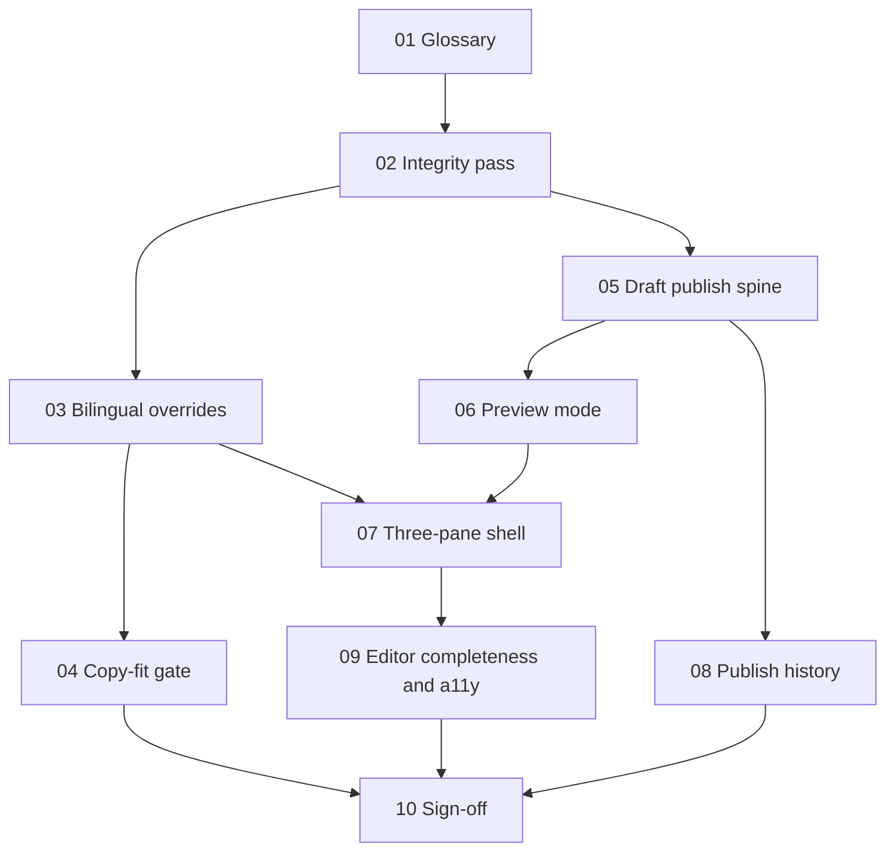

# Page Builder Redesign — Vertical Slices (Issues)

Tracer-bullet breakdown of the PRD (`../page-builder-redesign-prd.md`). Each slice is a thin,
demoable path through all layers (schema, API, UI, tests). Published locally
(no external issue tracker configured).

**Triage label:** `needs-triage` (each slice)

## Slices

| # | Title | Type | Status | Blocked by | User stories |
|---|-------|------|--------|------------|--------------|
| 01 | Domain glossary: Landing section, Section draft, Publish, Publish snapshot, Preview mode | AFK | **done** | none | 1–3 |
| 02 | Integrity pass: typed section types, locked slugs, validated images, guarded list, audit log | AFK | **done** | 01 | 4–12 |
| 03 | Bilingual overrides: locale resolver + section language switch | AFK | **done** | 02 | 13–17 |
| 04 | Copy-fit gate: wire the existing validator to the write path + live meters | AFK | **done** | 03 | 18–21 |
| 05 | Draft/publish spine: draft columns, publish function, snapshots, media walks | AFK | **built, migration not applied** | 02 | 22–28, 44 |
| 06 | Preview mode: shared renderer, admin-gated draft route, chrome and analytics suppression | AFK | **done** | 05 | 30, 37–40 |
| 07 | Three-pane shell: tree, live preview, inspector, device and theme toolbars | AFK | **done** | 03, 06 | 29, 31–36 |
| 08 | Publish history: snapshot list, restore into draft, retention | AFK | **built, migration not applied** | 05 | 41–43 |
| 09 | Editor completeness and accessibility | AFK | **done** | 07 | 45–54 |
| 10 | Sign-off: real device, both locales, production publish | HITL |  | 02–09 | 57 |

Test coverage for the pure helpers introduced by 03, 04, 05 and 06 rides along in those
slices (stories 55–56) rather than forming a separate suite slice.

## Dependency graph

## Build order

1. 01 (glossary) first — it is the shared language every later slice uses.
2. 02 next and alone. It closes the failures that can break the live homepage and hardens
   the write path before anything is built on top of it.
3. 03 then 04 — both close live bugs and ship standalone, with no UI redesign yet.
4. 05 can start as soon as 02 lands, in parallel with 03/04 if two agents are available.
5. 06 after 05 (the preview needs something to preview), then 07 after both 03 and 06.
6. 08 any time after 05; 09 after 07.
7. 10 last, once every AFK slice is merged.

## HITL notes

- Slice 10 is the only human slice. It needs a real phone, both locales, and a production
  publish, and it records pass/fail in `../OPS-SIGNOFF.md`.
- Migrations in 05 and 08 must be applied with `supabase db push`. Never use the MCP
  `apply_migration` tool — it stamps its own version and desyncs the ledger from
  `supabase/migrations/`.
