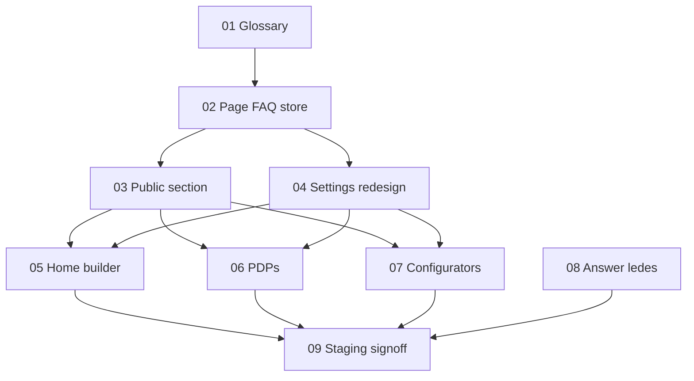

# Page FAQ Embeds — Vertical Slices (Issues)

Tracer-bullet breakdown of the PRD (`../page-faq-embeds-prd.md`). Each slice is a thin, demoable path through all layers (schema, API, UI, tests). Published locally (no external issue tracker configured).

**Triage label:** `needs-triage` (each slice)

## Slices

| # | Title | Type | Blocked by | User stories |
|---|-------|------|------------|--------------|
| 01 | Domain glossary: Page FAQ, FAQ surface, TL;DR → Answer lede | AFK | none | 1–3 |
| 02 | Page FAQ store: schema, surface_key, CRUD helpers, bilingual seed, self-check | AFK | 01 | 33–37, 39 |
| 03 | Public Page FAQ section + FAQPage JSON-LD (hide when empty) | AFK | 02 | 12, 14, 17–21 |
| 04 | Settings FAQ redesign: Global \| Page FAQs tabs + admin APIs | AFK | 02 | 22–27, 29, 33–34 |
| 05 | Home: page-builder `faq` section → `home` surface | AFK | 03, 04 | 11, 30–32 |
| 06 | PDPs: auto Page FAQ embed for `product:{id}` | AFK | 03, 04 | 13–14, 18 |
| 07 | Configurators: Page FAQ on `mp-config` / `mbolster-config` shells | AFK | 03, 04 | 15–16, 18 |
| 08 | Answer lede coverage audit + fill on commercial surfaces | AFK | none | 4–10 |
| 09 | Staging signoff: Rich Results + Settings E2E | HITL | 05–08 | 40 |

## Dependency graph

## Build order

1. 01 (glossary) and 08 (answer ledes) can start immediately in parallel.
2. 02 after 01.
3. 03 and 04 after 02 (parallel).
4. 05, 06, 07 after 03+04 (parallel with each other).
5. 09 after 05–08.
