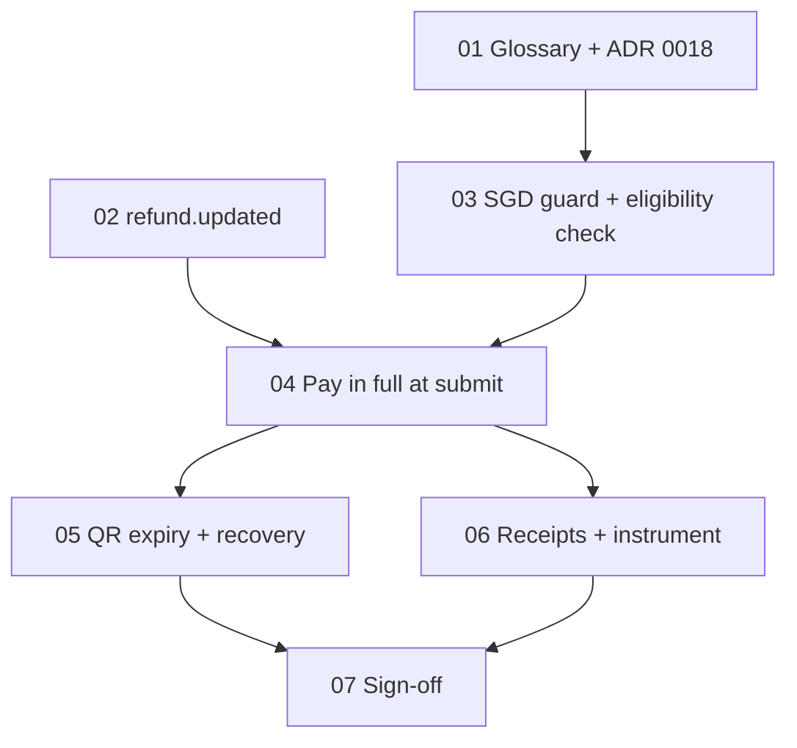

# PayNow at checkout — Vertical Slices (Issues)

Tracer-bullet breakdown of the PRD (`../paynow-checkout-prd.md`). Each slice is a
thin, demoable path through all layers.

**Triage label:** `needs-triage` (all slices)
**Tracker:** [#141](https://github.com/ivanyeors/mp/issues/141) is the PRD issue; each slice below links its own.
**Stripe account:** MELLOW LIFE only — `acct_1UEobvCMlMx7bA76` live,
`acct_1UEocJFmfnDU9wZa` sandbox.

## Slices

| # | Title | Type | Status | Blocked by | User stories |
|---|-------|------|--------|------------|--------------|
| [01](https://github.com/ivanyeors/mp/issues/142) | Glossary and ADR 0018: what PayNow is, and the one flow it cannot serve | AFK | **not started** | none | underpins all |
| [02](https://github.com/ivanyeors/mp/issues/143) | Handle `refund.updated`, so an async refund reaches the money ledger | AFK | **built 2026-11-22**; Dashboard subscription outstanding | none | 11, 12 |
| [03](https://github.com/ivanyeors/mp/issues/144) | Keep PayNow eligible: an SGD guard and a check protecting the two good paths | AFK | **not started** | 01 | 1–3 |
| [04](https://github.com/ivanyeors/mp/issues/145) | Pay in full at submit, so a Singapore shopper can use PayNow on a customisation | AFK | **not started** | 02, 03 | 4–7 |
| [05](https://github.com/ivanyeors/mp/issues/146) | A QR that expires in an hour, and a session that does not strand anything | AFK | **not started** | 04 | 8, 9 |
| [06](https://github.com/ivanyeors/mp/issues/147) | "Who is STRIPE PAYMENTS SINGAPORE?", and telling PayNow orders apart | AFK | **not started** | 04 | 10, 13, 14 |
| [07](https://github.com/ivanyeors/mp/issues/148) | Sign-off: a real bank app, a real QR, a real Singapore dollar | HITL | **not started** | 05, 06 | all |

## Dependency graph

## Build order

1. **02 first, and it is not part of the feature.** It fixes a gap that is live
   today: an asynchronously-completing refund is never written to the money ledger,
   because `charge.refunded` correctly ignores a `pending` refund and
   `refund.updated` is not handled anywhere. Cards refund synchronously so nothing
   has been lost yet; PayNow makes it certain. Shipping the feature first means
   taking PayNow money we cannot correctly refund.
2. **01** next, because slices 03 and 04 are both decided by two facts that belong
   written down: PayNow was already enabled on this account, and it can never appear
   on a manual-capture Checkout.
3. **03.** Additive and inert. Nothing new is offered; the eligibility that already
   exists becomes impossible to lose silently. Ends with a recorded, observed
   `payment_method_types` list rather than an assumption.
4. **04.** The only slice that changes what a shopper can do, and the only one with
   a genuine product decision in it.
5. **05 and 06 in either order.** Both hang off 04 and do not touch each other.
6. **07** closes it with a human, a Singapore bank app and live SGD.

**Ordering hazard, stated once because it decides a deploy rather than a build:**
02 must reach production before 04. Between them there is a window in which a
shopper can pay in full by PayNow and a refund to them would move money with no
ledger row — silently under-reporting a real liability. If only one can ship, ship
02; it stands alone and is useful without any of the rest.

**Second hazard:** slice 04 must not modify `app/api/results/[id]/accept/route.ts`.
A paid-in-full **Result** is a **Balance payment** that settles through the existing
out-of-band branch unchanged. A diff there means the premise is wrong, and the right
response is to stop and re-derive rather than patch around it. The same constraint
binds `PRD-in-store-counter-payments` slice 03 (#135), for the same reason — a
counter payment and a paid-in-full submit are the same shape with different
instruments.

## What the audit found, so it is not re-litigated

- **PayNow is already enabled.** `available: true`, `preference: "on"` in live *and*
  sandbox as of 2026-09-12. There is no Dashboard enablement step to plan for.
- **It is already eligible on two of three Checkout paths.** The shop cart
  (`lib/stripe/checkout.ts:202`) and the top-up/settle path
  (`lib/authorization-hold/index.ts:152`) both capture automatically and set no
  `payment_method_types`.
- **It can never be eligible on the third.** `createHoldCheckout` is manual-capture
  because it exists to take an **Authorization hold**, and Stripe states *Manual
  capture support: No*. Not a bug, not fixable.
- **The fulfilment gate is already right.** `lib/stripe/fulfilment-gate.ts` and the
  comment above it already classify PayNow as real-time rather than
  delayed-notification. Do not "fix" it — gating PayNow would strand every order as
  `unpaid`.
- **No chargebacks.** `charge.dispute.*` will never fire for PayNow. That is an
  upside, not missing coverage.

## HITL notes

- **Slice 07 is the only human slice.** A Singapore bank app is required; nothing
  else can prove a QR scans or that an async refund lands.
- **Slice 02 carries a Dashboard step:** subscribe
  `we_1UEpVxCMlMx7bA76xFJYdCCj` to `refund.updated`, 9 events → 10.
- **Stripe CLI is authorized for MELLOW LIFE** as of 2026-09-12, profile `mellow`,
  both contexts (live `acct_1UEobvCMlMx7bA76`, sandbox `acct_1UEocJFmfnDU9wZa`, the
  sandbox active). The `default` profile is still the retired Mpillow account
  `acct_1Q7HmBFq5J2TJixu`, so `stripe listen` and every probe must pass
  `--project-name mellow` or switch context first. Slice 03's verification is done —
  its results are recorded in the slice.
- **Live has no products.** `npm run stripe:sync-all` has only run against sandbox;
  MELLOW LIFE live had 0 products on 2026-09-12. Slice 07's live cart rows need it.
