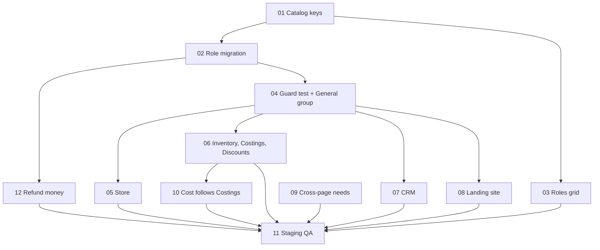

# View and Edit per page — Vertical Slices (Issues)

Breakdown of the PRD (`../permissions-view-edit-prd.md`). Each slice ships on its own, with a check that fails on the old code. Published locally (no external issue tracker).

**Triage:** all slices ready. The owner answered every decision on 2026-11-22 (PRD "Owner decisions"). Decision 5 added slice 12, Refund money.

## Slices

| # | Title | Type | Blocked by | User stories | Owner review | Status |
|---|-------|------|------------|--------------|--------------|--------|
| 01 | Glossary, ADR 0055 in CONTEXT, catalog Edit, tab and refund keys (no behaviour change) | AFK | none | 2, 4, 11 | code | todo |
| 02 | Role migration: every role keeps Edit and refunding on what it has | AFK | 01 | 5 | **supabase/** | todo |
| 03 | Roles grid: View / Edit ticks, tab rows, "what this unlocks" | AFK | 01 | 1–4, 10 | code | todo |
| 04 | Write-guard test + General, Users, Appointments, Analytics, read-only pages | AFK | 02 | 6, 7, 11 | code | todo |
| 05 | Store: Products, Categories, Configure, Rules Engine, Shipping, Couriers | AFK | 04 | 6, 7 | **money** (variant prices) | todo |
| 06 | Inventory, Costings, Discounts | AFK | 04 | 6, 7 | **money** | todo |
| 07 | CRM: Results, Orders, Returns, Campaigns + Send, Email templates (refund paths excluded) | AFK | 04 | 6, 7 | **money** (RMA, payment links, holds) | todo |
| 08 | Landing site: Page Builder, Partners, applications, commissions, Blogs, FAQ, Forms, Media | AFK | 04 | 6, 7 | **money** (commissions) | todo |
| 09 | Cross-page needs: Review SLA, product pickers on Page FAQs and Discounts | AFK | none | 8 | code (+money for Discounts) | todo |
| 10 | Cost price follows Costings everywhere | AFK | none (writes: 06) | 9 | **money** | todo |
| 11 | Staging QA signoff | HITL | 03–10, 12 | all | — | todo |
| 12 | Refund money: its own row under Orders and Returns | AFK | 01, 02 applied | 12, 13 | **money** | todo |

"Owner review" follows `scripts/pr-risk.mjs`. Every non-docs change waits for the owner unless `AUTO_MERGE_CODE` is on. **money** slices also get the `reviewer` subagent's second check (`.claude/rules/money.md`). **supabase/** slices are applied by the owner or on the owner's word.

## Dependency graph

## Recommended build order

1. **09** and **10** (cost reads) now. They fix today's leaks and don't wait on the key scheme.
2. **01**, then **02** applied in production before anything moves a guard. Old code ignores the new keys, so applying early is safe.
3. **12** right after 02 is applied. It is small, independent of the page slices, and closes the riskiest action first: sending money back.
4. **03** any time after 01. Until a page's slice lands, its Edit tick has no effect, so 03 ships behind 02 with a header note: "Edit takes effect page by page." The Refund money rows work as soon as 12 lands.
5. **04**, then **05**–**08** in any order, one pull request each. Slice 07 leaves the refund paths to 12.
6. **11** last.

## Rule for every page slice (04–08)

For each page in the slice:
- Move every write path to the page's Edit key (or the tab's).
- Pass `canEdit` from the server page.
- Render read-only mode.
- Add the page's folders to `page-write-guard.test.ts`.
- Add one route-gate test: View-only gets 403, Edit is served.

Show the guard test failing before the move and passing after, plus preview screenshots (`.claude/skills/preview`) of the page as a View-only role.
