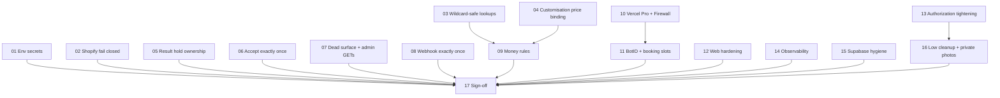

# Prod hardening: vertical slices (issues)

Tracer-bullet breakdown of the PRD (`../prod-hardening-prd.md`). Each slice closes one class of hole end to end and leaves a vitest check that fails on the code it fixes.

- **Triage label:** `needs-triage` (all slices)
- **Tracker:** [#166](https://github.com/ivanyeors/mp/issues/166) is the PRD issue. Each slice is a sub-issue, and all are on Project **mp** as `Todo`.
- **Related:** PayNow slice 02 [#143](https://github.com/ivanyeors/mp/issues/143) owns `refund.updated`.
- **Start here:** slice 01 is two env vars and no code. Every prod cron returns 401 until it's done.

## Slices

| # | Title | Type | Pri | Status | Blocked by | User stories |
|---|-------|------|-----|--------|------------|--------------|
| [01](https://github.com/ivanyeors/mp/issues/167) | Ops: set `CRON_SECRET` and `SHOPIFY_SYNC_TOKEN` in prod, then check what the dead crons missed | HITL | P0 | **partly done**: `CRON_SECRET` is set in prod; the Shopify routes fail closed without `SHOPIFY_SYNC_TOKEN`. Not yet checked what the dead crons missed | none | 1, 3 |
| [02](https://github.com/ivanyeors/mp/issues/168) | Lock the Shopify admin routes: fail closed, Staff session or token, constant-time compare | AFK | P0 | **done** (#185) | none | 2–4 |
| [03](https://github.com/ivanyeors/mp/issues/169) | Wildcard-safe lookups: exact coupon match, escaped email match, Staff record ownership | AFK | P0 | **done** (#185) | none | 5–7 |
| [04](https://github.com/ivanyeors/mp/issues/170) | Bind a customised checkout line to its build: product match, price recomputed on the server, stock per Variant | AFK | P0 | **done** (#185) | none | 8–10 |
| [05](https://github.com/ivanyeors/mp/issues/171) | Result hold: re-submitting needs ownership, a retry never deletes, stable idempotency key | AFK | P0 | **done** (#185) | none | 11–13 |
| [06](https://github.com/ivanyeors/mp/issues/172) | Accept a Result exactly once: a conditional claim before any side effect | AFK | P0 | **done** (#185) | none | 14 |
| [07](https://github.com/ivanyeors/mp/issues/173) | Remove dead endpoints, fix the reviews route, lock the product and blog GETs | AFK | P0 | **done** (#185) | none | 15–18, 32 |
| [08](https://github.com/ivanyeors/mp/issues/174) | Stripe webhook exactly once and safe to retry: atomic claim, checked writes, honest status | AFK | P1 | **done** (pre-launch hardening, 2026-10-25): every failure answers 500, atomic confirm, checked writes, `payment_intent.canceled`. Payment Links created no Order; retired 2026-11-22 (ADR 0048) | none | 19–23 |
| [09](https://github.com/ivanyeors/mp/issues/175) | Money rules that can't be typed around: tax country, self-referral, Add-on quantity, coupon cap | AFK | P1 | **done** (pre-launch hardening, 2026-10-25): tax country on Results too, self-referral, integer Add-ons, capped coupon count + open checkouts count | 03, 04 | 24–27 |
| [10](https://github.com/ivanyeors/mp/issues/176) | Move to Vercel Pro and add Firewall rate-limit rules on the endpoints that spend money | HITL | P1 | **not started** (HITL). Meanwhile a shared database rate limiter covers the money and messaging endpoints | none | 28, 29 |
| [11](https://github.com/ivanyeors/mp/issues/177) | BotID on booking, Result hold and checkout; a booking must be a real slot | AFK | P1 | **partly done**: a booking must be an offered slot, with per-IP/email/phone limits. BotID not added | 10 | 30, 31 |
| [12](https://github.com/ivanyeors/mp/issues/178) | Web hardening: safe post-login redirect, escaped JSON-LD, security headers | AFK | P1 | **done** (#224, plus the backslash redirect on 2026-10-25) | none | 33–35 |
| [13](https://github.com/ivanyeors/mp/issues/179) | Authorization tightening: owner-only role grants, Reference photo permission, cart ownership, partner logo host | AFK | P1 | **mostly done**: owner-only grants, partner logo host. Reference photo upload is still open to every Staff role; there is no server-side cart | none | 36–39 |
| [14](https://github.com/ivanyeors/mp/issues/180) | Observability: Sentry, error pages on every route, disputes and webhook failures reach a human | HITL | P2 | **partly done**: error pages on every route, disputes alert the Staff Telegram group. No error tracker yet | none | 40–42 |
| [15](https://github.com/ivanyeors/mp/issues/181) | Supabase hygiene: function `search_path`, anon execute, policy initplan, leaked passwords | HITL | P2 | **mostly done** (#193, #294): advisors show only the two intended SECURITY DEFINER helpers and leaked-password protection (no password sign-ins exist) | none | 43, 44 |
| [16](https://github.com/ivanyeors/mp/issues/182) | Low cleanup: escaped search, no raw DB errors, one lockfile, Reference photos private | AFK | P2 | **partly done**: one lockfile. Raw DB errors and public Reference photos remain | 13 | 45–47 |
| [17](https://github.com/ivanyeors/mp/issues/183) | Sign-off: prove every hole is closed in prod | HITL | P0 | **not started** | 01–16 | 48 |

## Dependency graph

## Suggested order

1. **Today:** 01.
2. **P0 in parallel worktrees:** 02, 03, 04, 05, 06 and 07. They touch different files, except 03 and 04, which both edit `app/api/shop/checkout/route.ts` in different sections; merge 03 first.
3. **P1:** 08, 12 and 13 in parallel; 10 (a purchase), then 11; 09 after 03 and 04.
4. **P2:** 14, 15, then 16.
5. **Last:** 17.

## Migrations

- Slices 06 (only if a claim column is needed), 09, 15 and 16 carry migrations.
- Merging to `main` auto-deploys, but migrations are not automated.
- Apply each with `supabase db push` in the same sitting as its merge. Never use the MCP `apply_migration`.
- Pre-launch hardening (2026-10-25) added two: `20261025120000_rate_limit_hits.sql` (shared rate limiter) and `20261025130000_coupon_usage_decrement.sql` (atomic coupon decrement on refund). `20261025000000_coupon_usage_cap.sql` (capped `increment_coupon_usage`, #316) is already applied in prod. The code works before the two are applied (the limiter falls back to per-instance counting), but the shared limit is not real until they are.
