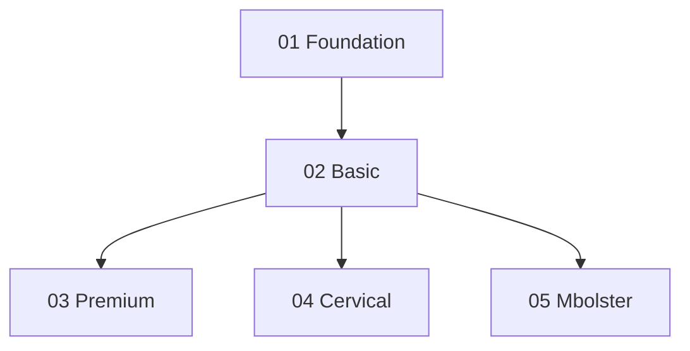

# Product Slide-In Section Templates — Vertical Slices

Tracer-bullet breakdown of the PRD (`../product-slide-sections-prd.md`). Each slice is a thin, demoable path through templates + config + one refactored slide-in. Published locally for build tracking.

**Triage label:** `needs-triage` (each slice)

## Slices

| # | Title | Type | Blocked by | User stories |
|---|-------|------|------------|--------------|
| 01 | Template foundation + renderer + agent catalog | AFK | none | 11–15, 18–19, 35 |
| 02 | Basic Mpillow learn-more refactor | AFK | 01 | 1, 6–8, 12–13, 15–16, 21–23, 26–28, 32–33 |
| 03 | Premium Mpillow learn-more refactor | AFK | 02 | 2, 6–9, 17, 21–25, 31–33 |
| 04 | Cervical Neck Support learn-more refactor | AFK | 02 | 4–5, 21–24, 29–30 |
| 05 | Mbolster learn-more refactor | AFK | 02 | 3, 6, 10, 17, 21–23, 26–27, 31 |

## Dependency graph

## Recommended build order

1. **01** — Types, content schemas, `resolve-slide-content`, renderer shell, `product_slide_section` wrapper, agent playbook; one template (`split_hero`) as proof.
2. **02** — Remaining Basic templates + `basic-mpillow` config + refactor Basic slide-in; content parity checklist.
3. **03** — Premium templates, `measurement_grid` complex component, `trust_strip` i18n, premium config + refactor.
4. **04** — Cervical templates (`media_intro`, `feature_card_grid`, `text_callout_block`) + refactor; preserve `openCervicalNeckSupportSheet` + Back footer.
5. **05** — Mbolster `purchase_panel`, carousel consolidation, mbolster config + refactor.

Slices **03**, **04**, and **05** can run in parallel after **02** completes.

## Parent PRD context

Grill-with-docs session (Jul 2026). Domain terms: **Learn-more slide-in**, **Product section template**, **Product slide section config**, **Template content schema** — see root `CONTEXT.md` Marketing section.

**Hard constraints:** Do not modify landing pages; do not change slide-in shells; do not delete existing content.
