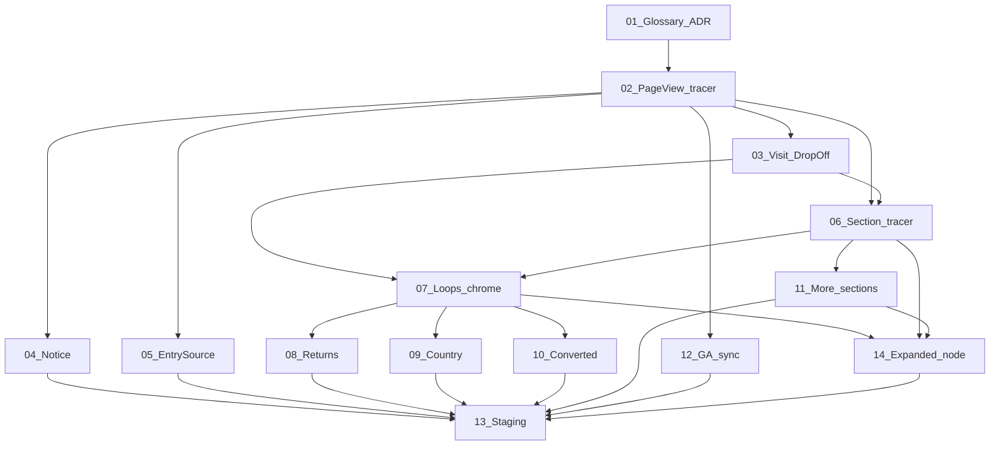

# Prospect journey analytics — Vertical Slices (Issues)

Tracer-bullet breakdown of the PRD (`../prospect-journey-analytics-prd.md`). Each slice is a thin, demoable path through all layers (schema, API, UI, tests). Published locally for build tracking (no external issue tracker required).

**Triage label:** `needs-triage` (each slice)

## Slices

| # | Title | Type | Blocked by | User stories |
|---|-------|------|------------|--------------|
| 01 | Domain glossary + ADR 0007 | AFK | none | 41, 42 |
| 02 | Page-view tracer: schema + Visitor + ingest + Admin transitions | AFK | 01 | 24, 33, 37–39, 43 |
| 03 | Visit lifecycle + Drop-off sink + tests | AFK | 02 | 8, 26, 40 |
| 04 | Analytics notice bar | AFK | 02 | 21–23 |
| 05 | Entry source freeze + filter + tests | AFK | 02 | 14, 30–31, 40 |
| 06 | Section tracer: home tags + expand/collapse | AFK | 02, 03 | 4–5, 7, 25, 48 |
| 07 | Unique-node loops + custom node chrome + side panel | AFK | 03, 06 | 3, 6, 9, 44 (19 dig-in → slice 14) |
| 08 | Returns: dashed re-entry + return metrics | AFK | 07 | 10, 15, 27 |
| 09 | Country: IP→ISO + multi-select color-by-country | AFK | 07 | 12–13, 32, 45, 49 |
| 10 | Converted sink + Include converted + last-touch | AFK | 07 | 2, 16–18, 46, 50 |
| 11 | Section tags: PDP, configurators, checkout/Result | AFK | 06 | 25, 48 |
| 12 | GA→DB BigQuery sync + ga_client_id stitch | AFK | 02 | 34–36 |
| 13 | Staging E2E signoff | HITL | 04–12, 14 | 43–46 |
| 14 | Expanded node dig-in (replace side panel) | AFK | 07, 06/11 | 19 (amended), 7 |

## Dependency graph

## How to work a slice

1. Pick an unblocked AFK slice (or HITL when ready for staging).
2. Implement end-to-end for that tracer only; leave follow-on slices alone.
3. Mark acceptance criteria done in the slice file when verified.
4. Do not close or edit the parent PRD status except via normal triage.
