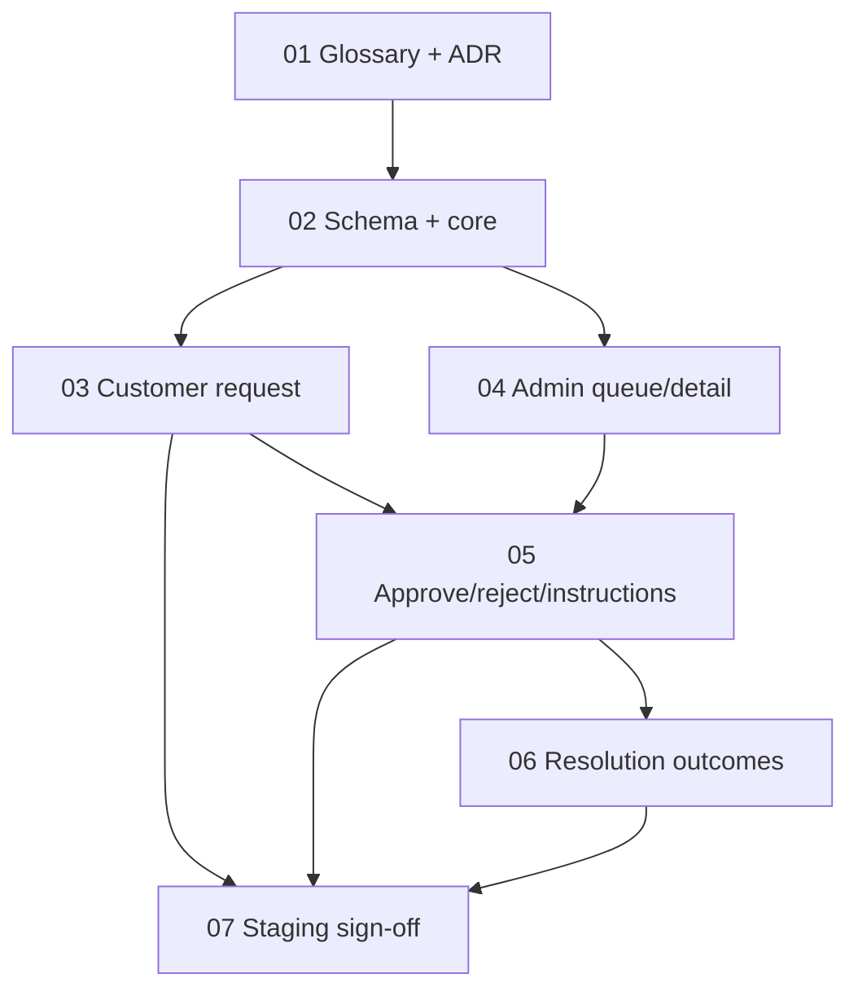

# Returns/RMA — issue index

Parent PRD: `.claude/PRD-returns-rma/returns-rma-prd.md` · GitHub umbrella **#41**

Tracer-bullet breakdown. Each slice is a thin, demoable path through all layers
(schema, API, UI, email, tests). Published locally for build tracking.

**Triage label:** `needs-triage` (each slice)

| # | Slice | Type | Status | Blocked by |
|---|-------|------|--------|------------|
| 01 | Glossary + RMA lifecycle/model ADR | HITL | done (ADR 0011) | — |
| 02 | RMA schema + eligibility & transition core | AFK | done (13 tests) | 01 |
| 03 | Customer request flow (+ received email, RMA email ledger) | AFK | done (14 tests) | 02 |
| 04 | Admin RMA queue + detail (role-gated) | AFK | done (3 tests) | 02 |
| 05 | Admin approve / reject + instructions-sent (+ emails) | AFK | done (33 tests) | 03, 04 |
| 06 | Resolution outcomes (refund / exchange / replacement + email) | AFK | done (36 tests) | 05 |
| 07 | Staging E2E QA sign-off | HITL | ready — needs schema apply + staging | 03, 05, 06 |

Parallelizable after 02: slices 03 and 04 are independent of each other.

Reused platform patterns:
- Audit: `admin_audit_log` + `recordAdminAction` (`lib/auth/audit.ts`)
- Email idempotency: `order_emails`-style ledger + `dispatchOrderEmail` (`lib/email/index.ts`)
- Customer RLS: `current_customer_id()` (`supabase/migrations/0039_customer_order_rls.sql`)
- Refund: existing `refundPayment` + money-ledger webhook

