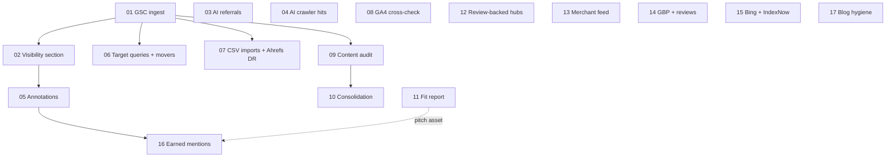

# Search & AI Visibility — Vertical Slices

Tracer-bullet breakdown of the PRD (`../search-visibility-prd.md`).

**Triage label:** `needs-triage` (each slice)

Two tracks run in parallel:
- **Measure (01–08):** get the numbers into `/settings/analytics` first, so every content change after this has a before/after line.
- **Discover (09–17):** consolidate content, publish first-party assets, grow off-site presence.

## Slices

| # | Title | Type | Blocked by | User stories |
|---|-------|------|------------|--------------|
| 01 | GSC snapshot ingest | AFK | none | 1, 3, 4, 7, 20 |
| 02 | Search & AI visibility section — KPI row + trend charts | AFK | 01 | 2, 4, 13, 14, 15, 19 |
| 03 | AI referral channel + channel mix + conversion join | AFK | none | 8, 9, 16 |
| 04 | AI crawler hit logging | AFK | none | 10, 11 |
| 05 | SEO annotations on charts | AFK | 02 | 17, 18 |
| 06 | Target-query watchlist + movers | AFK | 01 | 5, 6 |
| 07 | CSV imports (GSC Gen-AI, Bing AI Performance) + Ahrefs DR | AFK | 01 | 12, 22 |
| 08 | GA4 property confirmation + Data API cross-check | OPS + AFK | none | 21 |
| 09 | Blog content audit + consolidation map | HITL | 01 | 23, 24, 28 |
| 10 | Execute consolidation — merges, 301s, prunes, E-E-A-T | AFK | 09 | 25, 26, 27 |
| 11 | Singapore pillow fit report (first-party data) | HITL | none | 29, 30, 31 |
| 12 | Review-backed sections on guides and consolidated posts | AFK | none | 32 |
| 13 | Merchant Center feed + free listings | AFK + OPS | none | 33, 34 |
| 14 | Google Business Profile + post-visit review requests | AFK + OPS | none | 35, 36 |
| 15 | Bing Webmaster Tools + IndexNow | AFK + OPS | none | 37 |
| 16 | Earned mentions playbook | OPS | 05 | 38 |
| 17 | Blog hygiene quick wins | AFK (+ HITL) | none | 26, 27 |

## Dependency graph

## Recommended build order

1. **01, 03, 04, 15, 17** (in parallel; 15 is quick and its OPS half is free; 17 fixes defects that are live today)
2. **02, 05**: the charts are useful as soon as data exists
3. **09**: the audit needs GSC data from 01 (the backfill makes 16 months available immediately)
4. **10, 11, 13, 14** (10 after approval of 09)
5. **06, 07, 08, 12**
6. **16**: ongoing, once 05 exists to log placements

## OPS runbooks

- `../GA4-SETUP.md`: new GA4 property for `custom.mpillow.com` (slice 08)

## Hard constraints

- Costings is the single source of sell price. The merchant feed never computes its own price.
- The admin page never calls Google or Bing APIs live.
- No astroturfing, paid reviews or undisclosed sponsored placements.
- Do not rewrite or prune content before 01 and 05 are live; we need the before-line.
