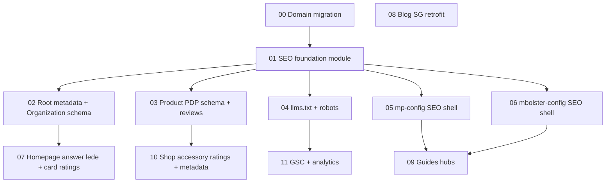

# Technical SEO, AEO, and GEO — Vertical Slices

Tracer-bullet breakdown of the PRD (`../seo-aeo-geo-prd.md`). Each slice is a thin, demoable path through all layers. Published locally for build tracking.

**Triage label:** `needs-triage` (each slice)

## Slices

| # | Title | Type | Blocked by | User stories |
|---|-------|------|------------|--------------|
| 00 | Domain migration work → custom | OPS | none | 1, 36 |
| 01 | SEO foundation module + URL sweep | AFK | 00 | 2–5, 38 |
| 02 | Root metadataBase + Organization/WebSite JSON-LD | AFK | 01 | 4, 6 |
| 03 | Product PDP full JSON-LD + review aggregate + seo_answer field | AFK | 01 | 7–10, 17, 19, 32 |
| 04 | llms.txt curated index + robots disallow cleanup | AFK | 01 | 5, 13–15, 21–22 |
| 05 | mp-config SEO shell + allow crawl | AFK | 01, 04 | 21, 24, 30 |
| 06 | mbolster-config SEO shell + allow crawl | AFK | 01, 04 | 22, 24, 30 |
| 07 | Homepage answer lede + landing product card ratings | AFK | 02, 03 | 16, 29 |
| 08 | Top 10 Singapore blog retrofit (answer lede + H2 semantics) | AFK | 01 | 18, 20 |
| 09 | /guides/ editorial hub pages (3 routes) | AFK | 05, 06 | 23, 25–28 |
| 10 | Shop index metadata + accessory card ratings | AFK | 03 | 31, 33–35 |
| 11 | GSC verification + analytics migration | OPS | 00, 04 | 36, 37 |

## Dependency graph

## Recommended build order

1. **00** — DNS/Vercel domain + 301 redirects + env `NEXT_PUBLIC_SITE_URL`
2. **01** — `lib/seo/` module + URL consistency sweep
3. **02, 03, 04, 05, 06** — parallel after 01
4. **07, 08, 10** — after 02/03 as needed
5. **09** — after 05+06
6. **11** — ops signoff after 00+04

## Parent PRD context

Grill-with-docs session (Jul 2026). Domain terms: **Answer lede**, **Editorial hub**, **SEO shell**, **Curated llms index** — see root `CONTEXT.md` Marketing section.

**Hard constraints:** No duplicate commercial landing pages; mp-config/mbolster-config are commercial intent paths; `/guides/` for editorial intent only.
