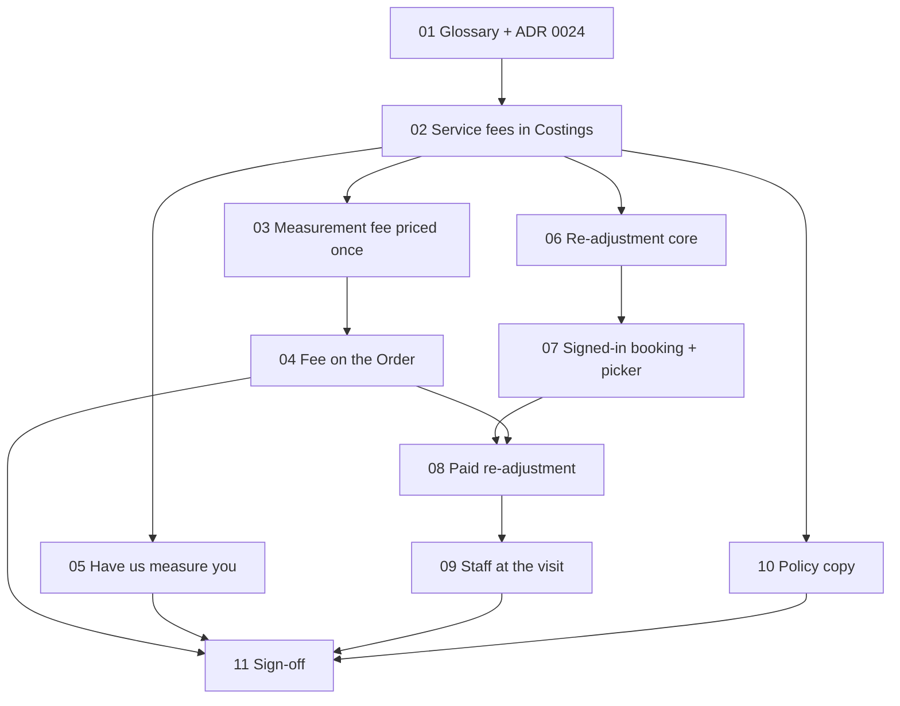

# Service fees and re-adjustment: vertical slices (issues)

This is a tracer-bullet breakdown of the PRD (`../service-fees-readjustment-prd.md`). Each slice is a thin, demoable path through every layer: schema, API, client, copy and tests.

**Triage label:** `needs-triage` (all slices)
**Tracker:** not yet published to GitHub. Publish the PRD as the umbrella issue and link each slice here.

## Slices

| # | Title | Type | Status | Blocked by | User stories |
|---|-------|------|--------|------------|--------------|
| [01](01-glossary-and-adr.md) | Glossary and ADR 0024: a service is a price without a part | AFK | **done** | none | underpins all |
| [02](02-service-fees-in-costings.md) | Service fees in Costings: table, reader, *Costings → Service fees* page, complimentary rule | AFK | **done** (migration to apply) | 01 | 1–3 |
| [03](03-measurement-fee-priced-once.md) | Measurement fee priced through one helper on every Result surface, plus the hold attribution fix | AFK | **done** | 02 | 5, 6, 9–11 |
| [04](04-fee-on-the-order.md) | The fee on the Order as its own line, kept out of shipping, RMA and commission, and shown wherever money is shown | AFK | **done** (migration to apply) | 03 | 5, 8 |
| [05](05-have-us-measure-you.md) | *"Have us measure you"*: configurator entry and the fee on the customisation booking page | AFK | **done** | 02 | 7 |
| [06](06-readjustment-core.md) | Re-adjustment core: `readjustment_bookings`, `evaluateReadjustment()`, the purchase loader | AFK | **done** (migration to apply) | 02 | 13, 15, 19 |
| [07](07-signed-in-booking-and-picker.md) | Signed-in re-adjustment booking: sign-in gate, purchase picker, complimentary visit end to end | AFK | **done** | 06 | 12–15, 17, 19 |
| [08](08-paid-readjustment.md) | Paid re-adjustment: service Order, Stripe Checkout, slot hold, webhook settlement, expiry | AFK | **done** | 04, 07 | 16, 18 |
| [09](09-staff-at-the-visit.md) | Staff at the visit, and the customer's way in from their order | AFK | **done** (see deferred) | 08 | 20–23 |
| [10](10-policy-copy-one-source.md) | Policy copy that reads its numbers from Costings and stops contradicting itself | HITL | **built — owner to approve wording** | 02 | 4 |
| [11](11-signoff.md) | Sign-off: staging, real test cards, both locales, a handset | HITL | **not started** | 04, 05, 09, 10 | all |

## Build notes (2026-10-13)

Slices 01–10 are built on `claude/service-fees-readjustment-di9g2w`. Before
slice 11 can start:

- **Apply three migrations with `supabase db push`:**
  - `20261013100000_service_prices.sql`
  - `20261013110000_order_items_kind.sql`
  - `20261013120000_readjustment_bookings.sql`

  Code that reads the new columns fails until they exist.
- **Owner sign-off on slice 10's wording**, en-US and zh-CN.

Where the build differs from the issue text, so the issues are not read as
promises:

- **Owner change, 2026-10-13: Mbolster has no measurement fee.** This replaces
  decision (c)'s Basic rate. `measurementServiceKey` returns nothing for a
  bolster, the Mbolster configurator offers the studio visit with no fee, and
  the copy reads "none for Mbolster". Mbolster re-adjustments are unchanged
  (always charged).

- **03:**
  - The shared rule is `resultServiceLines` / `loadResultServiceLines`, called
    beside `priceComposedBuild` rather than folded into one charge-line list.
    `pricing-surface.check.ts` asserts every surface calls it.
  - Assign keeps its own pricing copy; moving it onto `loadAssignedBuild` was
    left out to keep this change's risk down.
  - The Mbolster preview still shows the shelf price, plus the fee row.
  - The hold route now stamps a **fresh** row with the Staff profile working
    the device, which the issue did not spell out. Mbolster mints its Result
    id at hold, so without this a Staff-measured bolster was never charged.
- **04:** platform Analytics reads `order_margins` per Order, not per line, so
  service revenue is counted there with no new "Services" series. Commission
  needed no change: it already skips lines without a pillow or bolster
  snapshot.
- **07:** the guest booking route now refuses `appointment_type =
  readjustment`, so the sign-in requirement cannot be bypassed through the API.
- **09, deferred:**
  - the calendar chip's fee marker;
  - the `needs_reschedule` banner (the Telegram alert and the customer email
    cover it for now);
  - the Profile "Upcoming re-adjustment" card.

  The event sheet's Re-adjustment panel and the order-page entry point are built.
- **10:**
  - `{freeVisits}` is not interpolated; the copy says "one free visit". Raising
    the count in Costings → Service fees therefore also needs a copy edit.
  - "Doorstep surcharge" stays literal (out of scope).

Review fixes after the build (2026-10-13):

- **Results priced before the fee.** A Result whose `final_amount` was set
  before deploy is accepted at that amount, with no fee line
  (`quotedServiceLines`). The status page and accept agree on it.
- **Exactly-once calendar writes.** Both booking paths record the event id the
  moment Google creates it (`bookCalendarSlot`'s `onEventCreated`). A paid
  booking retried after a partial failure finishes instead of reading its own
  event as a clash. A free booking whose invite went out is kept, never
  cancelled.
- **Holds everywhere a slot is offered.** The WhatsApp reschedule list
  subtracts live Checkout holds, like the booking page does.
- **A $0 re-adjustment fee means every visit is free.** It books through
  `/api/readjustments/book` with no Order (`isFreeVisit`); Stripe never sees
  it. Costings refuses a re-adjustment fee between $0.01 and $0.49, which
  Stripe cannot charge.
- **Costs stay with Costings.** The Appointments-facing fee route and the Order
  snapshot carry prices only.
- **Known gaps, not fixed here:**
  - "Measured by" locks once a Result is held, so a wrong value cannot be
    corrected afterwards.
  - Tax on services assumes exclusive tax; tax is off today.
  - Costings can drift between assign and accept, which predates this work.

## Dependency graph

After 02 there are two parallel tracks: **measurement** (03 → 04 → 05) and **re-adjustment** (06 → 07 → 08 → 09). They meet at 08, which needs 04's `order_items.kind`.

## Build order

1. **01 first, and it is not ceremony.**
   - "Service" is about to be the word for a priced act of labour, and "fee" already means a negative Stripe dispute fee in the money ledger (`order_payments.type = 'fee'`, `20260630130001_money_ledger.sql:22-25`).
   - "Re-adjustment" already names an **Appointment** type.
   - The `_Avoid_` lines stop a **Service fee** being modelled as an **Item** or an **Add-on**, which is the mistake this whole PRD exists to prevent.
2. **02.** Additive and inert: a table, a reader and a page. Nothing charges yet. It ends with an operator editing $50 → $55 and seeing it persist and audit.
3. **03 and 04 together.** 03 is the pricing core; 04 makes the **Order** and every receipt agree with it. **They must reach production in the same deploy** (see the hazard below).
4. **05** at any point after 02. It is copy and a link.
5. **06 → 07 → 08 → 09.**
   - 06 is pure and testable with no UI.
   - 07 is the tracer bullet for the customer flow and moves no money.
   - 08 is the only re-adjustment slice that takes money.
   - 09 is the **Staff** side and the order-page entry point.
6. **10** at any point after 02. It needs owner sign-off on wording, so start it early.
7. **11** closes it.

**Ordering hazard, stated once because it decides a deploy rather than a build:** 03 alone makes every **Result** total include the fee, while accept still writes a single `order_items` row at the goods subtotal (`app/api/results/[id]/accept/route.ts:369-388`). The **Order**'s lines would then not sum to its subtotal, and the receipt would not explain the difference. If only one can ship, ship neither, or ship 03 with all three `service_prices.msrp` at 0.

**Second hazard, smaller but load-bearing:** the hold route's `measured_by_type: "by_user"` (`app/api/results/hold/route.ts:676`) must be fixed **in slice 03's PR**, not as a follow-up. Before this PRD it is a latent attribution bug. After 03 it silently drops the measurement fee from every **Staff assist mode** sale.

## What the research ruled out, so it is not re-litigated

- **Fees as Items.** Every **Result** build line is stock-checked at assign, finish, accept and reorder, and deducted at accept. A fee Item would also need a category, a stock exemption in six places and an exclusion from **Add-ons** and shop listings. ADR 0001 rejected a flag on `items` for the same reason.
- **Fees in `site_settings`.** It is the simplest store, but it would be a second write surface for sell price, with untyped public TEXT and no cost, currency or audit. Costings is the single source of sell price.
- **Fees as `product_prices` rows.** This means relaxing its `kind` CHECK and blurring "finished-good MSRP of a **Composed sellable**". A sibling table is one migration.
- **The fee as an `addon_lines` entry on the Result.** The configurator keeps only `accessories` add-ons (`mp-config-client.tsx:1602-1610`), so a Staff reconfigure would drop it. The entry would be stock-checked, and reorder copies `addon_lines`.
- **A stored "fee applies" flag on the Result.** The fact is already recorded as `measured_by_type`. A second column would be a second source of truth that could disagree with the first.
- **Creating the calendar event before payment.** `sendUpdates: "all"` would send every abandoned checkout a Google invite and then a cancellation. The slot is held in our database instead.
- **A re-adjustment payment that is not an Order.** Analytics, the money ledger, refunds, disputes and receipts all key on `orders`. A payment recorded only on the booking would be invisible to all of them.
- **Anything Shopify** (owner, 2026-10-13). Shopify is ad hoc and not on the roadmap. None of these slices adds any of the following:
  - email on the Shopify order mirror;
  - a Shopify purchase in the picker;
  - a mapping for Shopify's retired "services" product;
  - a price push to Shopify.

  Shopify-era customers book through *not listed*. A slice that reaches for `lib/shopify/` is off-plan.

## HITL notes

- **Slice 10 needs the owner** to approve the reconciled policy wording in en-US and zh-CN. In particular it replaces *"Customisation charge for every hour: $50"* with a flat measurement fee.
- **Migrations (02, 04, 06)** are applied with `supabase db push`, never the MCP `apply_migration` tool, which stamps its own version and desyncs the ledger from `supabase/migrations/`.
- **No Stripe Dashboard change is expected.** Slice 08 rides `checkout.session.completed` and `checkout.session.expired`, which the shop already handles. Slice 08's notes must still confirm that both are subscribed on the live endpoint.
- **Every slice refreshes the knowledge graph** (`rm -rf graphify-out/cache && ./scripts/graphify update .`) in the same commit, or `graphify-freshness` fails the PR.
