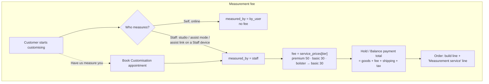
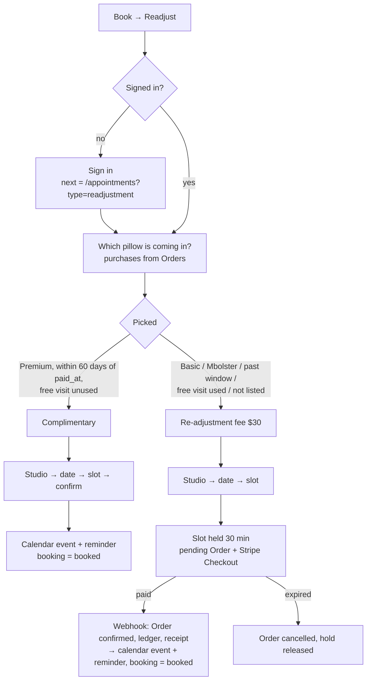

# PRD: Service fees — measurement and re-adjustment, priced in Costings and charged where the work happens

Status: Built (slices 01–10) — migrations to apply, owner wording sign-off (10) and staging sign-off (11) pending
Source: Planning session 2026-10-13. The owner asked for three operator-set fees: **Measurement fee (Premium) $50**, **Measurement fee (Basic) $30** and **Re-adjustment service $30**. They should be easy to find in the **Admin Panel**, added to the total automatically when the service happens, and re-adjustment should need **Sign in** plus a choice of which purchased pillow or bolster it is for. A codebase audit during drafting found that none of the three services exists on the platform. They exist only as a retired Shopify product ("Measurement and Readjustment Services", `info/GET-from-shopify.md:928-968`), and no code references it.
ADRs: `docs/adr/0024-services-priced-in-costings.md` (new, slice 01 — a service is a price without a part); `docs/adr/0001-costings-single-price-source.md` (amended by 0024: Costings now prices services as well as Items and Composed sellables); `docs/adr/0002-authorize-then-capture-customised-goods.md` and `docs/adr/0016-deferred-payment-for-assisted-builds.md` (the money paths the measurement fee rides on, unchanged); `docs/adr/0011-returns-rma-lifecycle.md` (the eligibility-function pattern the re-adjustment rule copies); `docs/adr/0013-custom-multi-location-booking.md` (the first-party booking flow re-adjustment extends)
Glossary: `CONTEXT.md` — **Costings**, **MSRP**, **Item**, **Add-on**, **Result**, **Order**, **Staff**, **Staff assist mode**, **Assisted customisation**, **Partner-assisted customisation**, **Authorization hold**, **Balance payment**, **Appointment**, **Re-adjustment appointment**, **Customisation appointment**, **Sign in**, **Customer**, **Location**. New terms: **Service**, **Service fee**, **Measurement service**, **Re-adjustment**, **Complimentary re-adjustment**, **Re-adjustment booking**.

## Decisions taken before drafting

Owner decisions (2026-10-13), not to be re-litigated in build:

- **(a) Three fees, set in the Admin Panel.** Measurement (Premium) $50, Measurement (Basic) $30, Re-adjustment $30.
- **(b) The measurement fee is charged when Staff measure the customer.** Measuring yourself online stays free. The configurator also offers *"Have us measure you"* for customers who would rather come in.
- **(c) Mbolster carries no measurement fee.** Revised by the owner on 2026-10-13: it originally borrowed the Basic rate. A Staff-measured bolster is charged nothing for measuring. Mbolster re-adjustments are still charged; see (e).
- **(d) Re-adjustment requires Sign in.** A customer with several pillow or bolster purchases chooses which one the visit is for.
- **(e) One complimentary re-adjustment per Premium Mpillow, within 60 days of the purchase date.** It is a one-time visit. After the window, or once the free visit is used, the re-adjustment fee applies. Basic Mpillow and Mbolster always pay. This matches the warranty page (`components/marketing/returns-warranty-page.tsx:61, 355-366`). It overrules the `pricingNotes` line, which says the opposite (see *Problem Statement*).
- **(k) Nothing here links to or syncs with Shopify.** Shopify is ad hoc and not on the roadmap. Shopify orders are not matched to **Customers**, and service prices are not pushed to Shopify. Shopify's retired "services" product is neither mapped nor read. A pillow bought on Shopify is booked through *"My pillow isn't listed"*.

Drafting decisions. Each is reasoned below and each can be reversed in one place:

- **(f) Fees live in Costings as non-inventory rows (`service_prices`).** They are not **Items** and not `site_settings`. Slice 02 explains why.
- **(g) The measurement fee is derived, not stored.** It comes from the **Result**'s existing `measured_by_type` on every repricing. There is no new Result column and no client-supplied amount.
- **(h) A paid re-adjustment is an Order with one service line.** It goes through the existing shop-order webhook branch, so the ledger, receipt, refunds and Analytics all come for free.
- **(i) Eligibility is judged on the day of booking, anchored on `orders.paid_at` in Singapore calendar days.** The price is known before the customer picks a slot, and a full diary never costs them the free visit.
- **(j) One booking re-adjusts one pillow.** A couple with two pillows books twice.

## Problem Statement

### Measuring is work we do and never charge for

**Staff** measure customers in the studio every day, and the platform records it. Since migration 0025, every **Result** carries `measured_by_type` (`by_user` | `staff`) and `measured_by_staff_id` (`supabase/migrations/0025_staff_management.sql:41-57`). A **Staff** device's "working as" profile stamps it when the Draft is created (`app/api/mp-config/responses/route.ts:358-365`). In-store finalize refuses to proceed without it (`responses/route.ts:416-428`).

The price ignores that fact. A **Result** total is `priceComposedBuild` (Costings row, cover/case deltas and **Add-on** MSRPs) plus shipping and tax (`lib/result-pricing/index.ts`), so a build measured by **Staff** costs exactly what a self-measured build costs. The fee the business used to charge on Shopify (`MRS-MS-PRM` $50, `MRS-MS-BSC` $30) has no counterpart here. Today it is either forgotten or keyed in by hand somewhere outside the money path.

### Re-adjustment is an anonymous calendar entry

**Re-adjustment appointment** booking is first-party (ADR 0013) and already has its own type (`/appointments?type=readjustment`, `lib/appointments/appt-type.ts`). It is entirely anonymous:

- **No sign-in.** `POST /api/appointments/book` takes name, phone and email in the body and nothing else (`app/api/appointments/book/route.ts:19-27`).
- **No link to a purchase.** The only persisted row is `appointment_reminders`, keyed by calendar event id, whose header reads *"no Order/Customer link in v1"* (`supabase/migrations/20260709120000_appointment_reminders.sql`). CONTEXT.md says the same: appointments "are not linked to Orders in v1".
- **No payment.** `PRD-locations-booking` lists "Online payment / deposit at booking" as out of scope.

So the person behind the counter knows nothing at the visit: which pillow is coming in, when it was bought, or whether this visit is free. The warranty page's *"Proof of purchase must be presented"* (`returns-warranty-page.tsx:359`) is, operationally, staff asking the customer to find an email.

### The policy is published, contradictory, and unmodelled

The 60-day rule exists only as copy, and the copy disagrees with itself:

| Where | What it says |
|---|---|
| `lib/i18n/messages/en-US.ts:270-274` (`pricingNotes`) | *"Readjustment charge: $30 within 60 days of purchase"* — i.e. you pay inside the window |
| `en-US.ts:313-315` (`commitmentReadjustment*`) | *"one-time complimentary visit within the initial 60 days post-purchase. Beyond this period or for additional adjustments, a re-adjustment fee of $30 applies"* |
| `returns-warranty-page.tsx:47, 61` | Premium: *"1 free adjustment within 60 days, then $30 per visit"*; Basic: *"$30 per adjustment"*; Mbolster: unspecified |
| `zh-CN.ts:257-261, 298-300` | Mirrors both English versions, contradiction included |

Nothing in code computes the rule: no window setting, no free-visit counter, no `site_settings` key. The fee amounts are hard-coded as `$30` and `$50` in at least four strings, so the day an operator changes a fee, the website starts lying.

### Six findings from the audit that decide the build

1. **A service cannot be an Item.**
   - Every **Result** build line, **Add-ons** included, is stock-checked by `findStockShortages` (`lib/build-assembly/index.ts:164-186`). That check runs at assign (`app/api/results/[id]/assign/route.ts:337-352`), finish, accept and reorder.
   - Accept then writes a −qty inventory transaction for each line (`accept/route.ts:467-480`).
   - A fee Item with no stock would block every sale with a 409. It would also show up in the on-hand stock KPIs and, if categorised `accessories`, as a configurator **Add-on** and a shop listing.
   - Making it work needs a new category plus at least six exemptions. ADR 0001 already rejected a flag on `items` for this kind of reason.
2. **`site_settings` would be a second write surface for sell price.**
   - Its values are untyped public TEXT (`20260308000000_create_site_settings.sql`) with no cost, currency or audit trail.
   - CONTEXT.md:35-37 and ADR 0001 say price is written in exactly one place.
3. **Five surfaces price a Result by hand.** Each builds the same `[...addonLines, ...placedChargeLines]` list itself:
   - hold `app/api/results/hold/route.ts:489-503`
   - assign `assign/route.ts:371-377`
   - `lib/results/assigned-build.ts:262-268`
   - the status API `app/api/results/[id]/route.ts:171-181`
   - the preview `app/[lang]/mp-config/mp-config-client.tsx:2270-2295`

   `lib/pricing/pricing-surface.check.ts:108` already insists they all call `priceComposedBuild`. A fee added surface by surface will drift by the second PR.
4. **The hold route erases the fact the fee depends on.**
   - It writes `measured_by_type: "by_user"` unconditionally (`app/api/results/hold/route.ts:676`), including when it updates an existing Draft (`:776-783`).
   - On a Draft a **Staff** device stamped as staff-measured, the update either trips the 0025 check constraint, leaving `by_user` with a non-null `measured_by_staff_id` (a 500 at hold), or erases the attribution.
   - Once the fee keys on that column, the same bug would silently drop $50 from every **Staff assist mode** sale.
5. **Shipping assumes every order line is a parcel.**
   - `loadOrderShippableLines` classifies a line with no variant and no snapshot as `"pillow"` (`lib/shipping/lines.ts:79-82`).
   - `order_items` has no line-kind column (`0028_ecommerce.sql:456-468`).
   - Inventory deduction already skips variant-less lines (`lib/ecommerce/inventory-deduction.ts:139, 260`). The courier path does not.
6. **Only platform Orders can be listed, and that is the intended scope.** The picker reads the signed-in **Customer**'s `orders` (RLS through `current_customer_id()`).
   - Purchases made before customer accounts existed, in store, or on Shopify have no platform **Order**.
   - Per decision (k), they are not imported or linked. They are booked as *not listed*, at the re-adjustment fee, and **Staff** refund on proof of purchase.

## Solution

**From an operator's perspective:** a new **Service fees** entry under **Costings** in the **Admin Panel** sidebar. One small page lists three rows (Measurement (Premium), Measurement (Basic), Re-adjustment), each with an MSRP and an optional cost, saved like every other Costings price and recorded in the Audit Log. Beneath the Re-adjustment row sits the complimentary rule: *"[1] free visit per Premium Mpillow within [60] days of purchase"*. Change $30 to $35 and every surface follows: totals, emails, the booking page, the policy copy. Nothing needs a deploy.

**From a customer measured in the studio:** the preview's Ballpark shows a line, *"Measurement service (Premium) · $50"*, the moment the **Staff** profile working the device is recorded as measuring. The same line appears on the authorization hold, the status page, the "your build is ready" email, the **Order** and the receipt. A customer measuring themselves at home never sees it. If they would rather not measure themselves, the configurator's first screen offers *"Prefer our team to measure you? Book a studio measurement — $50, paid with your pillow"*, which leads to the existing customisation booking.

**From a customer whose pillow needs adjusting:** *Book → Readjust* asks them to sign in, because *"we need to know which pillow is coming in and when you bought it"*. They see their pillows and bolsters as cards (photo, name, order number, purchase date), each with a badge:

- *"Complimentary visit available until 12 Dec"*
- *"$30"*
- for a Premium already past the window: *"$30 · complimentary window ended 3 Nov"*

They pick one, then a studio, date and slot, with contact details prefilled from their account. A free visit books in one tap. A paid one goes through Stripe Checkout, and the slot is held for them while they pay. *"My pillow isn't listed"* is always there: it books at the re-adjustment fee and notes where they bought it, and **Staff** can refund on proof.

**From Staff at the visit:** the calendar event already says *"Premium Mpillow · Size M · Order #1042 · bought 3 Sep · Complimentary"*, or *"Paid $30 · Order #1077"*, or *"Not listed — check proof of purchase"*. One tap marks the visit attended or a no-show.

**From a developer's perspective,** three ideas keep this small:

> **A service is a price without a part.**

Services are priced in Costings, in their own table, and are never an **Item**, never a build line and never stock-checked. They enter every total through one function in `lib/pricing/`, next to `priceComposedBuild`, so the five hand-built surfaces cannot disagree.

> **The measurement fee is a fact about who measured, not a choice in a cart.**

The platform already records who measured, so the fee is derived from `measured_by_type` and the **Tier** on every repricing. It needs no new column, no client-supplied amount and no "add fee" button for anyone to forget. The fee follows the existing **Authorization hold** and **Balance payment** paths unchanged (ADR 0002, ADR 0016).

> **Every dollar we take is an Order.**

A paid re-adjustment is an **Order** with one service line, created pending and settled by the same `checkout.session.completed` branch every shop order uses. It therefore gets the money ledger, the receipt email, refunds, disputes and Analytics with no new settlement code. A complimentary one is a **Re-adjustment booking** with no Order, because no money moved.

### The two flows





### What ships

1. Glossary entries and ADR 0024 (services are priced in Costings as non-inventory rows), plus an amendment line on ADR 0001.
2. **Service fees** in the **Admin Panel**: a `service_prices` table seeded 50 / 30 / 30, a reader in `lib/pricing/`, a page at **Costings → Service fees**, and the complimentary rule beside it.
3. The measurement fee priced through one helper on every **Result** surface, with the hold-route attribution bug fixed in the same change.
4. The fee on the **Order** as its own line (`order_items.kind = 'service'`), kept out of shipping, inventory, RMA, commission and the free-shipping threshold, and shown everywhere money is shown.
5. *"Have us measure you"* in the configurator and the fee on the customisation booking page.
6. The re-adjustment core: a `readjustment_bookings` table, a pure eligibility function, and a purchase loader.
7. Signed-in re-adjustment booking: the sign-in gate, the purchase picker, and a complimentary booking end to end.
8. Paid re-adjustment: the service **Order**, Stripe Checkout, the slot hold, settlement by webhook, and the expiry path.
9. **Staff** at the visit, and the customer's way in: event detail, attended/no-show, *"Book a re-adjustment"* on the account order page, and the not-listed flag.
10. Policy copy that reads its numbers from Costings and stops contradicting itself (en-US, zh-CN, the warranty page).
11. Staging sign-off with real Stripe test cards, both locales and a handset.

## User Stories

### Setting the fees

1. As an operator, I want to set the three service fees in one obvious place in the **Admin Panel**, so that I do not have to ask a developer to change a price.
2. As an operator, I want the fees saved with the same permission, audit trail and currency as every other price, so that a fee change is as accountable as an MSRP change.
3. As an operator, I want to set how many free re-adjustments a Premium Mpillow gets and for how many days, so that the policy can change without a deploy.
4. As an operator, I want the website's policy copy to show the fees I set, so that a price change never leaves the site quoting the old one.

### Being measured

5. As a customer measured by **Staff**, I want the measurement fee shown as its own line before I authorize payment, so that I know what I am paying for.
6. As a customer measuring myself online, I want no measurement fee, so that the self-service path stays free.
7. As a customer who would rather not measure myself, I want an obvious way to book a studio measurement and to see what it costs, so that I can choose before I travel.
8. As a customer, I want the measurement fee on my receipt and **Order** as a separate line from the pillow, so that the two are not confused.
9. As **Staff**, I want the fee added automatically when I am recorded as measuring, so that I never have to remember to charge it.
10. As **Staff**, I want correcting "Measured by" before assignment to correct the fee, so that a mis-tapped profile does not overcharge a self-measured customer.
11. As **Staff**, I want a bolster I measured to carry no measurement fee, so that bolster customers are never charged for it.

### Re-adjusting

12. As a customer, I want to be asked to sign in before booking a re-adjustment, and told why, so that the requirement feels like a service rather than a hurdle.
13. As a customer with several pillows, I want to pick the one I am bringing in, so that **Staff** prepare for the right one.
14. As a customer with exactly one pillow, I want it preselected, so that I am not asked a question with one answer.
15. As a customer with a Premium Mpillow bought within the last 60 days, I want to see that my visit is free and until when, so that I book before the window closes.
16. As a customer whose visit is charged, I want to pay when I book and have my slot held while I pay, so that I do not lose the time I chose.
17. As a customer, I want my name, phone and email prefilled from my account, so that I do not type them again.
18. As a customer whose pillow is not listed (bought online or in store before accounts existed, or received as a gift), I want to book anyway, so that the system's gap does not become my problem.
19. As a customer who cancels a complimentary booking, I want my free visit back, so that a reschedule does not cost me $30.
20. As a customer, I want to start a re-adjustment from my order page next to the pillow, so that I do not have to find the booking page.

### At the visit

21. As **Staff**, I want the calendar event to name the pillow, its order, its purchase date and whether the visit is free or paid, so that I do not ask the customer for proof of purchase.
22. As **Staff**, I want bookings for unlisted pillows flagged for a proof-of-purchase check, so that I know which ones to verify.
23. As **Staff**, I want to mark a visit attended or a no-show, so that the free-visit count and the service **Order** reflect what happened.

## Design

### Where the fees live: Costings → Service fees

```
Admin Panel ▸ Inventory ▸ Costings ▸ Service fees                     [Save]

Services are priced here like everything else: this is what the customer pays.

  Service                          MSRP (SGD)   Cost (SGD)   Charged when
  ───────────────────────────────  ──────────   ──────────   ─────────────────────────────────────────
  Measurement service (Premium)      50.00         —         Staff measure a Premium Mpillow customer
  Measurement service (Basic)        30.00         —         Staff measure a Basic Mpillow customer (never Mbolster)
  Re-adjustment service              30.00         —         A re-adjustment is booked and isn't complimentary

  Complimentary re-adjustment — Premium Mpillow only
    [ 1 ] free visit per pillow within [ 60 ] days of purchase
```

- **Route:** `/settings/costings/services`. It is a child of **Costings** in `NAV_GROUPS` (`components/settings/settings-sidebar-nav.tsx:74`), as **Configure** is a child of **Products**. It is guarded by the existing `costings` **Permission**, so it needs no new catalog key and no role-seed migration. The Appointments settings sheet's re-adjustment section shows the current fee and rule read-only, with *"Edit in Costings → Service fees"*.
- **Storage:** `service_prices(key text primary key check (key in ('measurement_premium','measurement_basic','readjustment')), msrp numeric(12,2) not null check (msrp >= 0), cost_price numeric(12,2) null, currency text not null default 'SGD', updated_at)`.
  - It is seeded with 50 / 30 / 30.
  - RLS is on with no policies; reads go through the server.
  - The keys are a closed set because each one is wired to a rule in code. A fourth service is a migration plus a rule, never a row an operator invents.
- **The complimentary rule:** `site_settings` keys `readjustment_free_visits` (default 1) and `readjustment_free_window_days` (default 60), written by the same save route under the same permission. Premium-only is code (decision (e)), not a setting.
- **Why not reuse `product_prices`:** it would need its `kind` CHECK relaxed (`0009_product_prices.sql:4`), and CONTEXT.md defines it as "finished-good MSRP of a **Composed sellable**". A service is not one. A separate table costs one migration and blurs nothing.

### Measurement fee rules

The fee is `service_prices[measurement_<tier>]` when `measured_by_type = 'staff'`. Otherwise it is zero.

- **Tier:** `assigned_tier ?? suggested_tier`. A Basic flow upsold to Premium pays the Premium fee.
- **Bolster:** `product_type = 'bolster'` carries no measurement fee (decision (c)).

| Path | `measured_by_type` | Fee |
|---|---|---|
| Guest self-measures online (`/mp-config`, `/mp-basic`, `/mbolster-config`) | `by_user` | none |
| **Staff assist mode** (shared studio device, working-as profile) | `staff` | tier fee |
| In-store measurement, finalised from the Results list (`source = 'manual'`) | `staff`, required at finalize | tier fee |
| **Assisted customisation**, customer on a **Staff** device | `staff` | tier fee |
| **Assisted customisation**, customer alone on their own device | `by_user` | none |
| **Partner-assisted customisation** (the partner's device, not **Staff**) | `by_user` | none |
| Shop-cart customiser (`/mp-maker`) | n/a, priced by `quoteCustomization` | none |
| Reorder of an expired or declined build | copied (`lib/results/reorder.ts:38-39`) | same as the original, which was never paid |

- **The fee moves with "Measured by" until assignment freezes it.**
  - Correcting **Measured by** in the Results list re-prices at the next repricing (assign, finish, request-payment, accept), exactly like a Costings change.
  - An **Authorization hold** taken before a correction is reconciled by the existing `planCapture`: a top-up if the final total is higher, a partial capture if lower.
  - The **Order** snapshot freezes it.
- **What the fee counts toward:**
  - It **does not** count toward a shipping method's `free_above` threshold, which is tested on the goods subtotal (`lib/ecommerce/shipping.ts:29-34`).
  - It **does not** count toward a partner's commission base, which is `build.basePrice`, the Costings row only (`accept/route.ts:422-441`).
  - It **is** part of the taxable base when GST is switched on. In Singapore a service is standard-rated like goods. `DEFAULT_TAX_RULES` is empty today (`lib/ecommerce/tax.ts:79`), so nothing changes now.

### Re-adjustment eligibility rules

`evaluateReadjustment(purchase, priorBookings, policy, today)` is pure, mirrors `evaluateEligibility` (`lib/rma/eligibility.ts:41`), and returns `{ complimentary: boolean, fee, reason, freeUntil? }`.

| Purchase | Premium Mpillow | Basic Mpillow | Mbolster | Not listed |
|---|---|---|---|---|
| Within the window, free visit unused | **Free** | Fee | Fee | Fee |
| Within the window, free visit used | Fee | Fee | Fee | Fee |
| After the window | Fee | Fee | Fee | Fee |

- **Window:**
  - The booking date (SGT) must be ≤ the `orders.paid_at` date (SGT) + `readjustment_free_window_days`.
  - The day of purchase is day 0.
  - The anchor is `paid_at` because the owner said *purchase date*. RMA anchors on `delivered_at`, but that is a different policy.
- **Free visits:**
  - Each unit gets `readjustment_free_visits` free visits.
  - Units on a line = `order_items.quantity − returned_quantity`, so a line of two Premium pillows earns two.
  - A booking in `booked`, `attended` or `no_show` uses one. `cancelled` and `expired` give it back.
- **Race-safety:**
  - Complimentary bookings carry `complimentary_seq` (1..N).
  - A partial unique index on `(order_item_id, complimentary_seq) where complimentary and status in ('booked','attended','no_show')` makes two tabs claiming the last free visit fail one of them at the database, not in a read-then-write.
- **Which purchases are listed:**
  - The customer's own **Orders**: `paid_at` is not null and `status` is not in `pending`, `cancelled`, `refunded` or `payment_failed`.
  - Lines with `kind = 'goods'` that classify as a pillow or bolster, with units left after returns.
  - Classification reuses the `loadOrderShippableLines` rule (`lib/shipping/lines.ts:79-82`):
    - **Tier:** `pillow_products.kind` for a shop variant, `customization_snapshot.assigned_tier` for a **Result** order.
    - **Length:** comes from the variant or the snapshot.
  - Newest first.
  - **Results** add the build only, never a second row: a captured **Result** is already its Order's line (`customization_snapshot.result_id`), and an uncaptured one is not a purchase.

### The customer's re-adjustment flow

| Step | Screen | Notes |
|---|---|---|
| 0 | `/appointments` → **Readjust** pill (or *Book a re-adjustment* on an order line) | The Customise path is unchanged and stays guest-friendly |
| 1 | **Sign in to book a re-adjustment** — *"We need to know which pillow is coming in and when you bought it. It's how we know whether your visit is free."* | `/account/login?next=<withLocale('/appointments?type=readjustment')>`. Gated in the server component, not just the client |
| 2 | **Which pillow are we re-adjusting?** Cards with photo, name (*Premium Mpillow · Size M*), *Order #1042 · bought 3 Sep 2026*, and a badge | One purchase means it is preselected. `?item=` preselects from the order page. *My pillow isn't listed →* is always last |
| 2b | Not listed: *"Where did you buy it?"* (online, before accounts · in store · gift · other) plus an optional order or receipt number | Always charged; flagged for Staff to check proof |
| 3 | Studio → date → slot | The existing `BookingFlow` controls. Slots exclude live payment holds |
| 4 | **Your details**, prefilled from `customers`; email locked to the account | The invite and the purchase identity must match |
| 5 | Summary: *Re-adjustment · Premium Mpillow · Size M · Order #1042 · Studio, Fri 14 Nov, 2:30 PM* — **Complimentary** → *Confirm booking*; or **$30.00** → *Pay $30 and book* | The price shown is the server's eligibility answer, re-checked at submit |
| 6 | Confirmation: the existing screen plus *"Complimentary visit"* or *"Paid · receipt sent"*, and the `.ics` | After paying, Stripe returns here |

**When there is nothing to list:** *"We couldn't find a pillow or bolster on this account."* It offers *Signed in with a different email? Switch account* and *My pillow isn't listed →*.

### Paid booking mechanics

1. **Start checkout.** `POST /api/readjustments/checkout` (signed in):
   1. Re-derives the purchase scoped to `customer_id`, as `rma/route.ts:52-61` does. The client's id is never trusted.
   2. Re-evaluates eligibility. A complimentary answer returns 409 and tells the client to use the free path.
   3. Re-checks `freeBusy` together with live holds.
   4. Inserts the **Re-adjustment booking** as `awaiting_payment` with `hold_expires_at = now + 30 min`.
   5. Inserts a pending **Order** with one `kind = 'service'` line (`service_key = 'readjustment'`).
   6. Creates a Stripe Checkout Session: ad-hoc `price_data`, `expires_at = hold_expires_at` (30 minutes is Stripe's minimum), metadata `{ order_id, purpose: 'readjustment', readjustment_booking_id }`.
   7. Stores `stripe_session_id` on the Order.
2. **Payment succeeds.** `checkout.session.completed` runs the existing `order_id` branch unchanged (`app/api/stripe/webhook/route.ts`): confirmed, `paid_at`, ledger, receipt. Inventory deduction is a no-op because the line has no variant (`inventory-deduction.ts:139`). One new step follows. When `purpose === 'readjustment'`, `finalizeReadjustmentBooking`:
   - is idempotent on `calendar_event_id`;
   - re-checks `freeBusy`;
   - creates the event, upserts the reminder row, and sends the WhatsApp confirmation;
   - sets the booking to `booked`.

   If someone has written straight into the calendar in the meantime, the booking becomes `needs_reschedule`. Telegram alerts the measurements group and the customer is emailed that we will call to re-time it. The money stays, attached to a real Order.
3. **The session expires.** The existing `checkout.session.expired` branch cancels the Order. The new step marks the booking `expired`, which releases the hold.
4. **Slots respect holds.** `/api/appointments/slots` and both book routes subtract live holds (`awaiting_payment` and `hold_expires_at > now`) from availability. Expired holds are ignored on read even if their webhook is late.

**No Google invite goes out before money is taken.** The event is created on payment, not at checkout. Creating it earlier would send a Google invite (`sendUpdates: "all"`, ADR 0013 amendment) followed by a cancellation for everyone who abandons checkout.

### What Staff see

- **The calendar event.** The summary stays `"{name} - {readjustmentSummaryMatch}"`, so type inference and the RSVP chip are untouched (`lib/appointments/type.ts:21`). The description gains the pillow, the order number, the purchase date and the fee status. A private extended property carries `readjustment_booking_id`, next to the Location id.
- **The Appointments event-detail sheet.** A re-adjustment panel shows the pillow and a link to its **Order**, plus one of: **Complimentary** · **Paid $30** with a link to the service **Order** · **Not listed: check proof of purchase**. Two actions:
  - **Mark attended** sets the booking to `attended`; a service **Order** goes to `delivered` (service rendered).
  - **No-show** keeps the free visit used. **Staff** can cancel the booking instead to restore it.
- **Order detail.** A service line reads *"Re-adjustment service"* or *"Measurement service (Premium)"*, carries no courier panel, and is never offered a label.

## Non-goals

Each of these is a plausible next request, and none is in these eleven slices.

- **Charging the measurement fee on its own** when a measured customer walks away without buying. The fee rides the build's payment. A measurement-only charge is a **Counter payment** or a standalone **Order**, and the owner has not asked for it. Raised as an open question.
- **A per-Result fee waiver.** The fee follows who measured. A discretionary waiver needs an audited override, and nobody has asked for one.
- **Re-adjustment walk-ins and Staff booking on a customer's behalf.** Both need a **Staff**-side booking surface that does not exist today. Walk-ins can still be booked in Google Calendar directly. They are simply not tracked.
- **Refunds on cancellation.** A paid booking cancelled by the customer is refunded, if at all, through the existing **Order** refund. There is no automatic refund rule.
- **Several pillows in one booking.** Book twice (decision (j)).
- **Doorstep visits** (*"Doorstep surcharge: $250"*). They appear only in copy, are not one of the three fees, and stay as copy.
- **Anything Shopify** (decision (k)). Shopify is ad hoc and not on the roadmap:
  - Shopify orders are not linked to **Customers** by email or any other key.
  - Service prices are not synced to Shopify.
  - Shopify's retired "services" product and its variants are not mapped.
  - `service_prices` gets no `shopify_*` columns.

  Customers who bought there use *not listed*.
- **The measurement fee on the shop-cart customiser** (`/mp-maker`). Nobody measures anyone there.

## Constraints and risks

| Risk | Mitigation |
|---|---|
| A fee added surface by surface drifts: the preview says $50 and the hold charges $0 | One helper in `lib/pricing/` feeds all five surfaces, and `pricing-surface.check.ts` is extended to assert every surface calls it (slice 03) |
| The hold route resets `measured_by_type` to `by_user` (`hold/route.ts:676`), silently dropping the fee for **Staff assist mode** | Fixed in slice 03, not separately: the hold keeps the Draft's `measured_by_*`. A test posts a hold over a staff-stamped Draft and asserts both the attribution and the fee |
| Slice 03 alone makes Result totals include the fee while accept still writes one `order_items` row at the goods price, so lines would not sum to the subtotal | **03 and 04 deploy together.** 04 adds the service line at accept. Recorded as the ordering hazard in the issue index |
| A service line is shipped as a pillow (`lib/shipping/lines.ts:79-82` defaults to `"pillow"`) | `order_items.kind` with `'service'` excluded from shippable lines, RMA eligibility and the ship queue (slice 04). A service-only **Order** never reaches Easyship |
| Two tabs claim the last complimentary visit | Partial unique index on `(order_item_id, complimentary_seq)`; the loser gets a 409 and is re-priced |
| An abandoned checkout leaves a slot blocked | The hold dies at `hold_expires_at` (30 minutes, the same as the Session's expiry) and is ignored on read after that, even if `checkout.session.expired` is late |
| Someone writes straight into Google Calendar while a customer is paying | `finalizeReadjustmentBooking` re-checks `freeBusy`. On conflict the booking is `needs_reschedule`, Telegram alerts Staff, the customer is told, and the money stays on a real Order |
| A Premium pillow built and shipped after payment spends part of its 60 days in production | Accepted per the owner's *purchase date*. If it proves unfair, the anchor is one field in `evaluateReadjustment` (`paid_at` → `delivered_at`) |
| Copy hard-codes `$30` / `$50` and contradicts itself | Slice 10 interpolates every fee from `service_prices` and states one rule. Owner approves wording (HITL) |
| A customer signed in with a different email from the one they bought with | The empty state offers *Switch account*. `linkCustomerToAuthUser` already backfills guest orders by email on sign-in (`lib/auth/customer-identity.ts:67, 140`) |
| Customers who bought before accounts existed (online, in store, or on Shopify) see nothing to pick | *Not listed* always works: booked at the fee, flagged for **Staff** to check proof, refunded through the **Order** if it should have been free. No Shopify linking, per decision (k) |
| Migrations applied with the Supabase MCP `apply_migration` tool desync the ledger | Apply with `supabase db push` only (as in `PRD-in-store-counter-payments`) |

## Success criteria

- An operator changes a fee at **Costings → Service fees**, and with no deploy the configurator preview, the next hold, the assigned email, the booking page and the policy copy all show the new number.
- A **Staff**-measured Premium build's hold, final total, **Order** and receipt each carry a $50 *Measurement service (Premium)* line. A self-measured build carries none. A **Staff**-measured bolster carries $30.
- No surface prices a **Result** without going through the shared helper, as asserted by `pricing-surface.check.ts`.
- A **Staff assist mode** hold over a staff-stamped Draft keeps its attribution and its fee.
- A service line is never shipped, never stock-deducted, never returnable through RMA, and never counted in commission or the free-shipping threshold.
- A signed-out visitor cannot book a re-adjustment. A signed-in customer picks from their own purchases only, and the server refuses another customer's line.
- A Premium Mpillow within 60 days of purchase books one free visit. The second costs the re-adjustment fee, and cancelling the free one gives it back. Basic and Mbolster always pay.
- A paid re-adjustment produces exactly one confirmed **Order** with a ledger row and a receipt, and exactly one calendar event, under double-press, a page reload or a late webhook. An abandoned one produces a cancelled **Order** and no event.
- **Staff** see the pillow, order, purchase date and fee status on the calendar event without asking the customer.
- `npm run ci` is green: lint, typecheck, vitest, `next build`, route budgets, the extended pricing-surface check, and a fresh graphify rebuild that matches the committed graph.

## Open questions

Non-blocking. Each has a default the slices build to.

1. **Walk-away measurement.** Should a customer measured in the studio who buys nothing still pay the measurement fee? *Default: no (non-goal).* If yes, it is a follow-up built on **Counter payment**.
2. **Copy wording.** *"Customisation charge for every hour: $50"* (`en-US.ts:271`) describes hourly billing. The fee the owner set is flat. *Default: slice 10 replaces it with "Measurement service: $50 (Premium) · $30 (Basic and Mbolster)"*, pending owner sign-off.
3. **Anchor.** `paid_at` (purchase) or `delivered_at` (received)? *Default: `paid_at`, per the owner.*
