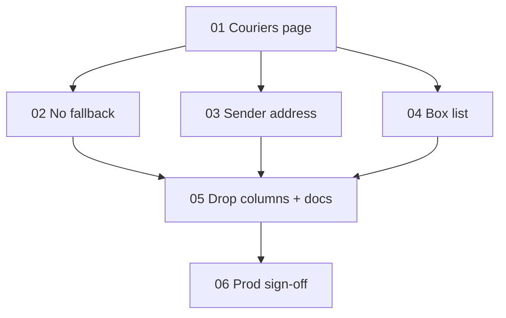

# Shipping › Couriers — Vertical Slices

Breakdown of `../shipping-couriers-prd.md`. Published locally.

| # | Title | Type | Blocked by |
|---|---|---|---|
| 01 | Couriers page, nav, redirect, brand copy | AFK | none |
| 02 | No fallback; live is the default | AFK | 01 |
| 03 | One sender address | AFK | 01 |
| 04 | One box list | AFK | 01 |
| 05 | Drop dead columns + docs | AFK | 02, 03, 04 deployed |
| 06 | Prod sign-off | HITL | 05 |

**Build order:** 01, then 02, 03 and 04 in parallel (02 and 03 both touch `lib/shipping/quote.ts`, so rebase carefully), then 05, then 06.

**Every slice:** `npx vitest run lib/shipping lib/easyship components/settings`, `npm run build`, `npm run bundle:check`, the `.check.ts` files run by hand, and `rm -rf graphify-out/cache && ./scripts/graphify update .` in the same commit. Migrations are applied by hand in the deploy sitting (`supabase db push`).
