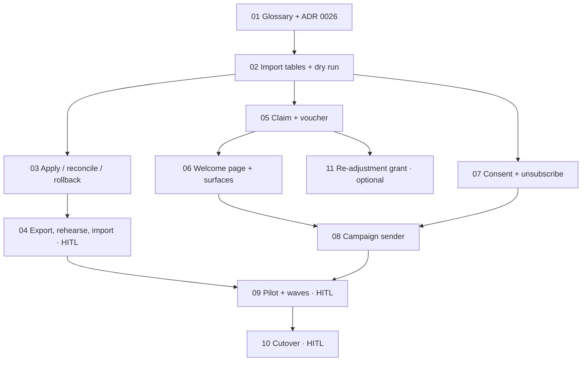

# Shopify customer migration: vertical slices (issues)

This is a tracer-bullet breakdown of the PRD (`../shopify-customer-migration-prd.md`). Each
slice is a thin, demoable path through all layers.

- **Triage label:** `needs-triage` (all slices)
- **Tracker:** not yet filed on GitHub. When filed, the PRD issue links each slice.

## Slices

| # | Title | Type | Status | Blocked by | User stories |
|---|-------|------|--------|------------|--------------|
| [01](01-glossary-and-adr.md) | Glossary and ADR 0026: what moves, what never moves, and what a Claim is | AFK | **not started** | none | underpins all |
| [02](02-import-tables-and-dry-run.md) | Import tables and a dry-run importer that reports and never writes | AFK | **not started** | 01 | 9 |
| [03](03-import-apply-and-rollback.md) | Apply, reconcile and roll back an import batch | AFK | **not started** | 02 | 9, 10, 13 |
| [04](04-export-rehearse-import.md) | Export from Shopify, rehearse on a branch, import into production | HITL | **not started** | 03 | 2, 8 |
| [05](05-claim-and-welcome-back-voucher.md) | Claim on first sign-in, and an account-bound welcome-back voucher | AFK | **not started** | 02 | 2, 3, 7 |
| [06](06-welcome-page-and-surfaces.md) | Welcome page, Claim link, and the account and Admin Panel surfaces | AFK | **not started** | 05 | 1, 3, 6, 8, 11, 12 |
| [07](07-marketing-consent-and-unsubscribe.md) | Marketing consent with provenance, and one-click unsubscribe | AFK | **not started** | 02 | 4, 5 |
| [08](08-campaign-emails-and-wave-sender.md) | Campaign emails, the send ledger, and a wave sender that cannot double-send | AFK | **not started** | 06, 07 | 1, 4, 5, 11 |
| [09](09-pilot-and-waves.md) | Sign-off: DNS, a pilot of 50, then the waves | HITL | **not started** | 04, 08 | all |
| [10](10-cutover-and-shopify-wind-down.md) | Cutover: final delta import, Shopify notices, erasure | HITL | **not started** | 09 | 13 |
| [11](11-optional-complimentary-readjustment.md) | *(optional)* One complimentary re-adjustment for Migrated customers | AFK | **owner decision** | 05 | 7 |

## Dependency graph

## Build order

1. **01.** Five new terms (**Migrated customer**, **Claim**, **Claim link**, **Welcome-back
   voucher**, **Marketing consent**) and one rule that every later slice leans on: *the import
   creates Customers, never auth users*.
2. **02, then 03.** The importer, dry-run first. 02 writes nothing to the database, so it can
   merge and run against a real export on day one. That surfaces the true column set and the
   skip counts before any schema decision hardens.
3. **04 can run as soon as 03 merges.** The import is silent, so production can hold the imported
   rows for days before any email goes out. Customers who sign in organically during that time
   simply land on their row.
4. **05 and 07 in parallel.** Both need only 02's `migrated_customers`.
5. **06**, then **08**.
6. **09** closes the build with real inboxes. **10** closes the initiative.

**Ordering hazard: this one decides a deploy, not just a build.** No campaign email may be sent
before slice 07 is live in production. Until then the platform cannot honour an unsubscribe,
and the privacy policy already promises one (`app/[lang]/privacy-policy/page.tsx:67,148`). The
slice 08 sender enforces this by refusing to run while the unsubscribe route is absent.

**Second hazard.** Nothing in this initiative calls `supabase.auth.admin.*`. A diff that does
(`inviteUserByEmail`, `createUser`, `generateLink`) means the premise is wrong. Stop and
re-derive rather than patch around it. Pre-creating auth users would send Supabase emails, make
accounts their owners never asked for, and bypass the one binding path,
`linkCustomerToAuthUser`.

**Third hazard.** The Shopify export is PII. It never enters git: `info/GET-from-shopify.md` is
committed, so do not follow that precedent. It is not opened in Excel, and it is destroyed at
cutover (slice 10). The importer refuses any path inside the repository that git does not
ignore.

## What the audit found, so it is not re-litigated

- **There are no passwords to migrate.** Sign in is Google or an emailed code
  (`components/auth/login-form.tsx`). Shopify does not export passwords either.
- **The claim already works.** `linkCustomerToAuthUser` adopts an unclaimed `customers` row by
  verified email (`lib/auth/customer-identity.ts:39-56`). Do not write a second linking path.
- **The Shopify Admin API is not needed.** The owner's CSV export covers every field this plan
  uses, and building on Shopify is off the roadmap (owner, 2026-10-13).
- **Coupons do not apply to customisations.** That is deliberate (`app/api/results/hold/route.ts:558`).
  The voucher is a shop-cart voucher. Do not "fix" the hold path inside this initiative.
- **Shopify orders stay unlinked.** The mirror has no customer fields. Staff see Shopify-era
  totals from `migrated_customers`, and customers see none.

## HITL notes

- **Slice 04** needs the owner's Shopify admin to export, and a Supabase branch or staging
  project for the rehearsal. The Supabase MCP connection failed in the session that wrote this
  PRD, so the rehearsal has not been attempted.
- **Slice 09** needs DNS access for the sending subdomain, a Resend account, and test inboxes
  at Gmail, Outlook and Yahoo.
- **Slice 10** needs the cutover date, which is owner decision 6.
