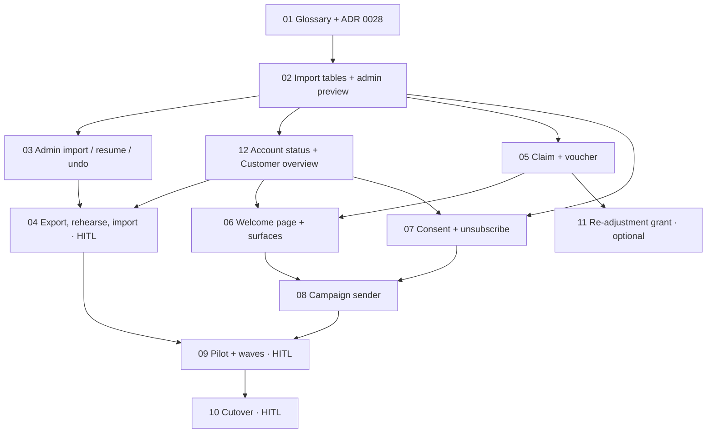

# Shopify customer migration: vertical slices (issues)

This is a tracer-bullet breakdown of the PRD (`../shopify-customer-migration-prd.md`). Each
slice is a thin, demoable path through all layers.

- **Triage label:** `needs-triage` (all slices)
- **Tracker:** [#264](https://github.com/ivanyeors/mp/issues/264) is the PRD issue. Each slice is a sub-issue (#265–#276), and its row below links it. Project **mp**: add #264 to the board by hand and its sub-issues follow.

## Slices

| # | Title | Type | Status | Blocked by | User stories |
|---|-------|------|--------|------------|--------------|
| [01](01-glossary-and-adr.md) · [#265](https://github.com/ivanyeors/mp/issues/265) | Glossary and ADR 0028: what moves, what never moves, and what a Claim is | AFK | **built** (`11ae402`) | none | underpins all |
| [02](02-import-tables-and-dry-run.md) · [#266](https://github.com/ivanyeors/mp/issues/266) | Import tables, and an Admin Panel upload that previews and never writes | AFK | **built** (`a143d5c`) | 01 | 9, 15 |
| [03](03-import-apply-and-rollback.md) · [#267](https://github.com/ivanyeors/mp/issues/267) | Apply, reconcile and undo an import batch from the Admin Panel | AFK | **built** (`e15f787`) | 02 | 9, 10, 13, 15 |
| [12](12-account-status-and-customer-overview.md) · [#276](https://github.com/ivanyeors/mp/issues/276) | Account status on every Customer, and the Customer overview | AFK | **not started** | 02 | 8, 14 |
| [04](04-export-rehearse-import.md) · [#268](https://github.com/ivanyeors/mp/issues/268) | Export from Shopify, rehearse, then import into production from the Admin Panel | HITL | **not started** | 03, 12 | 2, 8, 14, 15 |
| [05](05-claim-and-welcome-back-voucher.md) · [#269](https://github.com/ivanyeors/mp/issues/269) | Claim on first sign-in, and an account-bound welcome-back voucher | AFK | **built** (`f3d41cc`) | 02 | 2, 3, 7 |
| [06](06-welcome-page-and-surfaces.md) · [#270](https://github.com/ivanyeors/mp/issues/270) | Welcome page, Claim link, and the account and Admin Panel surfaces | AFK | **not started** | 05, 12 | 1, 3, 6, 8, 11, 12 |
| [07](07-marketing-consent-and-unsubscribe.md) · [#271](https://github.com/ivanyeors/mp/issues/271) | Marketing consent with provenance, and one-click unsubscribe | AFK | **not started** | 02, 12 | 4, 5 |
| [08](08-campaign-emails-and-wave-sender.md) · [#272](https://github.com/ivanyeors/mp/issues/272) | Campaign emails, the send ledger, and a wave sender that cannot double-send | AFK | **not started** | 06, 07 | 1, 4, 5, 11 |
| [09](09-pilot-and-waves.md) · [#273](https://github.com/ivanyeors/mp/issues/273) | Sign-off: DNS, a pilot of 50, then the waves | HITL | **not started** | 04, 08 | all |
| [10](10-cutover-and-shopify-wind-down.md) · [#274](https://github.com/ivanyeors/mp/issues/274) | Cutover: final delta import, Shopify notices, erasure | HITL | **not started** | 09 | 13 |
| [11](11-optional-complimentary-readjustment.md) · [#275](https://github.com/ivanyeors/mp/issues/275) | *(optional)* One complimentary re-adjustment for Migrated customers | AFK | **owner decision** | 05 | 7 |

## Dependency graph

## Build order

1. **01.** Seven new terms (**Migrated customer**, **Claim**, **Claim link**, **Welcome-back
   voucher**, **Marketing consent**, **Import batch**, **Account status**) and one rule that every later slice leans on: *the import
   creates Customers, never auth users*.
2. **02, then 03 and 12 in parallel.** 02's Admin Panel page only previews and writes nothing
   to the database, so it can merge and the owner can run it against a real export on day one.
   That surfaces the true column set and the skip counts before any schema decision hardens.
   12 gives every Customer an Account status, so the import is visible the moment it lands.
3. **04 can run as soon as 03 and 12 merge.** The import is silent, so production can hold the
   imported rows for days before any email goes out. Customers who sign in organically during
   that time simply land on their row, and the Admin Panel shows them as *Signed up*.
4. **05 and 07 in parallel.** Both need 02's `migrated_customers`; 07 also adds a column to
   slice 12's overview.
5. **06**, then **08**. Each adds its columns to slice 12's Customer overview and migration
   card, rather than building its own.
6. **09** closes the build with real inboxes. **10** closes the initiative.

**Ordering hazard: this one decides a deploy, not just a build.** No campaign email may be sent
before slice 07 is live in production. Until then the platform cannot honour an unsubscribe,
and the privacy policy already promises one (`app/[lang]/privacy-policy/page.tsx:67,148`). The
slice 08 sender enforces this by refusing to run while the unsubscribe route is absent.

**Second hazard.** Nothing in this initiative calls `supabase.auth.admin.*`. A diff that does
(`inviteUserByEmail`, `createUser`, `generateLink`) means the premise is wrong. Stop and
re-derive rather than patch around it. Pre-creating auth users would send Supabase emails, make
accounts their owners never asked for, and bypass the one binding path,
`linkCustomerToAuthUser`.

**Third hazard.** The Shopify export is PII. The import page reads it in the browser and
never uploads or stores the file: no Storage bucket, no Media, no Drive, and no `info/` folder
(`info/GET-from-shopify.md` is committed, so do not follow that precedent). The server action
receives rows only, and only the columns the import uses. The file is not opened in Excel, and it
is destroyed at cutover (slice 10).

**Fourth hazard.** `customer-import` is its own permission. Do not guard the import page or its
actions with `customers`, which the Manager and Staff roles also hold.

## What the audit found, so it is not re-litigated

- **There are no passwords to migrate.** Sign in is Google or an emailed code
  (`components/auth/login-form.tsx`). Shopify does not export passwords either.
- **The claim already works.** `linkCustomerToAuthUser` adopts an unclaimed `customers` row by
  verified email (`lib/auth/customer-identity.ts:39-56`). Do not write a second linking path.
- **The Shopify Admin API is not needed.** The owner's CSV export covers every field this plan
  uses, and building on Shopify is off the roadmap (owner, 2026-10-13).
- **Coupons do not apply to customisations.** That is deliberate (`app/api/results/hold/route.ts:648`; paired builds
  `lib/results/paired-hold.ts:118`).
  The voucher is a shop-cart voucher. Do not "fix" the hold path inside this initiative.
- **Shopify orders stay unlinked.** The mirror has no customer fields. Staff see Shopify-era
  totals from `migrated_customers`, and customers see none.

## HITL notes

- **Slice 04** needs the owner's Shopify admin to export, and a Supabase branch or staging
  project for the rehearsal. The owner runs the import itself in the Admin Panel. The Supabase MCP connection failed in the session that wrote this
  PRD, so the rehearsal has not been attempted.
- **Slice 09** needs DNS access for the sending subdomain, a Resend account, and test inboxes
  at Gmail, Outlook and Yahoo.
- **Slice 10** needs the cutover date, which is owner decision 6.
