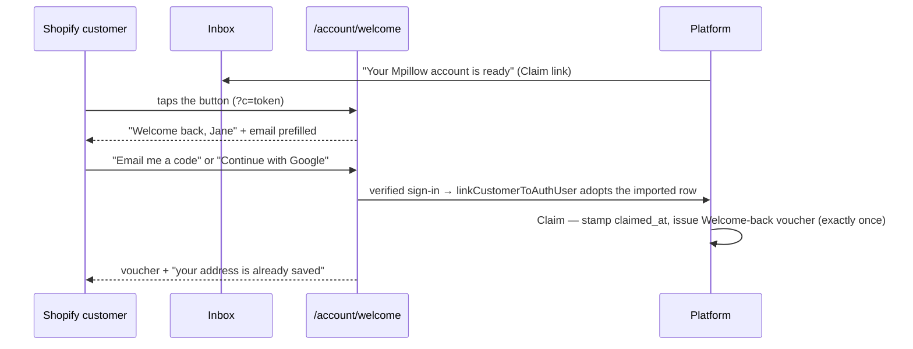

# PRD — Shopify customer migration and account onboarding

**Status:** specified, not started
**ADR:** `docs/adr/0026-shopify-customer-migration.md` (to be written by slice 01)
**Owner decisions still open:** see [Open decisions](#open-decisions-for-the-owner) — slice 04
cannot run until 1, 2 and 7 are answered.

## Problem statement

Everyone who bought from Mpillow on Shopify is a stranger to this platform. When they come
back for a re-adjustment, a spare cover or a second pillow, Staff see a **Customer** with no
history, and re-adjustment booking (which requires **Sign in**) files their pillow as "not
listed". We cannot even tell them the shop has moved: the platform holds no list of them and no
record of what they agreed to receive.

The goal is for every Shopify customer who has an email to already exist on the platform before
anyone asks them to do anything. Signing in with the email they shopped with should be the
whole of "creating an account", and there should be a reason to do it.

## What the audit found, before designing anything

Most of what a platform migration usually needs is already here. The parts that are missing are
consent, sending, and a safe place to put Shopify-era facts.

### 1. There is no password to migrate

**Sign in** is passwordless by design. It offers Google OAuth or an emailed one-time code and
magic link (`components/auth/login-form.tsx:94,110,135`; `components/auth/account-security.tsx:15-27`).
Shopify never exports customer passwords in any case. The step that usually hurts most in a
platform move, "reset your password", does not exist here.

### 2. The claim mechanism already exists

`linkCustomerToAuthUser` (`lib/auth/customer-identity.ts:67-128`) runs on every account surface:
`/account`, orders, addresses, results, reviews, appointments and re-adjustment. It looks up a
`customers` row by the signed-in user's verified email and **adopts it if `auth_user_id` is
null** (`decideCustomerLink`, `:39-56`). It then backfills that email's guest orders
(`associateGuestOrdersToCustomer`, `:140-158`).

So the entire account migration is to **pre-create one `customers` row per Shopify email, with
`auth_user_id = null`**. The first time that person signs in with that email, by Google or by
code, they land on their own row. The import creates no `auth.users` rows, sends no Supabase
invites, and sends no email at all.

Two precedents make the onboarding page cheap to build:

- `/account/login` already takes an `?email=` prefill (`app/[lang]/account/login/page.tsx:14-38`).
- The Result status page already embeds `LoginForm` with the customer's email filled in
  (`app/[lang]/results/[id]/page.tsx:805-823`).

### 3. Five traps in the customer schema

| # | Fact | Consequence |
|---|------|-------------|
| a | `customers.total_orders` / `total_spent` are recomputed from platform **Orders** by `updateCustomerStats` (`lib/ecommerce/customers.ts:65-81`), which the Stripe webhook calls | Shopify totals written there would be overwritten on the customer's next payment, and would mix two channels in one figure. Shopify-era figures get their own table. |
| b | A signed-in Customer can `select` **every column of their own row** (`supabase/migrations/0037_customer_auth.sql:15-18`) | Shopify `Note` and `Tags` are staff-facing and may contain health remarks (neck pain, CPAP). They must not go into `customers.notes` / `tags`. |
| c | `customer_addresses.country` defaults to `'MY'` in the DB (`0028_ecommerce.sql:251`) and in the zod schema (`lib/shop/customer-addresses.ts:22`). This is left over from the MYR era: coupon currency was fixed to SGD in `0031`, but this default was not | The importer always writes country explicitly. Slice 03 moves both defaults to `'SG'`. |
| d | `recipient`, `line1`, `city`, `postal_code` are NOT NULL (`0028_ecommerce.sql:245-250`) | An incomplete Shopify address is skipped, never padded. Singapore postal codes start with `0` (018956), so the export must never pass through Excel. |
| e | `customers.email` is NOT NULL and unique on `lower(email)` (`0028_ecommerce.sql:214,227`) | A phone-only Shopify customer cannot be imported, and could not sign in anyway. They are counted and skipped. |

### 4. The platform holds no Shopify customer data, and needs no API to get it

Nothing in the app reads Shopify customers. The integration is REST only, and calls orders,
products, inventory and locations (`lib/shopify/client.ts`, `orders.ts`, `products.ts`). The
**Shopify order mirror** stores no customer fields at all
(`20260715013000_shopify_order_mirror_schema.sql`).

The export is therefore the **owner's own Admin CSV** (Customers → Export → All customers →
*Plain CSV file*). This needs:

- no new access scope;
- no protected-customer-data approval;
- no new code against Shopify, which keeps the owner's rule of 2026-10-13
  (`CONTEXT.md:329`, ADR 0024: Shopify is ad hoc and off the roadmap).

**Expected columns.** These must be confirmed against a real file in slice 04, because
Shopify's documentation host was unreachable from the session that wrote this PRD:

> Customer ID · First Name · Last Name · Email · Accepts Email Marketing · Default Address
> Company / Address1 / Address2 / City / Province Code / Country Code / Zip / Phone · Phone ·
> Accepts SMS Marketing · Total Spent · Total Orders · Note · Tax Exempt · Tags

The import page validates the header row and refuses a file it does not recognise.

### 5. A coupon engine exists, but every code is a bearer code, and only the shop cart takes one

- **What the table supports.** `coupons` (`0028_ecommerce.sql:347-370`) supports percentage,
  fixed and free-shipping discounts, plus `usage_limit`, `per_customer_limit`, expiry and an
  `applies_to` scope. It has **no customer lock**: anyone holding a code can use it.
- **How it is checked.** Checkout passes the *typed* email and the email-matched customer to
  `validateCoupon` (`app/api/shop/checkout/route.ts:491-514`; `lib/ecommerce/discounts.ts:163-227`).
  It never looks at who is signed in.
- **No unique-code generation.** Codes are typed by hand, or generated one at a time with
  `Math.random` in the browser (`app/[lang]/settings/discounts/[id]/discount-editor-client.tsx:126-131`).
- **No reservation.** `usage_count` only increments after payment
  (`app/api/stripe/webhook/route.ts:378-385`).
- **Coupons never reach a customisation.** The hold prices with `discountAmount: 0`
  (`app/api/results/hold/route.ts:558`) and accept writes `discount_amount: 0`
  (`app/api/results/[id]/accept/route.ts:329`).
- **No other incentive mechanism.** There is no loyalty, points, store credit or gift card. A
  **Complimentary re-adjustment** applies only to purchases on the platform. An unlisted
  purchase is always charged (`lib/readjustment/eligibility.ts:78`), and a DB CHECK binds
  complimentary bookings to `purchase_source = 'platform'`
  (`20261013120000_readjustment_bookings.sql:47`).

### 6. Email sends one message at a time, with no consent, unsubscribe or suppression

- **Transport.** Resend, Gmail or console, chosen once for the whole app
  (`lib/email/transport.ts:167-214`). `.env.example` selects Gmail. `OutgoingEmail` has no custom
  headers, so it cannot carry `List-Unsubscribe`.
- **No consent or unsubscribe.** There is no marketing-consent column or table anywhere, no
  unsubscribe endpoint, and the footer has no unsubscribe link (`lib/email/theme.ts:146-162`).
- **The privacy policy already promises opt-out.** It names Mellow Life Pte Ltd as controller
  (`app/[lang]/privacy-policy/page.tsx:23`), promises opt-out (`:67`, `:148`) and names
  Shopify as an integration (`:90`). The platform cannot keep that promise yet.
- **Precedent for a send ledger.** Idempotent sends already use ledger tables (`order_emails`,
  `partner_emails`).
- **Journey analytics cannot measure the campaign.** UTM parameters are captured as **Entry
  source** (`lib/analytics/journey/entry-source.ts:55-90`), but `mergeVisitorIdentity` and
  `linkVisitToPaidOrder` have no callers (`lib/analytics/journey/identity.ts:105,149`). The
  campaign funnel is measured in its own ledger instead.

### 7. The Admin Panel can host the import, within two limits, and shows no account state

- **The Customers page shows no account state.** `/settings/customers` lists Name, Email,
  Orders, Spent, Tags and Joined (`app/[lang]/settings/customers/customers-client.tsx`). Nothing
  shows whether a Customer has signed up, and nothing records when a row was bound to a login:
  `linkCustomerToAuthUser` writes `auth_user_id` and no timestamp.
- **A CSV import precedent exists.** Analytics reads CSV files in the browser with `f.text()` and
  hands them to a server action (`app/[lang]/settings/analytics/SearchVisibilityCard.tsx:74`,
  `seo-actions.ts:309`), with a pure parser (`lib/seo-metrics/csv-import.ts:42`).
- **Limit 1: request size.** A server action body is capped at 1 MB by default, and
  `next.config.ts` does not raise it. A Shopify customer export passes 1 MB at around 3,000
  rows, so the rows go in chunks.
- **Limit 2: permissions.** Permissions are granted per page, and the Manager and Staff roles
  both hold `customers` (`lib/auth/permissions.ts:191-217`). Bulk-writing customer data needs
  its own key, in the way `categories` is a tab-level key of Products.

## Solution

Stated as one sentence, because it keeps the work small:

> **Import every Shopify customer who has an email as an unclaimed Customer row, from the Admin
> Panel, silently and reversibly. Let the existing Sign in adopt that row the first time they
> use the same email, and show Staff who has.
> Give them a reason to do it: an account-bound welcome-back voucher, issued at that moment,
> through a campaign that honours what they agreed to on Shopify.**

### The customer's path: three taps, no form

Customers who never open the email lose nothing. Signing in normally with the same email claims
the same row and issues the same voucher. Buying as a guest with that email attaches the
**Order** to the imported row too (`findOrCreateCustomer` finds it), so their history is waiting
when they do sign in.

### Decisions (ADR 0026 records these)

1. **The source is the owner's Shopify CSV export, not the Shopify Admin API.** This adds no
   scopes and no Shopify code. The batch records the file's hash.
2. **The import creates Customers, never auth users.** No `auth.admin.*`, no invite emails. An
   account exists only once its owner proves the email.
3. **Platform data wins.** Where a Customer already exists, the import only fills fields that are
   null. It never changes email, `auth_user_id`, tags, notes or totals.
4. **Shopify-era facts live beside the Customer, not on it.** `migrated_customers` holds the
   Shopify id, order count, spend, tags, note and consent snapshot. It is readable only by the
   service role, so a customer never sees staff notes (trap 3b).
5. **Every import is idempotent and reversible by batch.** Re-running a file changes nothing.
   Undoing a batch removes what it created, unless the person has since signed up or bought.
6. **Claim means the first sign-in after import, and happens exactly once.** One SQL function
   stamps `claimed_at` and issues the voucher in the same transaction.
7. **A Claim link prefills and attributes. It never signs anyone in.** Its token is opaque, keeps
   PII out of URLs and logs, and only ever selects whose email to prefill.
8. **The incentive is account-bound.** The voucher is valid only for its own signed-in Customer,
   checking out with the account email. A forwarded code is worthless.
9. **Consent moves with its provenance.** "Accepts Email Marketing = yes" becomes `subscribed`,
   with source `shopify_import` and the export date. Customers without consent get, at most,
   one service notice that contains no offer.
10. **Shopify orders stay unlinked** (owner, 2026-10-13). Customers see no Shopify order history.
    Staff see the Shopify-era count and spend from `migrated_customers`.
11. **The import runs in the Admin Panel, Customers → Import from Shopify, behind its own
    `customer-import` permission.**
    - The browser reads the file and sends only the columns used, in chunks. The file is never
      stored.
    - The server re-validates every row, and one SQL function does every write.
    - There is no CLI importer, so there is one write path. The owner needs no developer and no
      service-role key on a laptop.
12. **Every Customer shows an Account status** (*Signed up* since a date, or *No account*), not
    only the imported ones. Statuses are derived from stored facts in one read model,
    `admin_customer_overview`, which is also the base of the CRM (below).

## The incentive: options and recommendation

The question was "some sort of digital incentive". Here is what each candidate costs, measured
against what the code already does:

| Incentive | Reuses | New work | Verdict |
|---|---|---|---|
| **Welcome-back voucher**: fixed S$ off a shop order, one use, signed-in only | `coupons`, `validateCoupon`, Stripe `amount_off` (`lib/stripe/checkout.ts:184-195`) | customer lock + server-generated code + issuance at Claim | **Recommended.** Its liability is known in advance, and it suits the audience: existing pillow owners mostly need covers, cases, protectors and bolsters, which are all sold in the shop. |
| Free-shipping voucher | `discount_type = free_shipping` already exists | same as above | Cheap, but weak in Singapore, where shipping is already low. Better as the **reminder** sweetener than as the headline. |
| Complimentary re-adjustment for Shopify-era pillows | booking flow, `evaluateReadjustment` | a grant table + relaxing one CHECK (slice 11) | **Strong optional add-on.** Booking a re-adjustment *requires* an account, so it is the most honest reason to claim one. It costs Staff time, not margin, and brings people into a **Location**. It is a service rather than a digital reward. |
| Voucher usable on a custom build (**Result**) | nothing | the hold, accept, commission base and refunds (the money path) | **Not in v1.** It needs its own PRD; see Non-goals. |
| Points / store credit | nothing | a new ledger | No. |

**Recommended defaults for the owner to accept or change.** These are placeholders, not
analysis:

- **Discount.** A fixed amount, not a percentage. A percentage of a S$610 pillow is a liability
  that grows with basket size, while a fixed amount costs at most *value × claims*.
- **Minimum spend.** Set it above the voucher value, so the voucher cannot zero out a small
  accessory.
- **Expiry.** 60 days after Claim. This creates urgency without a countdown gimmick.
- **Issuance window.** Vouchers are issued only for claims before a set date, after which the
  campaign is closed and the liability capped.
- **Liability formula.** Live liability = vouchers issued × value. Realised cost = redeemed ×
  value. Slice 06 shows both.

## Consent and sending

### Who receives what

| Group (at import) | Email | Contains the offer? |
|---|---|---|
| Accepts Email Marketing = **yes** | Announcement; one reminder after 7 days if unclaimed | Yes |
| Accepts Email Marketing = **no** | At most **one** service notice ("the shop has moved; here is where your account lives") | **No.** If they sign in, the voucher is shown on the site, not in their inbox. |
| Unsubscribed, bounced or complained, at any point | Nothing further from the campaign | — |

Every campaign email carries a one-click unsubscribe (`List-Unsubscribe` and
`List-Unsubscribe-Post`, RFC 8058) and a footer link. Unsubscribing stops all campaign mail.
Order and **Result** emails continue, because they are transactional.

### Legal points for the owner to confirm (not legal advice)

- **Which entity ran the Shopify store?** If it was Mellow Life Pte Ltd, the controller named in
  the privacy policy, this is one organisation moving its own data between processors, and a
  notice is enough. If it was a different entity (Stripe still carries a retired "Mpillow"
  account), moving the data is a disclosure under the PDPA and needs its own basis.
- **Unsolicited messages.** Singapore's Spam Control Act sets rules for unsolicited commercial
  email sent in bulk: an unsubscribe facility, and labelling. Sending the offer only to people
  who opted in, and keeping the service notice free of offers, is the conservative reading.
  Counsel should confirm the service-notice copy.
- **No WhatsApp or SMS blast.** Marketing to Singapore numbers brings Do Not Call Registry duties,
  and WhatsApp marketing templates need opt-in. Email only.

### Protecting the mailbox that sends order emails

Bulk mail from the same Gmail Workspace mailbox that sends order confirmations would put the
deliverability of every order email at risk. A Workspace mailbox also caps daily sends (roughly
2,000 a day). So the campaign:

- goes through **Resend from its own subdomain** (for example `hello.mpillow.com`), with SPF,
  DKIM and DMARC set up;
- goes out in **waves**: a pilot of 25–50, then waves sized to the list;
- **pauses** a wave when the bounce rate passes 2% or complaints pass 0.1%. Google and Yahoo's
  bulk-sender rules start enforcing near 0.3%.

**Buyers go first.** Shopify newsletter forms attract bot sign-ups, and those show up as
`Total Orders = 0` with marketing consent. Mailing them first risks hitting spam traps. Waves
run from buyers (`Total Orders ≥ 1`) to subscribers who never bought, and the subscriber group
goes last, in smaller waves.

## User stories

**Shopify customer**

1. As a Shopify customer, I get one clear email that explains the move and takes me straight to
   my account.
2. As a Shopify customer, I sign in with the email I shopped with, by Google or by code, and my
   name and address are already there. I never set a password.
3. As a Shopify customer, I see my welcome-back voucher the moment I sign in, and I can use it at
   checkout.
4. As a Shopify customer who never agreed to marketing, I receive at most one service notice and
   nothing promotional.
5. As any recipient, I can unsubscribe in one click and never hear from the campaign again.
6. As a Shopify customer who signs in with a different email, I still get an account, and the
   welcome page tells me which inbox the voucher went to.
7. As a Shopify customer, I book a re-adjustment for my Shopify pillow exactly as I can today, as
   "not listed".

**Staff**

8. As Staff, I can see in Admin Panel → Customers who came from Shopify and whether they have
   signed up, and I can filter to those who have not. I can also see their Shopify-era order
   count and spend, and their consent.
9. As Staff, I can import a fresh export from the Admin Panel and nothing duplicates. If the tab
   closes mid-import, picking the same file continues it.
10. As Staff, I can undo an import batch, and anyone who has signed up or bought since is kept.
11. As Staff, I can see the funnel: sent → clicked → claimed → voucher redeemed → revenue.

**Owner**

12. As the owner, I can see what the incentive costs at any moment: vouchers issued, vouchers
    redeemed, and the revenue on those orders.
13. As the owner, I know the Shopify export never lands in git and is destroyed at cutover.
14. As Staff, I can see for **any** Customer whether they have an account, since when, and when
    they last opened their account while signed in.
15. As the owner, I can preview and run the import myself in the Admin Panel, without a
    developer, and see exactly what it will do before it writes anything.

## Non-goals

- **Showing Shopify orders in `/account`.** That reverses the owner's 2026-10-13 rule. It would
  also need Shopify customer API access, because the mirror stores no customer fields. If wanted,
  it is its own PRD.
- **Pre-creating Supabase auth users or sending invite emails.** Decision 2.
- **Migrating passwords or Shopify sessions.** There are none to migrate (audit §1).
- **A voucher that applies to customisations.** Results deliberately price with no discount
  (audit §5). Changing that touches the **Authorization hold**, accept, the **Commission** base
  and refunds, and belongs in its own PRD.
- **Loyalty points, store credit, gift cards.**
- **WhatsApp or SMS campaigns.**
- **Importing phone-only customers.**
- **Localised campaign copy.** Every email template is English-only today; the campaign matches.
- **Merging one person across two emails.** Support handles it case by case.
- **SEO redirects from Shopify URLs.** These belong to `PRD-search-visibility`.

## Risks

| Risk | Reality | Mitigation |
|---|---|---|
| Shopify notes or tags become visible to the customer | **Certain** if written to `customers`: the customer can read their own row (`0037_customer_auth.sql:15-18`) | Decision 4: `migrated_customers` is service-role only. |
| Imported totals silently overwritten or mixed into platform figures | Certain if written to `customers.total_*` | Decision 4. |
| SG postal codes lose their leading zero | Certain if the file is opened in Excel | Plain-CSV export, a "never open in Excel" step (slice 04), and the importer left-pads a 5-digit SG zip and counts each repair. |
| A typo'd Shopify email belongs to someone else, who claims the row and sees the address | Low. Shopify has the same exposure today through its email-code customer login | Bounced addresses are suppressed. An *Import without addresses* option (slice 03) is there if the owner prefers the conservative import. |
| The campaign damages order-email deliverability | Real if it is sent through the Gmail transport | Separate Resend subdomain; the campaign sender refuses Gmail (slice 08). |
| Bot sign-ups on Shopify's newsletter form are spam traps | Common on Shopify stores | Buyers first; subscribers-only last, in small waves; pause rules. |
| A voucher is used by someone other than its owner | Certain with today's bearer coupons | Decision 8: session check at preview and at checkout. |
| A Claim is processed twice and issues two vouchers | `linkCustomerToAuthUser` runs on every account page | Decision 6: one transaction plus a unique index on `(customer_id, issued_for)`. |
| A customer signs in before the claim code ships | Harmless | The claim runs on any later `linkCustomerToAuthUser` call, so they claim on their next page load. |
| Concurrent checkouts both pass the coupon's `usage_limit` | Exists today for all coupons (no reservation) | For a one-person voucher, this needs the same person to pay twice at once. Accepted; recorded in ADR 0026. |
| The export lands in git like `info/GET-from-shopify.md` did | That file is the precedent for Shopify exports in this repo | The import happens in the browser, so the file never needs to be near the repo. Slice 04's steps keep it out of shared folders, and slice 10 destroys it. |
| The import runs against production before rehearsal | Possible | Slice 04 makes rehearsal on a Supabase branch a precondition. |
| Someone with Customers access bulk-imports or undoes by mistake | Manager and Staff both hold `customers` | A separate `customer-import` key, held by Owner and Admin only. A preview before every import and every undo, a typed confirmation, and an audit row for each. |
| The tab closes, or the network drops, mid-import | Likely with thousands of rows | Each chunk is one transaction. The batch records `rows_done`, a chunk out of order is refused, and picking the same file resumes. |
| Customer PII passes through the browser | Inherent in a browser import | It goes only to our own server over HTTPS, as it would by CLI. Unused columns are dropped before sending, nothing is stored but the imported rows, and the preview returns no PII. |
| Pre-existing: staff `customers.notes` and `tags`, and `orders.internal_notes`, are already readable by their customer | Live today, independent of this work | Fixed by CRM slice 02 (`PRD-customer-crm`, P1), with column grants following the `order_items` precedent. It needs nothing from this initiative and can ship first. |

## Success criteria

- For every batch: rows in = created + merged + already imported + skipped, and every skip has a
  reason.
- Re-importing the same file creates 0 rows and changes 0 rows.
- No imported row is ever bound to an auth user whose verified email differs. This holds by
  construction, because only `linkCustomerToAuthUser` binds.
- Every claimed Migrated customer holds exactly one voucher, and no voucher is redeemed by a
  different Customer.
- No campaign email reaches an unsubscribed, bounced or complained address. Each wave stays under
  2% bounces and 0.1% complaints.
- The claim rate is reported per wave. The owner sets a target after the pilot, from real
  numbers.
- By the cutover date, the Shopify export is destroyed and the customer data held in Shopify is
  erased or the store is closed.

## Toward a simple CRM

The owner wants this to grow into a simple CRM: one place to manage customers and build a
relationship with them. This initiative does not build that CRM. It is shaped so that the CRM
is the next step rather than a rewrite. The CRM now has its own plan,
[`PRD-customer-crm`](../PRD-customer-crm/customer-crm-prd.md), which is the source of truth for
everything in this section past the table below.

### What this initiative already lays down

| CRM need | What is built here | Slice |
|---|---|---|
| One list of every customer, filterable | `admin_customer_overview`, filters kept in the URL | 12 |
| Whether they have an account, and how recently they used it | `account_linked_at`, `account_last_seen_at` | 12 |
| Where they came from | `migrated_customers`, import batches, the *Source* filter | 02, 12 |
| Bringing in customers from elsewhere | preview, import, resume and undo, with `source` widened per new source | 02, 03 |
| Whether we may email them, with proof | `marketing_email` and `customer_consent_events`, unsubscribe | 07 |
| What we sent, and what happened | `customer_campaign_sends`, Claim link clicks, bounces and complaints | 06, 08 |

### Rules that keep it CRM-shaped (ADR 0026 k, l)

1. **Facts, not statuses.** Store events and timestamps. Derive *Signed up*, *Voucher used* or
   *Lapsed* in the overview view, where they cannot drift.
2. **Staff-only facts never live on `customers`.** The customer can read their own row.
3. **Every per-customer event table is append-only and carries `customer_id` and a
   timestamp.** The CRM timeline then merges existing tables when it is read, with no backfill.
   Each slice here that creates such a table adds one timeline adapter (CRM slice 03).
4. **Audience rules live in `lib/`.** The wave sender is a script today. The future
   email-marketing initiative ([`PRD-email-marketing`](../PRD-email-marketing/email-marketing-prd.md))
   calls the same function and writes the same ledger.

### What the CRM adds next (not in this initiative)

The owner approved these six on 2026-10-19. They are specified in `PRD-customer-crm`. In the
order that helps the relationship most:

1. **Staff notes customers cannot read.** A `customer_notes` table (author, time, text), and the
   fix for the live `customers.notes` exposure (see Risks). Everything else leans on this.
2. **One timeline on the Customer detail**, newest first: orders, Results, re-adjustment
   bookings, returns, reviews, emails sent, consent changes and notes.
3. **Aftercare messages** by email and WhatsApp (service messages, owner 2026-10-20):
   - one Google review request 14 days after delivery, with a short *"need anything else?
     message us"* line;
   - a yearly re-adjustment check-up for Premium Mpillow that states the fee.

   Customers turn them off in their Profile, and Staff have a manual switch.

   There is no email about the free re-adjustment window.
4. **Saved segments.** A named filter on the Customers list, such as *Premium, bought over a year
   ago, never re-adjusted*.
5. **Email marketing, as a hand-off.** The CRM's Segments become audiences for the future
   [`PRD-email-marketing`](../PRD-email-marketing/email-marketing-prd.md). That initiative
   builds campaigns on slice 07's consent and slice 08's ledger. The CRM itself sends no
   marketing.
6. **Follow-ups.** *Call back Friday*, assigned to a **Staff** profile.

Added on 2026-10-20:

- a view-only Customers permission;
- contact and sign-in status, showing whether the email and mobile are linked up;
- reviews on every Customer: shop reviews exactly, and Google reviews by Staff-confirmed match;
- four switchable Telegram updates, including the existing online Result notice.

Out of scope even then: WhatsApp and SMS marketing (Do Not Call duties), and scoring or
predictions.

## Open decisions for the owner

1. **Which legal entity operated the Shopify store?** This decides the PDPA basis.
2. **Voucher terms:** value, minimum spend, expiry, scope (all shop products, or accessories
   only), and the date issuance stops.
3. **Does the no-consent group get the one service notice, or nothing?**
4. **Sending subdomain and Resend account.**
5. **Is the complimentary re-adjustment add-on (slice 11) wanted?** If so: Premium Mpillow only,
   or every pillow?
6. **The Shopify cutover date**, when Shopify checkout stops.
7. **Roughly how many Shopify customers, and how many have ever bought?** This sizes the waves.
