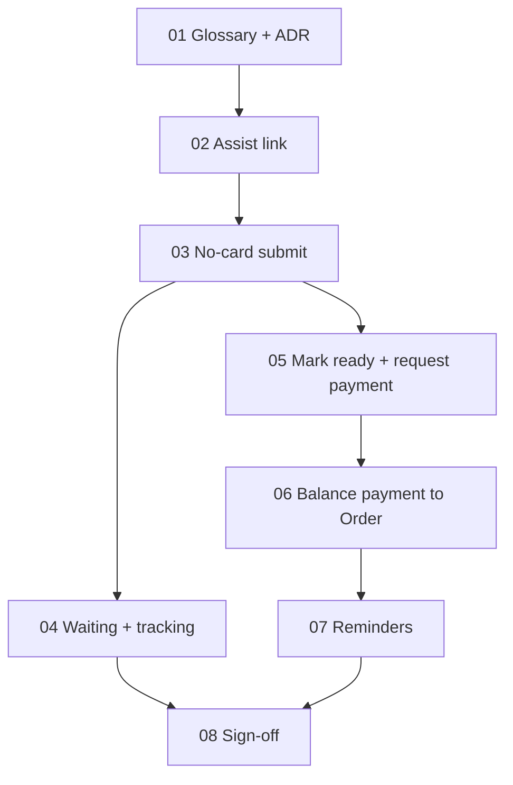

# Staff-Assisted Customisation — Vertical Slices (Issues)

Tracer-bullet breakdown of the PRD (`../staff-assisted-customisation-prd.md`). Each slice is a thin,
demoable path through all layers (schema, API, client, tests). Published locally (no external issue
tracker configured).

**Triage label:** `needs-triage` (all slices)

## Slices

| # | Title | Type | Status | Blocked by | User stories |
|---|-------|------|--------|------------|--------------|
| 01 | Domain glossary and ADR: Assist link, Assisted customisation, Balance payment | AFK | **done** `f6ecc4f2` | none | underpins all |
| 02 | The Assist link — generate it, copy it, recognise it | AFK | **done** `2b0f097a` | 01 | 1–5 |
| 03 | Submit without a card, and read as work rather than as stuck | AFK | **done** `ba374ff6` | 02 | 6, 22 |
| 04 | Tell the customer what happens next, and give them a way back | AFK | **done** `2e7fb563` | 03 | 7–10 |
| 05 | Save assignment notifies a cardless customer; Staff can copy the payment link | AFK | **done** `b9ce8594` | 03 | 13–16 |
| 06 | A Result with no hold is payable — Balance payment to Order | AFK | **done** `ee021d5e` | 05 | 11, 12, 17–21 |
| 07 | Reminders for a build nobody has paid for | AFK | **done** `aed1b843` | 06 | 23–25 |
| 08 | Sign-off: one real link, one real card, one real order | HITL | **not started** | 07 | all |

## Build state (2026-09-12)

Slices 01–07 are built on `feat/staff-assisted-customisation`, **unmerged and
undeployed**. `npm run ci` is green end to end: lint 0 errors, typecheck clean,
1700 tests, `next build`, and all 80 routes inside the bundle budget. The four
relevant self-checks pass (`staff-assist`, `assisted-cta`, `surface-parity`,
`api-contract`). The graph was refreshed once at the end of the branch (`a289a2c8`)
rather than per slice — the freshness workflow compares the committed graph against
a rebuild of the final tree, so that satisfies it without seven 40k-line diffs.

**Blocking anything real: the migration is written but NOT applied.**
`supabase/migrations/20260912000000_admin_assist_code.sql` adds
`admin_users.assist_code` and `mp_config_responses.assisted_by_admin_id`. Until it
is pushed, any configurator save carrying `?assist=` 500s on the unknown column.
Push with `supabase db push` — never the MCP `apply_migration` tool, which stamps
its own version and desyncs the ledger.

Two things found during the build that changed the shape of the work, recorded
because neither is visible in the PRD:

- **Pricing was gated on `hasHold`, not just the email** (slice 05). The whole
  `priceResult()` block sat inside that branch, so `final_amount` stayed null for a
  Result with no hold. Dropping the gate from the email alone would have sent a
  priced-looking email with no price and left slice 06 nothing to charge.
- **Hiding the "Save without purchasing" button was not the fix** (slice 03). The
  Admin Panel's send-to-Telegram action posts `isFinal` too, and
  `shouldCreateInstoreReviewOnly()` excluded only `online_purchase` — so that click
  rewrote an assisted row's Source to `manual`. The guard went into the shared
  predicate, where every caller passes.

One deliberate live behaviour change beyond assisted Results: any Result reaching
assign with a customer email and token now gets the "final build ready" email,
including in-store `manual` ones that previously got none. That is ADR 0016 working
as intended — assign is a deliberate staff act and those Results are now sellable
rather than residue — but it is a real change to an existing flow, so QA it in
slice 08.

## Dependency graph

## Build order

1. **01 first.** Three of the nouns this initiative introduces sit one word away from terms that
   already exist — **Staff assist mode** and **Partner-assisted customisation** are both real,
   both different, and both about to be confused with this. The `_Avoid_` lines are the deliverable.
   ADR 0016 belongs here too, because slice 06 is an amendment to ADR 0002 and should not be the
   first place anyone reads about it.
2. **02 next.** Additive and inert: a column, a code, a copy card and a resolver. It changes nothing
   for any existing visitor, and nothing downstream can be built until a **Result** can be stamped
   `staff_assisted`.
3. **03.** The first real tracer bullet — a customer completes a submission with no card and it lands
   in the queue as work. Ships and demos on its own even though nobody can pay yet, because an
   assisted **Result** sitting in **Needs assign** is exactly what an in-store measurement already
   is, and **Staff** can already work it.
4. **04 and 05 in either order.** Both hang off 03 and neither touches the other: 04 is customer-side
   copy and an email, 05 is the assign gate and the **Admin Panel** affordance.
5. **06.** The money. Deliberately late: it is the only slice that can produce an **Order** without a
   payment, and it should land on top of a flow that is otherwise finished and observable.
6. **07.** After 06, because a reminder to pay is dishonest until paying works.
7. **08** closes it with a human, a handset and a real Stripe account.

**Ordering hazard, stated once because it decides a deploy rather than a build:** 05 and 06 must ship
to production together. 05 alone emails a customer a finished build and a price, and points them at a
page that cannot take their money — the exact dead end this initiative exists to remove, except now
actively advertised. Build them in order, deploy them as one.

**Second hazard, smaller:** slice 06 drops the payment-intent guard on `accept` and leaves `capture`
as the sole barrier between the system and an unpaid **Order**. That guard is not a style choice and
the tests around it are not padding. If a later refactor finds it redundant, it is not.

## Coordination with Staff assist mode

**Staff assist mode** was rebuilt while this PRD was being drafted — slice 14 of
`PRD-staff-assist-spatial-fillings`, commit `f95cdc8a`, landed on `main` 2026-09-11. Read `../../PRD-staff-assist-spatial-fillings/issues/14-staff-toolbox-template-save.md`
before touching anything in the configurator.

**This initiative adds nothing to the assist tool rail, and that is deliberate.** Build completion
lives on the **Result** detail assign card, so no `ToolSpec` entry is added, neither
`staff-assist-panel.tsx` nor `staff-assist-bolster-panel.tsx` is modified, and the "change both or
neither" parity obligation does not arise. The only configurator file touched here is the preview
call to action in `mp-config-client.tsx` — slice 14 touched that file by a single line,
nowhere near it, so this branch builds on top of it cleanly. **If anyone feels the urge to put a "request payment"
control on the rail, that is the duplicated work this section exists to prevent.**

Three facts from slice 14 that this initiative depends on:

- **The assist gate is `results`, not `Boolean(staffCtx)`.** `viewer` is excluded from assist. An
  **Assist link** is orthogonal and stays a separate prop — the customer holding one has no
  `admin_users` row, so `getAdminContext()` is null and they cannot reach assist by any route.
- **`sessionTemplateId(loaded, session)` is the single source of the template claim**, for both the
  toolbox status pill and the hold snapshot's `templateId`. Slice 03's deferred submit carries it
  through unchanged and must not shadow it with a second "is dirty" flag.
- **`saveAffordance({ placements, loaded })` decides what may be saved** — unedited saves nothing,
  empty stage saves nothing, so clearing the x-ray cannot blank a catalog template. Reuse it.

Run `npx tsx lib/configurator/staff-assist.check.ts` before and after any work that touches these
files. All three decisions are asserted there as intent rather than drift; do not "restore" the old
assertion that forbade a save control, which Ivan reversed deliberately on 2026-09-11.

## HITL notes

- **Slice 08 is the only human slice.** It needs a real handset, a real inbox, a real Stripe test-mode
  account and a second browser. It records pass/fail in `../OPS-SIGNOFF.md`.
- **Slice 02 carries a manual step inside an otherwise AFK slice:** the migration must be applied with
  `supabase db push`, never the MCP `apply_migration` tool, which stamps its own version and desyncs
  the ledger from `supabase/migrations/`.
- **Not ours to sign off:** slice 14's catalog save path has never run against a real database and
  needs an overwrite and a save-new exercised. It wants a live database on the same afternoon as
  slice 08 and is easy to sweep in — but it belongs to slice 14's sign-off, and skipping it there on
  the grounds that "the assisted pass touched assist mode" is how it ends up tested by nobody.
