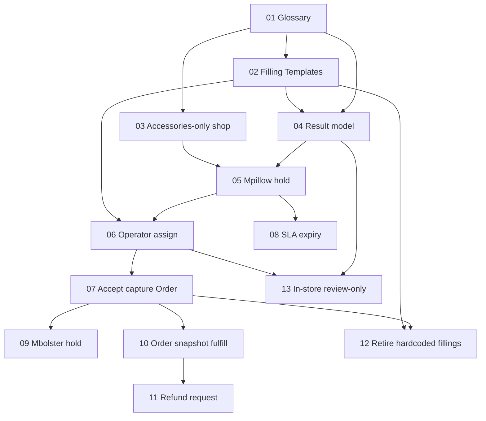

# Template-Linked Customisation — Vertical Slices (Issues)

Tracer-bullet breakdown of the PRD (`../template-linked-customisation-prd.md`). Each slice is a thin, demoable path through all layers (schema, API, UI, tests). Published locally for build tracking (no external issue tracker required).

## Slices

| # | Title | Type | Status | Blocked by | User stories |
|---|-------|------|--------|-----------|--------------|
| 01 | Domain glossary: tier, Result, Filling Template | AFK | **done** (`1f33793e`) | none | 41 |
| 02 | Filling Templates in Configure | AFK | **done** | 01 | 27, 28, 39 |
| 03 | Accessories-only shop catalog | AFK | **done** | 01 | 1, 2 |
| 04 | Result model + lifecycle + pricing modules | AFK | **done** | 01, 02 | 28, 36–40 |
| 05 | Mpillow hold path (mp-config → auth hold → Result held) | AFK | **done** (`f18e8e30`) | 04, 03 | 3, 5–10, 20, 41, 43 |
| 06 | Operator assign + customer notify (platform only) | AFK | **done** | 05, 02 | 11, 12, 24–26, 29–30, 41 |
| 07 | Customer accept / decline / top-up / capture → Order | AFK | **done** | 06 | 13–17, 19, 33, 37–38, 41 |
| 08 | SLA reminders, settings, and auto-expiry | AFK | **done** | 05 | 21–23, 31–32 |
| 09 | Mbolster hold path (mbolster-config) | AFK | **done** | 07 | 4–8, 43 |
| 10 | Order build snapshot + fulfill wiring | AFK | **done** | 07 | 33, 34 |
| 11 | Post-delivery refund request + operator approve | AFK | not started | 10 | 17, 18, 35 |
| 12 | Retire hardcoded fillings; LLM proposal field hooks | AFK | not started | 07, 02 | 6, 40 |
| 13 | In-store measurement-only Results (no Stripe hold) | AFK | not started | 04, 06 | 42, 24–26, 29–30 |

## User story coverage (all 43)

| US | Primary slice(s) | AC-backed |
|----|------------------|-----------|
| 1–2 | 03 | yes |
| 3 | 05 | yes |
| 4 | 09 | yes |
| 5–9 | 05, 09 | yes |
| 10 | 05, 06, 07 (status page + account + magic link) | yes |
| 11–12 | 06 | yes |
| 13–17 | 07, 11 (17 also) | yes |
| 18 | 11 | yes |
| 19 | 07 | yes |
| 20 | 05 | yes |
| 21–23 | 08 | yes |
| 24–26 | 06, 13 | yes |
| 27–28 | 02, 04 | yes |
| 29–30 | 06, 13 | yes |
| 31–32 | 08 | yes |
| 33–34 | 07, 10 | yes |
| 35 | 11 | yes |
| 36–40 | 04, 05, 07, 12 | yes |
| 41 | 01 (glossary) + 05/06/07 (UI copy) | yes |
| 42 | 13 | yes |
| 43 | 05, 09 (mp-maker unchanged) | yes |

## Dependency graph

## Recommended build order

1. **01** Glossary — unblocks vocabulary in code and docs.
2. **02** Filling Templates and **03** Accessories-only shop — parallel.
3. **04** Result model + deep modules (`build-assembly`, `result-pricing`, `result-lifecycle`) — foundation for money and assignment (nullable payment intent for in-store).
4. **05** Mpillow hold path — first demoable customer → held Result.
5. **06** Operator assign + customer email/status page.
6. **07** Accept / decline / capture → Order — money closes.
7. **08** SLA reminders/expiry — can start after 05; finish alongside 06–07.
8. **13** In-store review-only — after 06 (reuses assign UI without hold).
9. **09** Mbolster path — reuses 05–07 patterns.
10. **10** Order snapshot + fulfill — production UI.
11. **11** Refund request/approve — reuses money-flow refund helpers where present.
12. **12** Retire hardcoded fillings + LLM hooks — cleanup once purchase path is template-driven.

## HITL notes

- No Dashboard-only blockers expected for manual-capture PaymentIntents if Stripe keys already work for Checkout.
- Slice **11** should reuse money-flow refund/ledger work if already merged; otherwise implement the minimal Stripe refund approve path and note ledger integration as follow-up.
- Staff communication: after Accept, customers cannot cancel until delivery; declines require full restart; in-store measurement never forces card entry.
