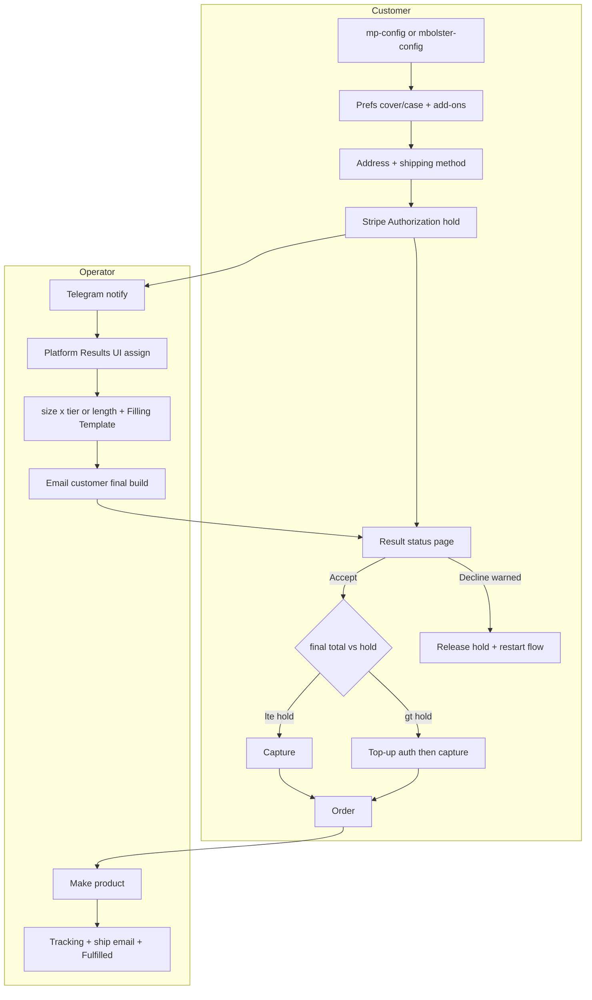

# PRD: Template-Linked Customisation, Authorize-Then-Capture, Accessories-Only Shop

Status: Draft (needs-triage)
Source: Grill-with-docs session + plan `prd_template-linked_customisation,_authorize-then-capture,_accessories-only_shop_7106b0cc.plan.md`

## Problem Statement

The only correct way to sell our main products online is through the mpillow / mbolster customisation flow. The shop should sell accessories and other items that do not need customisation. Today that is not how the system behaves:

- Mpillow and mbolster appear in the shop as direct-buy products with plain Add to Cart, so customers can purchase a generic size×tier (or length) without operator review.
- Configure already links BOM parts to inventory items and Costings, but the purchase path does not treat Configure recipes as the source of truth. Recommendation fillings are hardcoded, and Named BOM Templates are optional presets for warehouse Apply — not what a Result is sold against.
- When a customer finishes customisation, operators get a Telegram notify with no assignment workflow. There is no link from a Result to a size×tier (or length) plus a Filling Template, no customer-facing final build to accept, and payment captures immediately — so clinical/ops review cannot gate what is made or charged.
- Changing fillings today means editing many parent recipes or code. Operators need size-scoped Filling Templates they can pick independently so a mix change does not require rewriting every product BOM.

## Solution

From the operator and customer perspective:

1. The **shop** lists only accessories and other non-custom **Sellable items**. Mpillow and mbolster are not buyable there; entry is only via customisation.
2. Online customisation (**mp-config** online and **mbolster-config**; **mp-maker** out of scope for v1) collects measurements/preferences, **customer preferences** (cover, case), **add-ons** (accessories), address, and shipping, then places a Stripe **authorization hold** (card details taken, not charged).
3. That creates a **Result** in the operator queue. Telegram and email notify operators and link to the platform. Assignment happens only on the platform (no Telegram reply parsing).
4. The operator confirms or overrides **size×tier** (pillow) or **length** (bolster) and must select a **Filling Template** (a Configure BOM template that is a filling-only recipe, filtered by product type and size). Non-filling defaults (packaging, protector) come from the **Composed sellable** BOM for that size×tier / length. Protector is what separates basic vs premium **tier** — not a customer preference.
5. The customer receives **email** and a **Result status page** with the final build. **Accept** captures payment (or requires a top-up if the final total exceeds the hold) and creates an **Order**. **Decline** (with a warning) releases the hold; the customer must restart customisation.
6. After Accept, the Order appears for production. Operators add a shipping/tracking link, notify the customer, and mark fulfilled (existing fulfill capability, wired to this path). After delivery, refunds require an in-person return, a customer refund request, and operator approval on the platform (Stripe refund).

Inventory and Costings remain linked: final build lines are inventory **Items**; sell price is Costings **MSRP** for the composed sellable plus preference/add-on item MSRPs, plus shipping and tax. Filling Templates affect fulfillment and COGS, not sell price.

## User Stories

1. As a customer, I want to buy mpillow and mbolster only through customisation, so that I receive a reviewed build rather than a generic shop SKU.
2. As a customer, I want the shop to show only accessories and other non-custom items, so that I am not offered plain Add to Cart for main products.
3. As a customer, I want to complete online mp-config for a pillow purchase, so that my measurements and preferences become a Result under review.
4. As a customer, I want to complete mbolster-config for a bolster purchase, so that my bolster preferences become a Result under review.
5. As a customer, I want to choose cover and case preferences during customisation, so that the outer finish matches my taste.
6. As a customer, I do not want to pick fillings or protector myself, so that clinical/ops decisions stay with the operator via templates and tier.
7. As a customer, I want to add accessory add-ons during customisation, so that I can buy extras in one flow.
8. As a customer, I want to enter shipping address and method before my card is authorized, so that the hold amount includes shipping and tax.
9. As a customer, I want my card authorized but not charged until I accept the final build, so that I am not billed for an unreviewed configuration.
10. As a customer, I want a Result status page (via email link, and in my account if logged in), so that I can track review progress.
11. As a customer, I want email when the operator finishes review, so that I know the final build is ready.
12. As a customer, I want the status page to show size, tier or length, filling summary, preferences, add-ons, and price breakdown, so that I can decide to accept or decline.
13. As a customer, I want to Accept and be charged when the final total is within the hold, so that production can start.
14. As a customer, I want to approve a top-up when the final total exceeds the hold (for example after an operator size/tier override), so that I am never charged more than I authorized without consent.
15. As a customer, I want a clear warning before Decline, so that I know the hold will be released and I must restart customisation.
16. As a customer, after Decline I want to be able to start customisation again, so that I can submit a new Result.
17. As a customer, once I have Accepted I cannot cancel before delivery, so that production is not interrupted by casual cancellation.
18. As a customer, after delivery I want to request a refund only if I return the product in person, so that returns are controlled.
19. As a guest customer, I want a magic link to my Result status page, so that I do not need an account to accept or decline.
20. As an operator, I want Telegram when a new held Result needs review, with a link to the platform, so that I can act quickly.
21. As an operator, I want email reminders for Results waiting on review, so that I do not miss the SLA.
22. As an operator, I want Telegram reminders for Results waiting on review, so that urgent queue items stay visible.
23. As an operator, I want reminder timing and channels configurable in platform settings, so that ops can tune the SLA workflow.
24. As an operator, I assign size×tier or length and Filling Template only on the platform, so that assignment state always lives in the app (Telegram is notify-only).
25. As an operator, I want to confirm or override the suggested size×tier (pillow) or length (bolster), so that clinical judgment can correct the ballpark suggestion.
26. As an operator, I must pick a Filling Template filtered by product type and size, so that every sold build has an explicit filling recipe.
27. As an operator, I want Filling Templates maintained in Configure as selectable filling-only BOM templates, so that changing a mix does not require editing every parent product.
28. As an operator, I want composed sellable BOMs to own packaging and protector defaults by size×tier or length, so that tier (basic vs premium) stays an ops product decision.
29. As an operator, when I save an assignment I want the customer notified with the final customisation results, so that they can accept or decline.
30. As an operator, I want stock validated when I assign, so that I do not promise a build we cannot make.
31. As an operator, I want a Result to auto-expire after 5 working days if unassigned, releasing the hold and emailing the customer to restart, so that card authorizations do not die silently.
32. As an operator, I want expiry to always run before the card authorization expires, so that we never attempt capture on a dead hold.
33. As an operator, after capture I want an Order with the full build snapshot, so that production knows exactly what to make.
34. As an operator, I want to add a shipping/tracking link on the Order, notify the customer, and mark fulfilled, so that shipping is tracked in-platform.
35. As an operator, I want to manually approve a post-delivery refund request after in-person return, so that Stripe refunds only happen with ops control.
36. As inventory ops, I want no stock reservation on hold, so that we avoid complex soft-reserves in v1.
37. As inventory ops, I want stock re-validated at Accept and deducted only on successful capture, so that inventory moves when money is taken.
38. As finance/ops, I want hold and capture amounts to use Costings MSRP for size×tier or length plus preference/add-on MSRPs plus shipping and tax, so that price has a single source of truth.
39. As finance/ops, I want Filling Templates to affect COGS/fulfillment only, not sell price, so that fillings do not create a second price list.
40. As a future implementer, I want proposed-assignment fields on the Result for an LLM, so that a later phase can propose without redesigning the model.
41. As a developer, I want domain language to use **tier** (not kind) for basic/premium, so that docs and UI match operator language.
42. As a staff user measuring in-store only, I want Results that notify for review without a Stripe hold unless the customer checks out online, so that walk-in measurement is not forced through card authorization.
43. As a customer on mp-maker, I accept that this path is unchanged in v1, so that we ship the reviewed purchase path on mp-config and mbolster-config first.

## Implementation Decisions

### Modules (deep, testable interfaces)

Favor deep modules with small surfaces:

- **`build-assembly`**: Given composed sellable id (or size×tier / length), filling template id, preference lines, and add-on lines, return the final build lines (item id, qty, role) and COGS. Pure function over inventory/Costings data. No UI.
- **`result-pricing`**: Compute authorized and final totals from Costings (composed sellable MSRP + preference/add-on item MSRPs + shipping + tax). Fillings never add sell price. Pure pricing rules.
- **`result-lifecycle`**: Result status transitions (`held` → `assigned` → `accepted` / `declined` / `expired` → `captured` where applicable), invariants (cannot assign without Filling Template; cannot capture without Accept; decline/expire release hold). Single place for legal transitions.
- **`authorization-hold`**: Create manual-capture PaymentIntent, capture up to authorized amount, cancel/release, initiate top-up when final > authorized. Wraps Stripe; no business status beyond payment objects.
- **`filling-templates`**: List/validate Configure BOM templates typed as filling-only, filtered by product type and size; reject non-filling lines.
- **`sla-reminders`**: Working-day SLA (default 5), configurable reminder channels (Telegram, email), expire-before-auth-expiry. Settings-backed.

Modify existing surfaces (not new frameworks): Configure templates UI, Results settings UI, mp-config / mbolster-config flows, shop listing, orders fulfill, email templates, Telegram notify (extend, do not parse replies).

### Domain language

Update `CONTEXT.md` as part of delivery:

- **Tier** (basic | premium), not kind. Protector on the composed sellable separates tiers.
- **Result**: customisation submission with optional payment hold and operator assignment.
- **Filling Template**: Configure BOM template, filling lines only, size-scoped, operator-selectable.
- **Customer preference**: cover and case only.
- **Add-on**: accessory (or optional extra) at item MSRP.
- **Authorization hold**: uncaptured Stripe payment for ballpark total.

### Catalog

- Shop catalog excludes auto-generated mpillow/mbolster buyables (archive, hide, or filter). Entry only via customisation routes.
- Accessories remain publish-from-inventory **Sellable items**.
- Free-form product create stays disabled.

### Configure / templates

- **Composed sellable** BOM: non-filling defaults for sale builds (packaging, protector by tier). Live warehouse active BOM remains separate; Apply still updates stock/buildable defaults.
- **Filling Template**: BOM templates constrained/typed as filling-only; immediately selectable on Result assignment when active (no separate shop publish).
- Purchase path stops relying on hardcoded filling recipes once Filling Templates are live.

### Result model

Extend Result (prefer extending `mp_config_responses` or a 1:1 linked table — implementer chooses the smaller migration) with:

- product type (`pillow` | `bolster`)
- suggested and assigned size, tier (pillow) / length (bolster)
- `filling_template_id`
- preference lines (cover/case item ids)
- add-on lines
- shipping method and address snapshot
- authorized amount, final amount, currency
- Stripe payment intent id (manual capture)
- status: `held` | `assigned` | `accepted` | `declined` | `expired` | `captured` (exact set owned by `result-lifecycle`)
- optional `proposed_*` fields for future LLM
- `order_id` after capture

In-store measurement-only: notify/review without hold unless the customer checks out online.

### Customisation entry (v1)

- In scope: online mp-config, mbolster-config.
- Out of scope: mp-maker.
- Before hold: measurements/preferences, cover/case prefs, add-ons, address, shipping. No customer filling/protector picking.
- Suggestion may set ballpark size×tier / length for the hold; operator is authoritative after review.

### Payments

- PaymentIntent with manual capture for: composed sellable MSRP + prefs/add-ons + shipping + tax.
- Accept: capture if final ≤ authorized; else top-up then capture. Never capture above authorized.
- Decline / expire: cancel PaymentIntent.
- SLA: 5 working days to assign; configurable reminders; expire before card auth dies.
- Refunds: customer request after delivery + in-person return + operator approve → Stripe refund. No cancel-after-accept before delivery.

### Operator and customer UI

- Results list/detail: assign size×tier or length + Filling Template; save → `assigned` + customer email.
- Telegram: notify on new held Result and on reminder ticks; no reply parsing.
- Customer: email + status page with Accept / Decline (decline confirmation copy). Guest magic link supported.
- Orders: existing fulfill (tracking number/URL, ship email, shipped status). Customised Orders show full build snapshot from `build-assembly`.

### Inventory

- Validate at assign and at Accept.
- Deduct only on successful capture.
- No soft-reserve on hold.

### Pricing

- Align with ADR 0001 (Costings single price source).
- Base: `product_prices` for composed sellable.
- Prefs/add-ons: `item_prices.msrp`.
- Filling Template: COGS only.

### LLM (future)

- Schema hooks only. No model calls in this PRD.

### ADR

- Add one ADR when implementing payments: authorize-then-capture for customised goods (hard to reverse, surprising without context, real trade-off vs immediate capture).

## Testing Decisions

Good tests assert external behavior only (inputs → outputs / status / money / stock), not internal private helpers.

Modules with automated tests (prior art: `lib/ecommerce/__tests__`, `lib/shop` assert-style checks, money-flow slice tests):

- **`build-assembly`**: composed non-filling + filling template + prefs + add-ons; rejects filling template with non-filling lines.
- **`result-pricing`**: totals match Costings; fillings do not change sell price; shipping/tax included when provided.
- **`result-lifecycle`**: illegal transitions rejected; assign requires Filling Template; decline/expire release semantics.
- **`authorization-hold`**: capture ≤ authorized; top-up path when final > authorized; cancel releases (mock Stripe).
- **`sla-reminders`**: 5 working days; expiry before auth expiry.

Integration / manual:

- Configure Filling Template appears in assign UI.
- mp-config / mbolster-config hold → Result `held` → Telegram notify.
- Assign → email + status page → Accept → Order + inventory deduct; Decline → hold released.
- Fulfill tracking email; refund request + approve.

## Out of Scope

- mp-maker flow changes
- LLM auto-assignment or model integration
- Telegram as an assignment channel (reply parsing)
- Customer Telegram notifications
- Soft stock reservation on hold
- Named Product Templates beyond composed sellables
- Shopify channel pricing (existing ADR)
- Changing Costings to per-Filling-Template sell prices

## Further Notes

### Audit baseline

Configured parts already link to inventory item ids; Costings already drive MSRP and COGS for storefront and order paths. Gaps this PRD closes: templates as purchase/fulfillment source of truth for fillings, accessories-only shop, Result ↔ template link, authorize-then-capture, operator assign on platform, customer accept/decline, SLA expiry, post-delivery refund control.

### End-to-end flow

### Non-blocking defaults

- Guest checkout allowed with email + magic link to status page.
- Protector strictly from tier’s composed sellable BOM.
- Filling Template validation: all lines must be `filling` category items.
- Prefer extending existing Result and BOM template tables over parallel systems.

### Relationship to money-flow PRD

Refund ledger, admin refund, and fulfill email infrastructure may already exist or be in progress under money-flow traceability. This PRD’s refund slice should reuse that work and only add the Result/Order-specific request + in-person-return policy, not a second refund stack.
