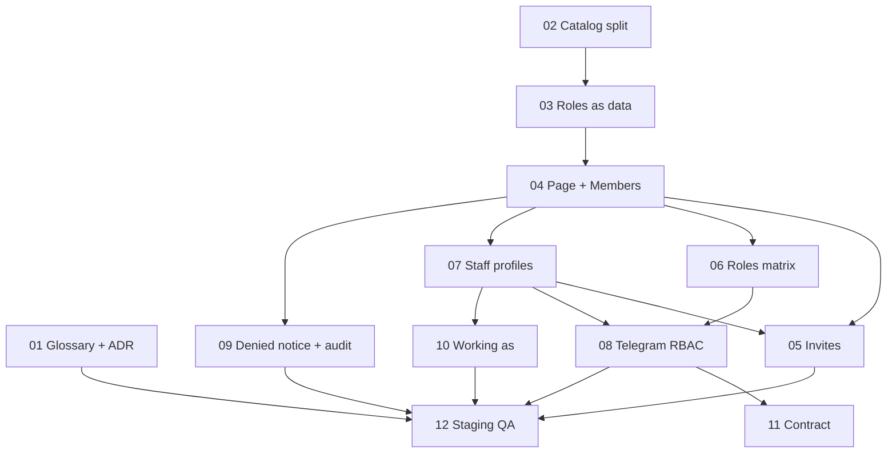

# Users & permissions (RBAC) — Vertical Slices (Issues)

Tracer-bullet breakdown of the PRD (`../users-permissions-rbac-prd.md`). Each slice is a thin, demoable path through schema / auth / UI with its tests. Published locally (no external issue tracker configured).

**Triage:** all slices ready — decisions confirmed 2026-10-04.

## Slices

| # | Title | Type | Blocked by | User stories | Status |
|---|-------|------|------------|--------------|--------|
| 01 | Glossary + ADR 0023 accepted | AFK | none | — | done |
| 02 | Permission catalog: one key per page (no behaviour change) | AFK | none | 3, 24, 37 | done |
| 03 | Roles as data: `admin_roles`, `role_id`, backfill, context from DB | AFK | 02 | 4, 19, 22, 23, 24 | done |
| 04 | Users & permissions page + Members tab + redirects | AFK | 03 | 1–3, 10–13, 15 | done |
| 05 | Invites: email, Invited state, resend, revoke | AFK | 04, 07 | 5–9 | todo |
| 06 | Roles tab: permission matrix editor + custom roles | AFK | 04 | 14, 16–22 | done |
| 07 | Staff profiles under logins | AFK | 04 | 9, 25–29 | todo |
| 08 | Telegram under RBAC | AFK | 06, 07 | 11, 30–35 | todo |
| 09 | Access-denied notice + audit coverage | AFK | 04 | 23, 36 | done |
| 10 | "Working as" profile on shared logins | AFK | 07 | 38 | todo |
| 11 | Contract: drop legacy columns and code paths | AFK | 03–08 soaked in prod | — | todo |
| 12 | Staging QA signoff | HITL | 01–10 | all | todo |

## Dependency graph

## Recommended build order

1. **01** and **02** in parallel. 02 is the largest mechanical change and ships with zero behaviour change, so it is safe to land first.
2. **03** — the only slice that changes how access is resolved. Land and watch before building UI on it.
3. **04**, then **06** and **07** in parallel.
4. **05** (needs profiles for the first-profile-on-invite step) and **08** (needs both matrix and profiles).
5. **09** any time after 04.
6. **10** after 07 (confirmed).
7. **12** staging pass, then **11** after a week in production.

## PR grouping

Suggested PRs, each one deployable on its own: **A** = 01 + 02 · **B** = 03 · **C** = 04 + 09 · **D** = 06 · **E** = 07 + 05 · **F** = 08 · **H** = 10 · **G** = 11. Every PR refreshes `graphify-out/` (cache deleted first) in the same commit.

## HITL notes

- **Decisions confirmed 2026-10-04** (PRD "Decisions"): staff names and Telegram operators move under `sg@mpillow.com`; existing Owners stay Owner; page-level access only (view-only is the next PRD); slice 10 is in.
- **Before slice 03 / 07 / 08 migrations run in production:** re-read the live rows each slice records and stop if they differ.
- **Slice 12:** device pass with three test logins (Owner, Admin, a narrow custom role) and one Telegram account.
