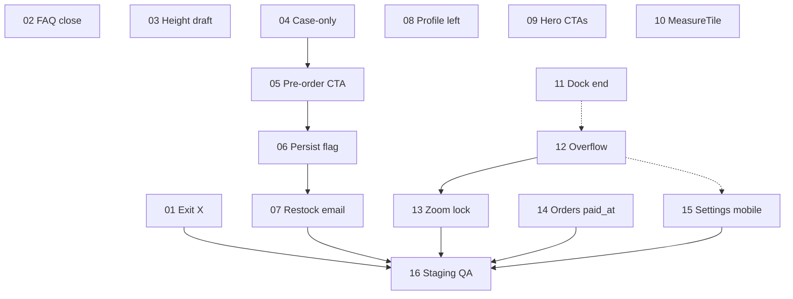

# UX Polish + Pre-order Jul 2026 — Vertical Slices (Issues)

Tracer-bullet breakdown of the PRD (`../ux-polish-jul2026-prd.md`). Each slice is independently grabbable. Published locally; triage label: `needs-triage`.

ADR: `docs/adr/0005-pre-order-authorization-hold.md`

## Slices

| # | Title | Type | Blocked by | User stories |
|---|-------|------|------------|--------------|
| 01 | Exit dialog: hide overlapping X | AFK | none | 1–2 |
| 02 | Mbolster FAQ close below accordion | AFK | none | 3 |
| 03 | Mbolster height decimal draft input | AFK | none | 4 |
| 04 | Mbolster case-only preference + auto-select | AFK | none | 5–8 |
| 05 | Pre-order trigger + live CTA + waiting-time i18n | AFK | 04 (soft) | 9–10, 14, 32 |
| 06 | Persist Pre-order on Result at hold create | AFK | 05 | 11 |
| 07 | Automated Pre-order restock email | AFK | 06 | 12–13, 15 |
| 08 | Landing header: Profile left + logo clearance | AFK | none | 16–18 |
| 09 | Landing hero: mobile CTAs lower in hero | AFK | none | 19–20 |
| 10 | Science of Sleep MeasureTile stack | AFK | none | 21 |
| 11 | Dock: show at page end + trim padding | AFK | none | 22–25 |
| 12 | Mobile overflow / no side-scroll | AFK | 11 (soft) | 26 |
| 13 | Site-wide pinch-zoom lock | AFK | 12 | 27 |
| 14 | Orders sales report by paid_at | AFK | none | 29–30 |
| 15 | Full Admin Panel mobile UX pass | AFK | 12 (soft) | 28 |
| 16 | Staging device QA checklist | HITL | 01–15 as relevant | 31 |

## Dependency graph

## Recommended build order

1. Parallel: **01–04**, **08–11**, **14**
2. **05 → 06 → 07** (Pre-order stack)
3. **12 → 13**; **15** after or with **12**
4. **16** HITL after relevant AFK slices

## HITL notes

- **Slice 16:** iOS Safari + Android Chrome matrix for Pre-order, Mbolster height/FAQ, landing, dock end-of-page, Settings mobile, Orders date range.
