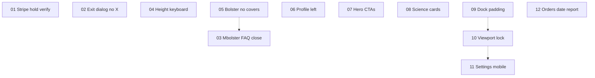
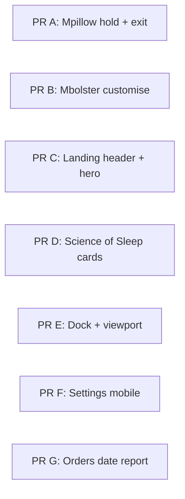

# UX Polish Jul 2026 — Vertical Slices (Issues)

Tracer-bullet breakdown of the PRD (`../ux-polish-jul2026-prd.md`). Each slice is a thin, demoable path. Published locally (no external issue tracker configured).

**Triage label:** `needs-triage` (each slice)

## Slices

| # | Title | Type | Blocked by | User stories | Suggested PR |
|---|-------|------|------------|--------------|--------------|
| 01 | Mpillow Stripe hold verification | HITL (+fix if broken) | none | 1–2 | A |
| 02 | Exit dialog — remove corner X | AFK | none | 3–4 | A |
| 03 | Mbolster FAQ close below accordion | AFK | none | 5 | B |
| 04 | Mbolster height keyboard input | AFK | none | 6 | B |
| 05 | Mbolster preferences: no covers | AFK | none | 7–8 | B |
| 06 | Landing header — Profile left | AFK | none | 9–10 | C |
| 07 | Landing hero — CTAs bottom mobile | AFK | none | 11 | C |
| 08 | Science of Sleep cards stack | AFK | none | 12–13 | D |
| 09 | Bottom padding + dock at page end | AFK | none | 14–15 | E |
| 10 | Mobile viewport — no zoom / no side scroll | AFK | 09 (soft) | 16–17 | E |
| 11 | Settings mobile UX audit | AFK | 10 (soft) | 18 | F |
| 12 | Orders sales report by date range | AFK | none | 19–20 | G |

## Dependency graph

Solid edges = hard blockers. Dotted = soft (prefer order; can parallelize).

## Recommended build order / PR split

Independent PRs off `main` (default). Stack only where noted.

1. **A** — slices 01–02 (configurator payment + exit)
2. **B** — slices 03–05 (Mbolster FAQ / height / covers)
3. **C** — slices 06–07 (landing)
4. **D** — slice 08 (Science of Sleep)
5. **E** — slices 09–10 (dock + viewport; soft stack)
6. **F** — slice 11 (Settings mobile; after E if overflow tokens change)
7. **G** — slice 12 (Orders API + UI; independent)

## HITL notes

- **Slice 01:** Staging Stripe test card — create hold, cancel, restore preview; document pass/fail before merging “verify” as done.
- **Slices 04, 09, 10:** Device matrix (iOS Safari + Android Chrome) required; AFK code alone is insufficient for sign-off.
