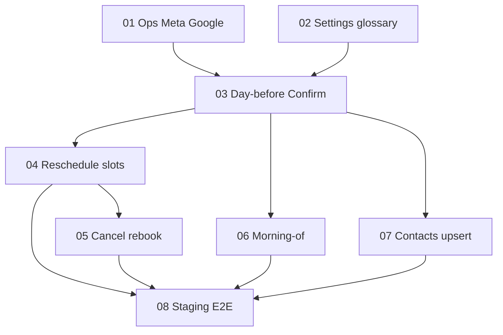

# WhatsApp Appointment Confirm — Vertical Slices (Issues)

Tracer-bullet breakdown of the PRD (`../whatsapp-appointment-confirm-prd.md`). Each slice is a thin, demoable path through all layers (schema, API, UI, tests). Published locally (no external issue tracker configured).

**Triage label:** `needs-triage` (each slice)

## Slices

| # | Title | Type | Blocked by | User stories |
|---|-------|------|------------|--------------|
| 01 | Ops: Meta WABA + English templates + Google OAuth + Event JSON dump | HITL | none | 36–37, 40 |
| 02 | Domain glossary + appointment settings (keys, API, `/settings/appointments`) | AFK | none | 20–25, 38 |
| 03 | Reminder log + day-before Confirm path (cron list→WA→webhook Confirm) | AFK | 01, 02 | 1–4, 15–16, 26–32, 35 |
| 04 | Reschedule: freeBusy → 3 slots → pick → Calendar patch | AFK | 03 | 5–6, 12, 34 |
| 05 | Second reject → cancel Event + cancel WA + matching rebook link | AFK | 04 | 7, 13–14 |
| 06 | Morning-of nudge when day-before silent | AFK | 03 | 8–9 |
| 07 | Google Contacts upsert on reminder send | AFK | 03 | 17–18 |
| 08 | Staging E2E signoff checklist (cron + Confirm/Reschedule/Cancel) | HITL | 04–07 | 40 |

## Dependency graph

## Recommended build order

1. **01** (ops) and **02** (settings + glossary) — parallel; no code dependency between them.
2. **03** (day-before + Confirm) — first end-to-end tracer bullet; requires Meta/Google credentials and settings keys.
3. **04** (reschedule), **06** (morning-of), **07** (contacts) — can proceed after 03; 06 and 07 are independent of 04.
4. **05** (cancel after second reject) — after 04.
5. **08** (staging E2E signoff) — after all functional slices.

## HITL notes

- **Slice 01:** Requires Meta Business app setup, WABA coexistence on `+65 8780 5311`, English template approval, Google OAuth consent for `admin@mpillow.com`, and dumping real Customisation + Re-adjustment event JSON to lock summary strings.
- **Slice 08:** Human verification on staging — book test slot, trigger cron, tap Confirm/Reschedule/Cancel in WhatsApp, verify Calendar + Contacts + Business app thread.
